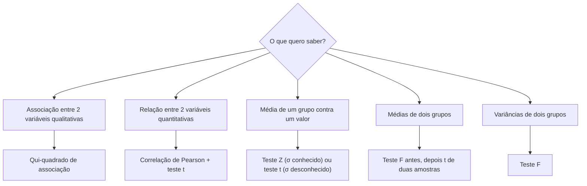

# 01 · Fundamentos de Estatística
**Prof. Wilson Tarantin Jr. · 3 aulas · Prioridade: ALTA — é a base de regressão, logística, contagem, multinível, PCA e séries temporais**

## O fio condutor deste capítulo

Imagine que você recebeu uma planilha com os dados de 500 clientes de um banco: idade, renda, estado civil, se pagaram o empréstimo em dia. Ninguém consegue "ler" 500 linhas e enxergar um padrão. A estatística existe para responder a duas perguntas, nesta ordem.

A primeira é **como resumir o que eu tenho** sem perder o essencial. A segunda é mais ousada: **o que posso concluir sobre os clientes que não estão na planilha**, ou seja, sobre a população inteira, tendo olhado só para uma amostra, e com que grau de segurança.

> **Memorize.** O caminho é sempre o mesmo: *classificar* a variável → *resumir* → escolher o *molde* (distribuição) → *testar* uma hipótese. Quase toda disciplina do curso repete esse caminho com um Y diferente.

## 1. Primeiro, que tipo de coluna é essa?

Quem programa já conhece a ideia: uma coluna tem um tipo, e o tipo define quais operações fazem sentido. Em estatística acontece o mesmo, com duas famílias.

| Família | O que diz | Exemplos | O que se pode calcular |
|---|---|---|---|
| **Qualitativa** (categórica) | *a qual grupo* a linha pertence; os números, quando existem, são etiquetas | estado civil, cor do carro, aprovado/reprovado, faixa de renda | frequências e a **moda** |
| **Quantitativa** (métrica) | *quanto* | idade, renda em R$, nº de filhos | tudo: centro, espalhamento, forma |

Dentro das quantitativas, as **discretas** vêm de contagem (0, 1, 2 filhos) e as **contínuas** admitem qualquer valor num intervalo (altura, salário).

> **Atenção.** Suponha que você codifique as cores de carro como branco = 1, preto = 2, prata = 3 e calcule a média: 5,68. O que isso significa? Nada: os números eram só etiquetas. Esse erro tem nome, **ponderação arbitrária**, e reaparece no curso inteiro (é o motivo de usarmos *dummies* em regressões).

## 2. Resumindo uma coluna numérica: centro, espalhamento e forma

Para uma variável quantitativa a pergunta natural é: *se eu tivesse de descrever essa coluna em três frases, o que diria?* A resposta tem três partes.

### Onde está o centro?

A **média** soma tudo e divide por n; usa toda a informação, mas é puxada por valores extremos. A **mediana** é o valor do meio quando os dados estão ordenados; é **robusta** a extremos. A **moda** é o valor mais frequente.

> **Exemplo resolvido.** Cinco salários, em milhares de reais: 3; 3,2; 3,5; 4 e 30. A média é \(\bar{x} = \frac{43{,}7}{5} = 8{,}74\), um valor que ninguém na amostra ganha: o salário de 30 arrastou a conta. A mediana vale 3,5 e descreve muito melhor o "salário típico".

Por isso, quando há valores extremos (os *outliers*), prefira a mediana; e sempre que a média está **acima** da mediana, sabemos que a cauda é longa à **direita**. Os **quartis** generalizam a mediana: Q1, Q2 (= mediana) e Q3 dividem os dados ordenados em quatro partes iguais. Dizer que P25 = 179 significa "25% dos valores são menores ou iguais a 179".

### O quanto os dados se espalham?

Dizer que a média é 100 não informa se os valores ficam entre 99 e 101 ou entre 0 e 200. A **variância amostral** mede o afastamento médio ao quadrado em relação à média:

\[ s^2 = \frac{\sum_{i=1}^{n} (x_i - \bar{x})^2}{n-1} \]

Divide-se por \(n-1\), e não por \(n\), porque a própria média já foi estimada a partir dos mesmos dados e "consumiu" um grau de liberdade. Como a variância está em unidade ao quadrado (reais², anos²), tira-se a raiz e obtém-se o **desvio padrão** \(s\), na mesma unidade dos dados.

> **Exemplo resolvido.** Dados 2, 4 e 6 (média 4). Desvios: −2, 0 e 2. Quadrados: 4, 0 e 4, soma 8. Variância = 8 ÷ 2 = **4**; desvio padrão = **2**.

Três medidas derivadas respondem a perguntas diferentes:

| Medida | Fórmula | Para que serve |
|---|---|---|
| **Coeficiente de variação** | \(CV = \frac{s}{\bar{x}} \times 100\) | comparar a dispersão de variáveis em **escalas diferentes** |
| **Erro padrão** | \(EP = \frac{s}{\sqrt{n}}\) | medir a precisão da **média** calculada |
| **Amplitude interquartil** | \(AIQ = Q_3 - Q_1\) | dispersão robusta; base da regra de Tukey |

Com média 100 e desvio 10, \(CV = 10\%\); com média 5 e desvio 2, \(CV = 40\%\): a segunda variável é quatro vezes mais heterogênea, embora seu desvio absoluto seja menor. Já o erro padrão mostra por que precisão custa caro: com \(s = 10\), uma amostra de 100 casos dá \(EP = 1\); uma de 400 dá \(EP = 0{,}5\). **Quadruplicar a amostra só dobra a precisão.**

A **regra de Tukey** detecta outliers: é outlier o valor abaixo de \(Q_1 - 1{,}5\cdot AIQ\) ou acima de \(Q_3 + 1{,}5\cdot AIQ\). Com \(Q_1 = 10\) e \(Q_3 = 20\), os limites são −5 e 35.

### Qual a forma?

Por fim olhamos o desenho da distribuição: a **assimetria** diz se há uma cauda (positiva = cauda à direita; média > mediana) e a **curtose** diz se a curva é mais pontuda (leptocúrtica) ou mais achatada (platicúrtica) que a normal.

## 3. De resumo a molde: as distribuições de probabilidade

Até aqui descrevemos dados que já tínhamos. Para dar o salto à população precisamos de uma ideia nova: muitos fenômenos se comportam como **moldes conhecidos**, as **distribuições de probabilidade**. Se sabemos qual é o molde, calculamos a chance de qualquer resultado sem observar tudo. O molde depende de *o que estamos contando*.

| Distribuição | O que descreve | Fórmula | Reaparece em |
|---|---|---|---|
| **Bernoulli** | **um** experimento, dois desfechos (sucesso com prob. \(p\)) | \(p^x (1-p)^{1-x}\) | regressão **logística** binária |
| **Binomial** | nº de sucessos em **n** tentativas independentes | \(\binom{n}{k} p^k (1-p)^{n-k}\) | logística multinomial |
| **Poisson** | nº de eventos numa **janela** (tempo, área), taxa média \(\lambda\) | \(\frac{e^{-\lambda}\lambda^k}{k!}\) | modelos de **contagem** |
| **Binomial negativa** | nº de tentativas até k sucessos | — | contagem com superdispersão |

> **Exemplo resolvido.** *Binomial:* lançando uma moeda 3 vezes, a chance de exatamente 2 caras é \(\binom{3}{2}\cdot 0{,}5^2\cdot 0{,}5 = 3 \times 0{,}125 = 0{,}375\). *Poisson:* se chegam em média 2 pacientes por ano (\(\lambda = 2\)), a chance de chegar exatamente 1 é \(e^{-2}\cdot 2 \approx 0{,}27\), isto é, 27%.

**Como escolher.** Conto sucessos em um número *fixo* de tentativas? Binomial. Conto eventos soltos numa janela, sem teto natural? Poisson.

Para variáveis contínuas o molde central é a **normal**, a curva em sino definida pela média \(\mu\) e pelo desvio \(\sigma\). Sua propriedade prática é a **regra empírica**: cerca de 68% dos valores ficam a até 1 desvio da média, 95% a até 2 e 99,7% a até 3.

Para trabalhar com qualquer normal usa-se o **escore Z**, que responde "a quantos desvios padrão do centro está este valor?":

\[ Z = \frac{X - \mu}{\sigma} \]

> **Exemplo resolvido.** Retorno médio de um ativo \(\mu = 2{,}8\%\), desvio \(\sigma = 1{,}2\%\). A chance de o retorno passar de 4% é a de \(Z\) passar de \(\frac{4 - 2{,}8}{1{,}2} = 1\), aproximadamente **16%**.

Três outras distribuições entram porque aparecem nos testes que veremos já:

| Distribuição | Ideia | Usada em |
|---|---|---|
| **t de Student** | como a normal, mas com **caudas mais pesadas**: compensa a incerteza de quem tem poucos dados e desvio desconhecido | teste t, intervalos de confiança |
| **Qui-quadrado (χ²)** | assimétrica à direita; compara **frequências** | associação entre categóricas |
| **F de Snedecor** | razão de variâncias | comparar variâncias, ANOVA |

Todas dependem dos **graus de liberdade** (gl), que se entendem como "quantos valores ainda são livres para variar": se cinco números devem somar 18, escolhemos quatro livremente e o quinto fica determinado.

## 4. A lógica de um teste de hipóteses

Agora podemos responder à segunda pergunta. Um fabricante afirma que seus potes têm 100 g. Você pesa 25 potes e encontra média 104 g, com desvio 10. A diferença é real ou foi sorte da amostra?

O raciocínio é o de um tribunal. Parte-se de uma afirmação presumida verdadeira até haver evidência forte contra ela: a **hipótese nula, H0** ("a média é 100"). A **hipótese alternativa, H1**, é o que se quer demonstrar ("a média é diferente de 100"). Você nunca *prova* H0; verifica se os dados seriam tão improváveis, **supondo H0 verdadeira**, que ela deve ser rejeitada.

Para medir "improvável" usa-se o **p-valor**: a probabilidade de observar um resultado tão extremo quanto o seu (ou mais), *se H0 fosse verdadeira*. Você escolhe antes um **nível de significância α** (usualmente 5%) e aplica a regra:

\[ p < \alpha \;\Rightarrow\; \text{rejeita } H_0 \qquad\qquad p > \alpha \;\Rightarrow\; \text{não rejeita } H_0 \]

Não rejeitar quer dizer apenas "evidência insuficiente", e não "H0 é verdadeira". Há duas maneiras de errar: o **erro tipo I** é rejeitar H0 sendo ela verdadeira (probabilidade igual a α, o "alarme falso"); o **erro tipo II** é não rejeitar H0 sendo ela falsa (o culpado que passou).

> **Exemplo resolvido (teste t).** A estatística do teste mede a diferença em unidades de erro padrão:
> \[ t = \frac{\bar{x} - \mu_0}{s/\sqrt{n}} = \frac{104 - 100}{10/\sqrt{25}} = \frac{4}{2} = 2{,}0 \qquad (gl = n - 1 = 24) \]
> O valor crítico bilateral a 5% é cerca de 2,064. Como 2,0 < 2,064, **não rejeitamos H0**: apesar de 4 g parecer muito, com essa variabilidade e esse tamanho de amostra a diferença poderia ser acaso.

Repare como a decisão combina três coisas: o **tamanho da diferença**, a **variabilidade** dos dados e o **tamanho da amostra**.

## 5. Qual teste usar?

O procedimento é sempre o mesmo; muda a estatística, e a escolha depende do tipo de variável e da pergunta.

| Situação | Teste | Estatística | gl |
|---|---|---|---|
| 2 variáveis **qualitativas** | **qui-quadrado de associação** | \(\chi^2 = \sum \frac{(O - E)^2}{E}\), com \(E = \frac{\text{total linha}\times\text{total coluna}}{N}\) | \((L-1)(C-1)\) |
| 2 variáveis **quantitativas** | **correlação de Pearson** + teste t | \(t = \frac{r}{\sqrt{(1-r^2)/(n-2)}}\) | \(n-2\) |
| média de 1 grupo, σ conhecido | **teste Z** | \(Z = \frac{\bar{x}-\mu_0}{\sigma/\sqrt{n}}\) | — |
| média de 1 grupo, σ desconhecido | **teste t** | \(t = \frac{\bar{x}-\mu_0}{s/\sqrt{n}}\) | \(n-1\) |
| variâncias de 2 grupos | **teste F** | \(F = s^2_{maior}/s^2_{menor}\) | \(n_1-1,\ n_2-1\) |
| médias de 2 grupos | **t de duas amostras** (após o F) | variância combinada se iguais; Welch se diferentes | — |
| 1 categórica: observado × esperado | **χ² de aderência** | \(\sum \frac{(O-E)^2}{E}\) | \(k-1\) |

> **Exemplo resolvido (qui-quadrado).** Tabela 2×2 com 100 casos, linhas = sexo, colunas = comprou/não comprou: observados \(\begin{pmatrix}30&20\\10&40\end{pmatrix}\). Totais: linhas 50 e 50; colunas 40 e 60. Os esperados são \(\frac{50\times40}{100}=20\), 30, 20 e 30. Então \(\chi^2 = \frac{10^2}{20}+\frac{10^2}{30}+\frac{10^2}{20}+\frac{10^2}{30} \approx 16{,}7\), com 1 grau de liberdade. O crítico a 5% é 3,84; como 16,7 > 3,84, **rejeita-se H0: há associação**.

Um **intervalo de confiança** diz o mesmo de outra forma: em vez de responder sim/não, entrega a faixa de valores plausíveis para a média, \(\bar{x} \pm t\cdot EP\). Se o valor de H0 estiver fora do intervalo de 95%, o teste a 5% rejeita H0.

## O que levar daqui

A estatística começa por classificar cada variável, porque isso delimita as contas permitidas. Resumimos uma coluna com centro, espalhamento e forma, usando medidas robustas (mediana, AIQ) quando há outliers. As distribuições são moldes que permitem calcular probabilidades: Bernoulli e Binomial para sucessos, Poisson para eventos numa janela, normal para variáveis contínuas. E um teste de hipóteses é um tribunal: presume-se H0, calcula-se quão raros seriam os dados sob H0 (p-valor) e rejeita-se H0 apenas quando \(p < \alpha\).

## Erros que todo mundo comete

| Erro | Correção |
|---|---|
| "p = 0,03 significa 3% de chance de H0 ser verdadeira" | p é a probabilidade dos **dados** sob H0, não de H0 |
| "Não rejeitei H0, logo H0 é verdadeira" | só há **evidência insuficiente** para rejeitar |
| Confundir α com o p-valor | α é escolhido **antes**; p é calculado **dos dados** |
| Média ou mediana de variável qualitativa | só frequências e **moda** |
| Usar o desvio padrão para comparar escalas diferentes | use o **CV** |
| Binomial × Poisson | Binomial: nº **fixo** de tentativas; Poisson: eventos numa janela |

## Teste-se

1. Por que a "média" das cores dos carros não faz sentido, e o que se pode calcular?

Ver resposta
Porque os números são apenas etiquetas de categorias (ponderação arbitrária). Para uma variável qualitativa só se calculam frequências e a moda.

2. Cinco salários: 3; 3,2; 3,5; 4; 30. Qual medida descreve melhor o salário típico e por quê?

Ver resposta
A mediana (3,5): o valor extremo de 30 puxa a média (8,74) para um valor que ninguém recebe.

3. Em um teste com α = 5% e p = 0,03, qual a decisão? E com α = 1%?

Ver resposta
Com 5%, p < α: rejeita H0. Com 1%, p > α: não rejeita H0.

4. Quantos graus de liberdade tem um qui-quadrado de associação de uma tabela 3×4?

Ver resposta
(3 − 1)(4 − 1) = 6.

5. Qual teste fazer antes de comparar as médias de dois grupos, e para quê?

Ver resposta
O teste F das variâncias, para decidir entre o t com variâncias iguais ou diferentes.

6. Dados 2, 4, 6: quanto vale a variância amostral?

Ver resposta
Média 4; soma dos quadrados dos desvios = 8; 8 ÷ (3 − 1) = 4.

## Pergunta típica
Para variável qualitativa, qual medida de posição posso usar · o que significa p < α · α é a probabilidade de qual erro · média > mediana indica qual assimetria · por que mais amostra reduz o erro padrão · quando usar o CV · qual teste para associação entre categóricas e qual para duas métricas · qual distribuição está na base de cada modelo (Bernoulli, Binomial, Poisson, Binomial negativa) · diferença entre Z e t

*Fonte: slides do Prof. Tarantin (baseados em Fávero e Belfiore, "Manual de análise de dados") e transcrições das 3 aulas.*
