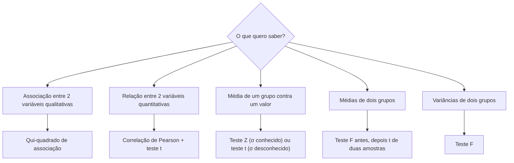

# 01 · Fundamentos de Estatística
**Prof. Wilson Tarantin Jr. · 3 aulas · Prioridade: ALTA — é a base de regressão, logística, contagem, multinível, PCA e séries temporais**

## O fio condutor deste capítulo

Imagine que você recebeu uma planilha com os dados de 500 clientes de um banco: idade, renda, estado civil, se pagaram o empréstimo em dia. Ninguém consegue "ler" 500 linhas e enxergar um padrão. A estatística existe para responder a duas perguntas, nesta ordem.

A primeira é **como resumir o que eu tenho** sem perder o essencial. A segunda é mais ousada: **o que posso concluir sobre os clientes que não estão na planilha**, ou seja, sobre a população inteira, tendo olhado só para uma amostra, e com que grau de segurança.

> **Memorize.** O caminho é sempre o mesmo: *classificar* a variável → *resumir* → escolher o *molde* (distribuição) → *testar* uma hipótese. Quase toda disciplina do curso repete esse caminho com um Y diferente.

## 1. Primeiro, que tipo de coluna é essa?

Quem programa já conhece a ideia: uma coluna tem um tipo, e o tipo define quais operações fazem sentido. Em estatística acontece o mesmo, com duas famílias.

| Família | O que diz | Exemplos | O que se pode calcular |
|---|---|---|---|
| **Qualitativa** (categórica) | *a qual grupo* a linha pertence; os números, quando existem, são etiquetas | estado civil, cor do carro, aprovado/reprovado, faixa de renda | frequências e a **moda** |
| **Quantitativa** (métrica) | *quanto* | idade, renda em R$, nº de filhos | tudo: centro, espalhamento, forma |

Dentro das quantitativas, as **discretas** vêm de contagem (0, 1, 2 filhos) e as **contínuas** admitem qualquer valor num intervalo (altura, salário).

> **Atenção.** Suponha que você codifique as cores de carro como branco = 1, preto = 2, prata = 3 e calcule a média: 5,68. O que isso significa? Nada: os números eram só etiquetas. Esse erro tem nome, **ponderação arbitrária**, e reaparece no curso inteiro (é o motivo de usarmos *dummies* em regressões).

## 2. Resumindo uma coluna numérica: centro, espalhamento e forma

Para uma variável quantitativa a pergunta natural é: *se eu tivesse de descrever essa coluna em três frases, o que diria?* A resposta tem três partes.

### Onde está o centro?

A **média** soma tudo e divide por n; usa toda a informação, mas é puxada por valores extremos. A **mediana** é o valor do meio quando os dados estão ordenados; é **robusta** a extremos. A **moda** é o valor mais frequente.

> **Exemplo ilustrativo (números inventados, para mostrar o efeito de um valor extremo).** Cinco salários, em milhares de reais: 3; 3,2; 3,5; 4 e 30. A média é \(\bar{x} = \frac{43{,}7}{5} = 8{,}74\), um valor que ninguém na amostra ganha: o salário de 30 arrastou a conta. A mediana vale 3,5 e descreve muito melhor o "salário típico".
>
> **Exemplo completo (da aula): preços de 100 produtos.** A planilha de apoio traz 100 preços em dólares. Resumo: **média = 190,77**, **mediana = 189**, **moda = 199**, mínimo 149 e máximo 239, **1º quartil = 179** e **3º quartil = 199**. Aqui média (190,77) e mediana (189) são **muito próximas**: não há valores extremos e a distribuição é quase **simétrica** (assimetria de 0,09). Compare com os salários acima, em que a média era mais que o dobro da mediana.

Por isso, quando há valores extremos (os *outliers*), prefira a mediana; e sempre que a média está **acima** da mediana, sabemos que a cauda é longa à **direita**. Os **quartis** generalizam a mediana: Q1, Q2 (= mediana) e Q3 dividem os dados ordenados em quatro partes iguais. Dizer que P25 = 179 significa "25% dos valores são menores ou iguais a 179".

### O quanto os dados se espalham?

Dizer que a média é 100 não informa se os valores ficam entre 99 e 101 ou entre 0 e 200. A **variância amostral** mede o afastamento médio ao quadrado em relação à média:

\[ s^2 = \frac{\sum_{i=1}^{n} (x_i - \bar{x})^2}{n-1} \]

Divide-se por \(n-1\), e não por \(n\), porque a própria média já foi estimada a partir dos mesmos dados e "consumiu" um grau de liberdade. Como a variância está em unidade ao quadrado (reais², anos²), tira-se a raiz e obtém-se o **desvio padrão** \(s\), na mesma unidade dos dados.

> **Exemplo ilustrativo (números pequenos para fazer à mão).** Dados 2, 4 e 6 (média 4). Desvios: −2, 0 e 2. Quadrados: 4, 0 e 4, soma 8. Variância amostral = 8 ÷ (3 − 1) = **4**; desvio padrão = **2**. (Divide-se por \(n-1\) e não por \(n\) porque, numa amostra, a média já "gastou" um grau de liberdade.)
>
> **Exemplo completo (da aula): os mesmos 100 preços.** **Variância amostral = 244,02** e **desvio padrão = 15,62**. O **erro padrão da média** é \(s/\sqrt{n} = 15{,}62/\sqrt{100} = 1{,}56\): mede o quanto a *média amostral* variaria de amostra para amostra (e é ele que entra nos testes e nos intervalos de confiança). O **coeficiente de variação** é \(15{,}62/190{,}77 = 8{,}2\%\): o desvio é 8% da média, uma dispersão baixa.

Três medidas derivadas respondem a perguntas diferentes:

| Medida | Fórmula | Para que serve |
|---|---|---|
| **Coeficiente de variação** | \(CV = \frac{s}{\bar{x}} \times 100\) | comparar a dispersão de variáveis em **escalas diferentes** |
| **Erro padrão** | \(EP = \frac{s}{\sqrt{n}}\) | medir a precisão da **média** calculada |
| **Amplitude interquartil** | \(AIQ = Q_3 - Q_1\) | dispersão robusta; base da regra de Tukey |

Com média 100 e desvio 10, \(CV = 10\%\); com média 5 e desvio 2, \(CV = 40\%\): a segunda variável é quatro vezes mais heterogênea, embora seu desvio absoluto seja menor. Já o erro padrão mostra por que precisão custa caro: com \(s = 10\), uma amostra de 100 casos dá \(EP = 1\); uma de 400 dá \(EP = 0{,}5\). **Quadruplicar a amostra só dobra a precisão.**

A **regra de Tukey** detecta outliers: é outlier o valor abaixo de \(Q_1 - 1{,}5\cdot AIQ\) ou acima de \(Q_3 + 1{,}5\cdot AIQ\). Com \(Q_1 = 10\) e \(Q_3 = 20\), os limites são −5 e 35.

### Qual a forma?

Por fim olhamos o desenho da distribuição: a **assimetria** diz se há uma cauda (positiva = cauda à direita; média > mediana) e a **curtose** diz se a curva é mais pontuda (leptocúrtica) ou mais achatada (platicúrtica) que a normal.

## 3. De resumo a molde: as distribuições de probabilidade

Até aqui descrevemos dados que já tínhamos. Para dar o salto à população precisamos de uma ideia nova: muitos fenômenos se comportam como **moldes conhecidos**, as **distribuições de probabilidade**. Se sabemos qual é o molde, calculamos a chance de qualquer resultado sem observar tudo. O molde depende de *o que estamos contando*.

| Distribuição | O que descreve | Fórmula | Reaparece em |
|---|---|---|---|
| **Bernoulli** | **um** experimento, dois desfechos (sucesso com prob. \(p\)) | \(p^x (1-p)^{1-x}\) | regressão **logística** binária |
| **Binomial** | nº de sucessos em **n** tentativas independentes | \(\binom{n}{k} p^k (1-p)^{n-k}\) | logística multinomial |
| **Poisson** | nº de eventos numa **janela** (tempo, área), taxa média \(\lambda\) | \(\frac{e^{-\lambda}\lambda^k}{k!}\) | modelos de **contagem** |
| **Binomial negativa** | nº de tentativas até k sucessos | — | contagem com superdispersão |

> **Exemplo completo (da aula): Binomial e Poisson.**
>
> **Binomial** (conta sucessos em um número *fixo* de tentativas): probabilidade de sucesso \(p = 0{,}065\) em cada uma de \(n = 12\) repetições. A chance de exatamente \(k\) sucessos é \(P(X=k) = \binom{12}{k}\,0{,}065^k\,0{,}935^{12-k}\):
>
> | k | 0 | 1 | 2 | 3 | 4 |
> |---|---|---|---|---|---|
> | P(X = k) | 0,4464 | 0,3724 | **0,1424** | 0,0330 | **0,0052** |
>
> Então **P(k = 2) = 14,2%**, **P(k = 4) = 0,5%** e a chance de **no máximo 2 sucessos** é \(0{,}4464 + 0{,}3724 + 0{,}1424 = \) **96,1%**. (Conferindo um valor: \(P(X=2) = 66\times 0{,}065^2\times 0{,}935^{10} = 66\times 0{,}004225\times 0{,}5106 = 0{,}1424\).)
>
> **Poisson** (conta eventos numa janela, sem teto): taxa média \(\lambda = 2\) por período. \(P(X=k) = e^{-2}\,2^k/k!\):
>
> | k | 0 | 1 | 2 | 3 | 6 |
> |---|---|---|---|---|---|
> | P(X = k) | 0,1353 | **0,2707** | 0,2707 | **0,1804** | **0,0120** |
>
> A chance de **exatamente 1 evento** é \(e^{-2}\cdot 2 = 0{,}1353\times 2 = 27{,}1\%\); de **nenhum**, \(e^{-2} = 13{,}5\%\); de **6 ou mais** é pequena (1,2% para exatamente 6).

**Como escolher.** Conto sucessos em um número *fixo* de tentativas? Binomial. Conto eventos soltos numa janela, sem teto natural? Poisson.

Para variáveis contínuas o molde central é a **normal**, a curva em sino definida pela média \(\mu\) e pelo desvio \(\sigma\). Sua propriedade prática é a **regra empírica**: cerca de 68% dos valores ficam a até 1 desvio da média, 95% a até 2 e 99,7% a até 3.

Para trabalhar com qualquer normal usa-se o **escore Z**, que responde "a quantos desvios padrão do centro está este valor?":

\[ Z = \frac{X - \mu}{\sigma} \]

> **Exemplo completo (da aula): a normal com média de 2,8% e desvio de 1,2%** (por exemplo, o retorno de um ativo). Para achar probabilidades, **padroniza-se**: \(Z = (X - \mu)/\sigma\) e consulta-se a tabela da normal padrão.
>
> | Pergunta | Z | Probabilidade |
> |---|---|---|
> | **P(X > 4%)** | \(\frac{4 - 2{,}8}{1{,}2} = 1{,}00\) | \(P(Z > 1) = \) **15,87%** |
> | **P(X < 3%)** | \(\frac{3 - 2{,}8}{1{,}2} = 0{,}17\) | \(P(Z < 0{,}17) = \) **56,6%** |
> | **P(X < 0%)** | \(\frac{0 - 2{,}8}{1{,}2} = -2{,}33\) | \(P(Z < -2{,}33) = \) **0,98%** |
> | **P(1% < X < 5%)** | de \(-1{,}50\) a \(+1{,}83\) | \(0{,}9667 - 0{,}0668 = \) **90,0%** |
>
> Em palavras: há 15,9% de chance de o retorno passar de 4%, e apenas 1% de chance de ele ser negativo; em 90% das vezes ele fica entre 1% e 5%.

Três outras distribuições entram porque aparecem nos testes que veremos já:

| Distribuição | Ideia | Usada em |
|---|---|---|
| **t de Student** | como a normal, mas com **caudas mais pesadas**: compensa a incerteza de quem tem poucos dados e desvio desconhecido | teste t, intervalos de confiança |
| **Qui-quadrado (χ²)** | assimétrica à direita; compara **frequências** | associação entre categóricas |
| **F de Snedecor** | razão de variâncias | comparar variâncias, ANOVA |

Todas dependem dos **graus de liberdade** (gl), que se entendem como "quantos valores ainda são livres para variar": se cinco números devem somar 18, escolhemos quatro livremente e o quinto fica determinado.

## 4. A lógica de um teste de hipóteses

Agora podemos responder à segunda pergunta. Um fabricante afirma que seus potes têm 100 g. Você pesa 25 potes e encontra média 104 g, com desvio 10. A diferença é real ou foi sorte da amostra?

O raciocínio é o de um tribunal. Parte-se de uma afirmação presumida verdadeira até haver evidência forte contra ela: a **hipótese nula, H0** ("a média é 100"). A **hipótese alternativa, H1**, é o que se quer demonstrar ("a média é diferente de 100"). Você nunca *prova* H0; verifica se os dados seriam tão improváveis, **supondo H0 verdadeira**, que ela deve ser rejeitada.

Para medir "improvável" usa-se o **p-valor**: a probabilidade de observar um resultado tão extremo quanto o seu (ou mais), *se H0 fosse verdadeira*. Você escolhe antes um **nível de significância α** (usualmente 5%) e aplica a regra:

\[ p < \alpha \;\Rightarrow\; \text{rejeita } H_0 \qquad\qquad p > \alpha \;\Rightarrow\; \text{não rejeita } H_0 \]

Não rejeitar quer dizer apenas "evidência insuficiente", e não "H0 é verdadeira". Há duas maneiras de errar: o **erro tipo I** é rejeitar H0 sendo ela verdadeira (probabilidade igual a α, o "alarme falso"); o **erro tipo II** é não rejeitar H0 sendo ela falsa (o culpado que passou).

> **Exemplo completo (da aula): teste Z para a média.** Uma fábrica de caixas de papelão usa historicamente **100 g** de papelão por caixa, com **desvio padrão de 12 g** (conhecido). Na linha de produção, parece que o consumo **aumentou**. Foram medidas **40 caixas** e a média amostral foi **104,075 g**.
>
> 1. **Hipóteses:** H0: \(\mu = 100\) (continuamos no padrão); H1: \(\mu > 100\) (o consumo aumentou). É um teste **unilateral à direita**, porque a suspeita é de aumento.
> 2. **Estatística de teste:** \(Z = \dfrac{\bar{x} - \mu_0}{\sigma/\sqrt{n}} = \dfrac{104{,}075 - 100}{12/\sqrt{40}} = \dfrac{4{,}075}{1{,}897} = \) **2,148**.
> 3. **Decisão:** com \(\alpha = 5\%\), o valor crítico unilateral é **1,645**. Como 2,148 > 1,645 (e o **p-valor** é **0,0159 < 0,05**), **rejeita-se H0**: há evidência de que o consumo de papelão **aumentou**.
>
> **Quando o desvio padrão é desconhecido, usa-se o teste t.** Exemplo (da aula): o tempo médio de processamento de uma tarefa numa máquina era de **18 minutos**. Depois de mudanças no processo, coletou-se uma amostra de **25** execuções, com **média 16,808 min** e **desvio padrão amostral 2,733 min**. H0: \(\mu = 18\); H1: \(\mu < 18\) (o tempo diminuiu).
>
> \[ t = \frac{\bar{x} - \mu_0}{s/\sqrt{n}} = \frac{16{,}808 - 18}{2{,}733/\sqrt{25}} = \frac{-1{,}192}{0{,}5466} = -2{,}181 \qquad (gl = n - 1 = 24) \]
>
> O **p-valor unicaudal** é **0,0196**. A decisão **depende do α**: com \(\alpha = 5\%\), o crítico é −1,711 e **rejeita-se H0** (p = 0,0196 < 0,05); com \(\alpha = 1\%\) (o nível usado na aula), o crítico é −2,492 e **não se rejeita H0** (p = 0,0196 > 0,01): a evidência de redução **não é forte o bastante** para esse rigor. A conclusão não é "o tempo não mudou", e sim "com um α de 1%, os dados não bastam".

Repare como a decisão combina três coisas: o **tamanho da diferença**, a **variabilidade** dos dados e o **tamanho da amostra**.

## 5. Qual teste usar?

O procedimento é sempre o mesmo; muda a estatística, e a escolha depende do tipo de variável e da pergunta.

| Situação | Teste | Estatística | gl |
|---|---|---|---|
| 2 variáveis **qualitativas** | **qui-quadrado de associação** | \(\chi^2 = \sum \frac{(O - E)^2}{E}\), com \(E = \frac{\text{total linha}\times\text{total coluna}}{N}\) | \((L-1)(C-1)\) |
| 2 variáveis **quantitativas** | **correlação de Pearson** + teste t | \(t = \frac{r}{\sqrt{(1-r^2)/(n-2)}}\) | \(n-2\) |
| média de 1 grupo, σ conhecido | **teste Z** | \(Z = \frac{\bar{x}-\mu_0}{\sigma/\sqrt{n}}\) | — |
| média de 1 grupo, σ desconhecido | **teste t** | \(t = \frac{\bar{x}-\mu_0}{s/\sqrt{n}}\) | \(n-1\) |
| variâncias de 2 grupos | **teste F** | \(F = s^2_{maior}/s^2_{menor}\) | \(n_1-1,\ n_2-1\) |
| médias de 2 grupos | **t de duas amostras** (após o F) | variância combinada se iguais; Welch se diferentes | — |
| 1 categórica: observado × esperado | **χ² de aderência** | \(\sum \frac{(O-E)^2}{E}\) | \(k-1\) |

> **Exemplo completo (da aula): qui-quadrado de associação, operadora × satisfação.** 200 clientes classificados pela **operadora de plano de saúde** (Total Health, Viva Vida e Mena Saúde) e pelo **nível de satisfação** (baixo, médio, alto). H0: as variáveis são **independentes**.
>
> **Frequências observadas:**
>
> | Operadora | Baixo | Médio | Alto | Total |
> |---|---|---|---|---|
> | Total Health | 40 | 16 | 12 | 68 |
> | Viva Vida | 32 | 24 | 16 | 72 |
> | Mena Saúde | 24 | 32 | 4 | 60 |
> | **Total** | **96** | **72** | **32** | **200** |
>
> **Frequências esperadas** (se fossem independentes): \(E = \frac{\text{total da linha}\times\text{total da coluna}}{N}\). Por exemplo, Total Health × Baixo: \(68\times 96/200 = 32{,}64\).
>
> | Operadora | Baixo | Médio | Alto |
> |---|---|---|---|
> | Total Health | 32,64 | 24,48 | 10,88 |
> | Viva Vida | 34,56 | 25,92 | 11,52 |
> | Mena Saúde | 28,80 | 21,60 | 9,60 |
>
> **Estatística:** \(\chi^2 = \sum\frac{(O-E)^2}{E}\) = **15,86**, com \(gl = (3-1)(3-1) = 4\). O crítico a 5% é **9,49**, e o **p-valor é 0,0032**: **rejeita-se H0, há associação** entre operadora e satisfação. Os **resíduos padronizados ajustados** mostram onde: a **Total Health** tem **mais** satisfação baixa que o esperado (+2,20), a **Mena Saúde** tem **mais satisfação média** (+3,34) e **menos alta** (−2,36), a **Total Health** tem também **menos satisfação média** que o esperado (−2,64); os demais cruzamentos ficam dentro do acaso (entre −1,96 e +1,96). A intensidade da associação (V de Cramér) é **0,20**, moderada.
>
> **Qui-quadrado de aderência (uma amostra).** Uma loja vendeu **210 unidades** na semana. Se o dia da semana não influenciasse, esperaria **210 ÷ 7 = 30 por dia**. Observado: Dom 35, Seg 24, Ter 27, Qua 32, Qui 25, Sex 36, Sáb 31. \(\chi^2 = \frac{5^2}{30} + \frac{6^2}{30} + \frac{3^2}{30} + \frac{2^2}{30} + \frac{5^2}{30} + \frac{6^2}{30} + \frac{1^2}{30} = \) **4,53**, com \(gl = 7 - 1 = 6\); o crítico a 5% é 12,59 e o **p-valor é 0,605**. **Não se rejeita H0**: a diferença entre os dias pode ser acaso (as vendas parecem uniformes).
>
> **Outros testes da planilha de apoio.**
>
> | Teste | Dados | Resultado | Decisão (α = 5%) |
> |---|---|---|---|
> | **Correlação de Pearson** (H0: ρ = 0) | notas de 30 alunos em Matemática e Física | r = **0,603**, t = 3,99, p = **0,0004** | rejeita H0: há correlação positiva |
> | Pearson, Matemática × Literatura | as mesmas 30 notas | r = −0,309, t = −1,72, p = 0,097 | **não** rejeita H0 |
> | **Teste F de variâncias** (H0: variâncias iguais) | duas rotas, 35 medições cada: variâncias 266,4 e 110,2 | F = 266,4/110,2 = **2,42** (gl 34 e 34), p = **0,006** | rejeita H0: a rota B é **mais variável** |
> | **Teste t de duas amostras independentes** (H0: médias iguais) | temperatura de dois fornos, 15 medições cada: médias 195,05 °C e 190,79 °C, variâncias 9,91 e 6,63 | variância agrupada 8,27 (\(S_p = 2{,}876\)); \(t = \frac{195{,}05 - 190{,}79}{2{,}876\sqrt{1/15 + 1/15}} = 4{,}06\) (gl = 28), crítico 2,048, p = **0,0004** | rejeita H0: o forno A é **mais quente** |
> | **Intervalo de confiança da média** (95%) | 25 peças: média 47 cm, desvio 1 cm | \(47 \pm 2{,}064\times\frac{1}{\sqrt{25}} = 47 \pm 0{,}413\) | de **46,59 a 47,41 cm** |
>
> (Antes do t de duas amostras, o professor faz o **teste F**: como as variâncias dos fornos são parecidas, o F de 1,49 fica abaixo do crítico de 2,48, e então se usa a **variância agrupada**.) Em todos, a decisão é a mesma: **p < α rejeita H0**.

Um **intervalo de confiança** diz o mesmo de outra forma: em vez de responder sim/não, entrega a faixa de valores plausíveis para a média, \(\bar{x} \pm t\cdot EP\). Se o valor de H0 estiver fora do intervalo de 95%, o teste a 5% rejeita H0.

## O que levar daqui

A estatística começa por classificar cada variável, porque isso delimita as contas permitidas. Resumimos uma coluna com centro, espalhamento e forma, usando medidas robustas (mediana, AIQ) quando há outliers. As distribuições são moldes que permitem calcular probabilidades: Bernoulli e Binomial para sucessos, Poisson para eventos numa janela, normal para variáveis contínuas. E um teste de hipóteses é um tribunal: presume-se H0, calcula-se quão raros seriam os dados sob H0 (p-valor) e rejeita-se H0 apenas quando \(p < \alpha\).

## Erros que todo mundo comete

| Erro | Correção |
|---|---|
| "p = 0,03 significa 3% de chance de H0 ser verdadeira" | p é a probabilidade dos **dados** sob H0, não de H0 |
| "Não rejeitei H0, logo H0 é verdadeira" | só há **evidência insuficiente** para rejeitar |
| Confundir α com o p-valor | α é escolhido **antes**; p é calculado **dos dados** |
| Média ou mediana de variável qualitativa | só frequências e **moda** |
| Usar o desvio padrão para comparar escalas diferentes | use o **CV** |
| Binomial × Poisson | Binomial: nº **fixo** de tentativas; Poisson: eventos numa janela |

## Teste-se

1. Por que a "média" das cores dos carros não faz sentido, e o que se pode calcular?

Ver resposta
Porque os números são apenas etiquetas de categorias (ponderação arbitrária). Para uma variável qualitativa só se calculam frequências e a moda.

2. Cinco salários: 3; 3,2; 3,5; 4; 30. Qual medida descreve melhor o salário típico e por quê?

Ver resposta
A mediana (3,5): o valor extremo de 30 puxa a média (8,74) para um valor que ninguém recebe.

3. Em um teste com α = 5% e p = 0,03, qual a decisão? E com α = 1%?

Ver resposta
Com 5%, p < α: rejeita H0. Com 1%, p > α: não rejeita H0.

4. Quantos graus de liberdade tem um qui-quadrado de associação de uma tabela 3×4?

Ver resposta
(3 − 1)(4 − 1) = 6.

5. Qual teste fazer antes de comparar as médias de dois grupos, e para quê?

Ver resposta
O teste F das variâncias, para decidir entre o t com variâncias iguais ou diferentes.

6. Dados 2, 4, 6: quanto vale a variância amostral?

Ver resposta
Média 4; soma dos quadrados dos desvios = 8; 8 ÷ (3 − 1) = 4.

## Pergunta típica
Para variável qualitativa, qual medida de posição posso usar · o que significa p < α · α é a probabilidade de qual erro · média > mediana indica qual assimetria · por que mais amostra reduz o erro padrão · quando usar o CV · qual teste para associação entre categóricas e qual para duas métricas · qual distribuição está na base de cada modelo (Bernoulli, Binomial, Poisson, Binomial negativa) · diferença entre Z e t

*Fonte: slides do Prof. Tarantin (baseados em Fávero e Belfiore, "Manual de análise de dados") e transcrições das 3 aulas.*
