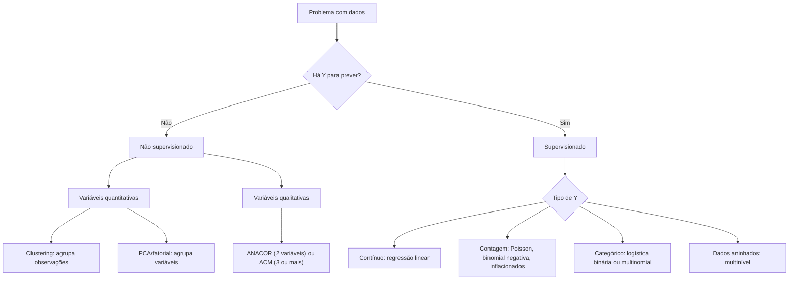

# 02 · Programação em Python + Mapa do Machine Learning
**Prof. Wilson Tarantin Jr. · 3 aulas · Prioridade: baixa para o Python em si (você já domina); alta para o "mapa" de ML, que organiza o curso inteiro**

## O fio condutor deste capítulo

Este capítulo tem duas partes de pesos muito diferentes. Python, aqui, é só a ferramenta: pandas para tabelas, numpy para contas, gráficos para olhar os dados. Como você já programa, basta lembrar o essencial. O que realmente importa para o resto do curso é o **mapa**: uma forma de responder, diante de qualquer problema com dados, *"que família de técnica devo usar?"*. Quase todas as disciplinas seguintes são uma "casinha" desse mapa, e ele evita que você as veja como assuntos soltos.

> **Memorize.** Duas perguntas resolvem a escolha da técnica: **(1)** existe uma variável que quero prever (Y)? **(2)** de que tipo são as variáveis? O resto do curso é detalhar as respostas.

## 1. O que é Machine Learning e como é o dado

Chamamos de **machine learning** o uso de dados e algoritmos (que contêm métodos estatísticos) para produzir informação útil na tomada de decisão. Há duas finalidades: entender como os dados se relacionam entre si e construir modelos que **prevejam** algo.

O dado chega como uma tabela. Cada **linha** é uma *observação* (um cliente, um país, uma empresa) e cada **coluna** é uma *variável* (um atributo). Quase sempre a tabela é uma **amostra**, isto é, uma parte da população. Isso importa porque só alguns modelos permitem tirar conclusões para além da amostra.

As colunas são de dois tipos, e a tabela abaixo organiza os nomes que o curso usa:

| Tipo | Subtipos | Exemplos |
|---|---|---|
| **Métrica** (quantitativa) | **discreta** (contagem: 0, 1, 2…) · **contínua** (qualquer valor real) | nº de filhos · renda em R$ |
| **Não métrica** (qualitativa) | **dicotômica** (2 categorias) · **policotômica** (mais de 2) · **nominal** (sem ordem) · **ordinal** (com ordem) | sim/não · cor · baixo/médio/alto |

> **Regra de ouro.** O **tipo da variável determina o modelo e a distribuição de probabilidade** adequados. Quase todo erro de modelagem começa em ignorar isso.

## 2. A primeira bifurcação: existe uma resposta a prever?

Diante de um problema, a primeira pergunta é: *eu tenho uma variável que quero prever ou explicar?* Se sim, há um "gabarito" (Y) e o problema é **supervisionado**. Se não, você só quer explorar a estrutura dos dados e o problema é **não supervisionado**.

| | **Supervisionado** | **Não supervisionado** |
|---|---|---|
| Também chamado | técnicas de **dependência**, confirmatório | técnicas de **interdependência**, exploratório |
| Existe Y? | **sim** | **não** |
| O que se estima | uma equação \(Y = f(X_1, X_2, \ldots, X_k)\) | agrupamentos, fatores, associações |
| Inferência para fora da amostra | **sim** (previsão) | **não**; se entram novas observações, refaz-se |
| Tarefas | prever ou explicar Y | reduzir variáveis, agrupar observações, associar categorias |

## 3. A segunda bifurcação: de que tipo são as variáveis?

Dentro de cada ramo a escolha da técnica segue o tipo de variável, e é por isso que o curso parece tão longo: cada tipo pede um modelo.

Além dessas técnicas, há famílias flexíveis que servem a vários casos: **árvores, random forest, boosting, SVM e redes neurais**.

> **Exemplo resolvido.** *Problema A:* prever se um cliente vai cancelar a assinatura (sim/não) a partir de idade e renda. Há um Y (cancelar), logo é supervisionado; Y tem duas categorias, logo **logística binária** (ou uma árvore). *Problema B:* descobrir perfis de clientes, sem nenhum rótulo prévio, usando gasto e frequência de compra. Não há Y, logo é não supervisionado; as variáveis são quantitativas, logo **clustering**.

## 4. Python no curso, só o que vale lembrar

O ambiente é o Spyder, via Anaconda. A estrutura central é o **DataFrame** do pandas.

| Para quê | Função |
|---|---|
| ver tipos e nulos | `info()` |
| estatísticas descritivas (o "50%" é a mediana) | `describe()` |
| selecionar por posição (índice começa em 0) | `iloc[linhas, colunas]` |
| agregar e ordenar | `groupby`, `sort_values`, `reset_index` |
| olhar a distribuição de uma métrica | histograma |
| mínimo, quartis, mediana, máximo e outliers | boxplot (outlier pela regra de 1,5 × AIQ) |

## O que levar daqui

Todo problema começa com duas perguntas: *há um Y a prever?* (supervisionado × não supervisionado) e *de que tipo são as variáveis?* (define a técnica). Com Y contínuo, regressão; com contagem, Poisson e afins; com categorias, logística; com dados aninhados, multinível. Sem Y, clustering e PCA para variáveis métricas, correspondência para categóricas.

## Erros que todo mundo comete

| Erro | Correção |
|---|---|
| Achar que clustering é supervisionado | não há Y; é exploratório |
| Usar PCA com variáveis categóricas | PCA exige **métricas**; categóricas → ANACOR/ACM |
| Esperar que técnicas não supervisionadas prevejam novas observações | não há inferência fora da amostra |
| Usar regressão linear para uma contagem | contagem pede Poisson/binomial negativa |

## Teste-se

1. Qual a diferença entre modelo supervisionado e não supervisionado?

Ver resposta
O supervisionado tem uma variável dependente Y, estima uma equação e permite previsão e inferência fora da amostra (dependência). O não supervisionado não tem Y e só explora relações dentro da amostra (interdependência).

2. Que técnica usar para associar três variáveis categóricas?

Ver resposta
ACM (análise de correspondência múltipla). A ANACOR serve para duas variáveis.

3. Y = número de acidentes por dia. Qual família de modelos?

Ver resposta
Modelos de contagem: Poisson (média ≈ variância) ou binomial negativa (variância maior que a média).

## Pergunta típica
Quais as diferenças entre modelo supervisionado e não supervisionado · para qual tipo de variável serve ANACOR/ACM e para qual PCA/clustering · como escolher o modelo conforme o tipo de Y
