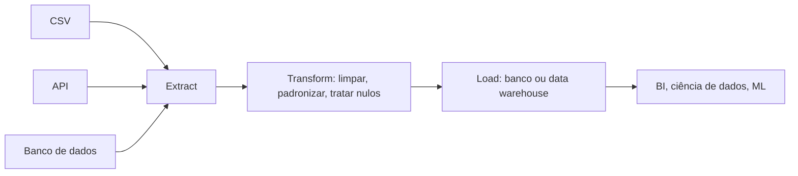

# 04 · Engenharia de Dados
**Prof. Guilherme Lima · 3 aulas · Prioridade: média (você, como dev, já domina boa parte; foque nos conceitos e no vocabulário)**

> **Destaque do professor.** *"O que é engenharia de dados?"* e *"O que é uma view?"* são perguntas prováveis: entenda o papel, não decore a definição.

## O fio condutor deste capítulo

Um cientista de dados quer treinar um modelo, mas os dados estão em três sistemas diferentes, com datas em formatos distintos, clientes duplicados e campos vazios. Quem resolve isso, de forma **automática e repetível**, é o engenheiro de dados. O capítulo começa por *o que é* esse papel e o fluxo ETL que ele constrói, passa pelo *armazenamento* (bancos relacionais e SQL), pela *modelagem* (como organizar as tabelas), por dois objetos que todo banco oferece (view e stored procedure) e termina nas *arquiteturas* que decidem como uma empresa organiza seus dados.

> **Analogia.** Pense em uma fábrica: o engenheiro de dados cuida da **linha de produção** (coleta, limpeza, transformação, entrega); o cientista de dados usa o **produto final**. Dizem que o cientista gasta cerca de 80% do tempo preparando dados e 20% no modelo; o engenheiro existe para inverter essa proporção.

## 1. O que é engenharia de dados

A engenharia de dados é a área responsável pelo **desenvolvimento e manutenção de sistemas que coletam, organizam e processam dados**: movimentação, manipulação e gerenciamento. O fluxo é: dados brutos → engenharia (coleta, armazenamento, transformação, entrega) → ciência de dados, BI e ML.

O que o engenheiro **normalmente não faz**: criar modelos de ML, montar dashboards, fazer análises, definir KPIs ou desenvolver aplicativos. Suas ferramentas diárias são SQL e Python, e é comum usar cloud em projetos maiores. Os problemas típicos que ele enfrenta são **valores ausentes, duplicados e formatos despadronizados**.

O mecanismo central é o **ETL**, e sua automação é o **pipeline de dados**:

Tratar nulos significa decidir entre **remover** a linha ou **preencher** (com média, mediana ou uma regra de negócio).

> **Exemplo resolvido.** Vendas chegam por API (JSON), por planilha (CSV) e do ERP (SQL). O pipeline lê as três fontes, padroniza datas e moedas, remove duplicados e grava tudo em uma única tabela no data warehouse. Os analistas passam a consultar só essa tabela.

**Big Data.** O termo foi usado em 1998 (John Mashey) e, em 2001, surgem os **3 Vs: Volume, Velocidade e Variedade**. A resposta histórica foi dividir os dados em **clusters** com hardware comum, o que originou o Hadoop. Um alerta de maturidade: poucos dados **não precisam** de microsserviços nem de cluster; o engenheiro não deve criar problemas que não existem.

## 2. Onde os dados moram: bancos relacionais e SQL

Um **banco relacional** guarda dados em **tabelas** (linhas e colunas) que se relacionam. Cada linha é identificada por uma **chave primária (PK)** e as tabelas se ligam por **chaves estrangeiras (FK)**. Centralizar os dados em um banco traz performance e **consistência**: um autor tem um único ID, mesmo que o nome apareça escrito de formas diferentes em arquivos soltos.

| Comando | Faz |
|---|---|
| `CREATE TABLE` | cria a tabela |
| `INSERT INTO … VALUES` | inclui linhas |
| `SELECT` (com `JOIN` e `GROUP BY`) | consulta, liga tabelas e agrega |
| `UPDATE … SET … WHERE` | altera linhas |
| `DELETE … WHERE` | apaga linhas |

> **Atenção.** Em `UPDATE` e `DELETE`, **sempre use `WHERE`**: sem ele, todas as linhas são afetadas. E lembre que **string vazia não é `NULL`**; nulos impedem cálculos estatísticos.

## 3. Como organizar as tabelas: o modelo entidade-relacionamento (MER)

Antes de criar tabelas, modela-se o problema. Uma **entidade** é um elemento do mundo real relevante ao sistema (cliente, produto) e um **atributo** é uma de suas propriedades (nome, preço). Há três tipos de entidade:

| Tipo | Ideia | Exemplo |
|---|---|---|
| **Forte** | existe por si só, com chave primária própria | clientes, produtos |
| **Fraca** | depende de outra e **não tem chave primária completa sem a chave da entidade da qual depende** | itens de pedido (dependem do pedido) |
| **Associativa** | representa um **relacionamento que tem atributos próprios** | vendas (liga cliente e produto e guarda data e quantidade) |

Há ainda dois mundos de uso: os sistemas **operacionais** (a aplicação escreve o tempo todo: muitas gravações) e os **analíticos** (analistas e cientistas leem e consultam; a base muda com menos frequência). O desafio da engenharia é servir pessoas diferentes com necessidades diferentes.

## 4. Dois objetos do banco: view e stored procedure

Estes dois conceitos são cobrados com frequência, porque parecem parecidos e são diferentes.

| | **View** | **Stored procedure** |
|---|---|---|
| O que é | **consulta salva** que se comporta como tabela virtual | **bloco de código SQL armazenado**, como uma função |
| Altera dados? | **não**, só consulta | **pode** alterar (insert, update, delete) |
| Lógica e parâmetros | sem lógica de programação | tem lógica, parâmetros de entrada e saída |
| Para quê | reaproveitar consultas complexas, simplificar relatórios | automatizar tarefas repetitivas, com segurança e reutilização |

Exemplo de view: `CREATE VIEW livros_por_idioma AS SELECT idioma, COUNT(*) … GROUP BY idioma;`. Depois, basta `SELECT * FROM livros_por_idioma;`.

## 5. Arquitetura: monólito × Data Mesh

Na abordagem **centralizada (monólito)**, uma equipe cuida de toda a base: é **simples e boa para começar**. No **Data Mesh**, **cada time cuida dos dados do seu domínio** e os disponibiliza aos demais; faz sentido quando a organização cresce.

## O que levar daqui

Engenharia de dados constrói a infraestrutura que coleta, organiza e entrega dados; seu núcleo é o ETL automatizado em pipelines. Bancos relacionais usam chaves primárias e estrangeiras. O MER distingue entidade forte, fraca e associativa. View é consulta salva (só leitura); stored procedure é código armazenado (pode alterar). Os 3 Vs descrevem o Big Data, e arquitetura deve acompanhar a maturidade.

## Erros que todo mundo comete

| Erro | Correção |
|---|---|
| "Engenheiro de dados cria modelos de ML" | normalmente **não**; prepara a base para quem cria |
| "View altera dados" | view só **consulta**; quem altera é a stored procedure |
| String vazia = NULL | são coisas **diferentes** |
| `UPDATE`/`DELETE` sem `WHERE` | atinge **todas** as linhas |
| Entidade fraca = tabela menos importante | é a que **depende** de outra para existir |
| Todo projeto precisa de cluster e microsserviços | poucos dados dispensam |

## Teste-se

1. Defina engenharia de dados e diga o que o engenheiro normalmente não faz.

Ver resposta
Desenvolve e mantém sistemas que coletam, organizam e processam dados. Normalmente não cria modelos de ML, dashboards, análises, KPIs nem aplicativos.

2. Qual a diferença entre view e stored procedure?

Ver resposta
View é tabela virtual/consulta salva, só leitura e sem lógica. A procedure é um bloco de código armazenado que pode alterar dados, ter lógica e parâmetros.

3. Dê um exemplo de entidade fraca.

Ver resposta
Itens de pedido: dependem do pedido e sua chave inclui a chave do pedido.

4. Cite três problemas comuns ao preparar dados.

Ver resposta
Valores ausentes, dados duplicados e formatos despadronizados.

## Pergunta típica
Defina engenharia de dados e diga o que o engenheiro não faz · o que é ETL · diferencie view e stored procedure · o que é entidade fraca e dê exemplo · diferencie sistema operacional e analítico · cite 3 problemas ao preparar dados · quais os 3 Vs
