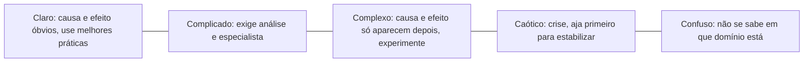

# 05 · Metodologias Ágeis I e II
**Prof. Gino Terentim · 2 aulas · Prioridade: alta para o vocabulário (vira questão conceitual fácil de pontuar)**

## O fio condutor deste capítulo

Construir uma ponte com projeto pronto é um problema cujo caminho já se conhece: planeja-se tudo e executa-se. Descobrir um produto que o cliente ainda nem sabe que quer é outro tipo de problema: só se aprende **fazendo e testando**. Usar o método errado custa caro (planejar demais o incerto, ou improvisar no que já se sabe fazer). A tese do capítulo é que **a abordagem de gestão deve ser escolhida pela natureza do problema**, e não pelo gosto do gestor.

O capítulo segue esta ordem: primeiro a diferença entre *projeto* e *processo*; depois um modelo que estima a chance de sucesso de um projeto (D.I.C.E.); em seguida a classificação dos problemas e a abordagem que cada um pede; então o que é *ser ágil* (Manifesto, Cynefin, PMRL) e, por fim, as ferramentas concretas: Scrum, Lean e Kanban.

> **Memorize.** Problema **conhecido** → abordagem **preditiva** (planejar e executar). Problema **conhecível** → **adaptativa/empírica**. Problema **incognoscível** → **experimentar** ("dê um passo para descobrir").

## 1. Projeto, processo e mudança

Um **projeto** cria algo **único e finito**, muda o negócio e costuma ter equipes transversais; um **processo** é contínuo e recorrente, mantém e aprimora o *status quo*, com equipes funcionais ("run the business"). Projetos direcionam **mudanças**, que podem ser **incrementais** (melhoria contínua), **transformacionais** (redefinição) ou **disruptivas** (inovação). Um projeto é uma organização temporária criada para entregar produtos conforme um **business case** aprovado: problema e justificativa, opções, benefícios e desbenefícios, entregas e marcos, riscos, custos e indicadores de sucesso.

## 2. D.I.C.E. — a chance de sucesso de um projeto

D.I.C.E. pontua quatro fatores, e **quanto menor a nota, melhor**:

| Fator | O que mede | Pontos |
|---|---|---|
| **D**uração | tempo até a conclusão (ou entre revisões) | <2 meses = 1; 2–4 = 2; 4–8 = 3; >8 = 4 |
| **I**ntegridade | capacidade da equipe, incluindo a liderança | 1 (excelente) a 4 |
| **C**ompromisso | **C1** = gestão sênior; **C2** = pessoas envolvidas | 1 a 4 cada |
| **E**sforço | esforço **além** das responsabilidades habituais | <10% = 1 … >40% = 4 |

\[ \text{Nota} = D + 2I + 2C_1 + C_2 + E \]

| Faixa | Zona | Leitura |
|---|---|---|
| 7 a 14 | **WIN** | altas chances de sucesso |
| 15 a 17 | **WORRY** | preocupante |
| 18 a 28 | **WOE** | alto risco |

> **Exemplo resolvido.** D = 2, I = 1, C1 = 2, C2 = 2, E = 1 → \(2 + 2\cdot1 + 2\cdot2 + 2 + 1 = 11\) → **WIN**. Com D = 3, I = 2, C1 = 3, C2 = 2, E = 2 → \(3+4+6+2+2 = 17\) → **WORRY**.

## 3. A natureza do problema define a abordagem

| Tipo de problema | Quando | Abordagem | Onde acomoda a incerteza |
|---|---|---|---|
| **Conhecido** | olha o passado: a resposta já existe | **preditiva**: planejar → executar → monitorar | em **prazo e custo** (escopo fixo) |
| **Conhecível** | presente: precisa de análise e experimentação | **adaptativa/empírica** ("frio/quente") | no **escopo** (prazo e custo rígidos) |
| **Incognoscível** | futuro: impossível saber antes | **experimentar**; a resposta provavelmente está errada, então dê um passo para descobrir | — |

O conhecimento **a priori** vem da razão e da dedução; o **a posteriori**, da experiência. O princípio prático: **não priorize o projeto, priorize o problema**. Em ciência de dados, divida o problema em **microproblemas** e veja quais você já sabe resolver (preditivo) e quais exigem experimentação (ágil).

## 4. O que é ser ágil: origem e Manifesto

Em 1986, **Takeuchi e Nonaka** observaram que empresas de sucesso (Fuji-Xerox, Canon, Honda) trabalhavam como no **rugby**, com a equipe junta passando a bola, e não como numa **corrida de revezamento** sequencial. As seis características: instabilidade embutida, equipes **autoorganizadas**, fases **sobrepostas**, **multiaprendizagem**, **controle sutil** e **transferência de aprendizado**. O nome **Scrum** vem do rugby.

O **Manifesto Ágil** declara quatro valores, sempre no formato "valorizamos *mais* o item da esquerda, ainda que o da direita também tenha valor":

| Valorizamos mais | do que |
|---|---|
| **Indivíduos e interações** | processos e ferramentas |
| **Software funcionando** | documentação extensa |
| **Colaboração com o cliente** | negociação de contratos |
| **Responder a mudanças** | seguir um plano |

### Cynefin: que tipo de situação é esta?

O modelo **Cynefin** (Dave Snowden) classifica o contexto e indica como liderar:

| Domínio | Prática | Foco |
|---|---|---|
| **Claro** | melhores práticas, checklist | eficiência |
| **Complicado** | análise e boas práticas | especialistas |
| **Complexo** | **experimentos seguros** (*probe → sense → respond*) | eficácia |
| **Caótico** | agir primeiro para estabilizar | liderança direta |

### PMRL: da descoberta à escala

O PMRL organiza a evolução de um produto em **9 estágios, em 3 fases**:

| Fase | Estágios | Abordagem |
|---|---|---|
| **Exploration** (Problem-Solution Fit) | 1 Discovery · 2 Prototyping · 3 Validation | ágil/empírica |
| **Delivery** (Product-Market Fit) | 4 **MVP** · 5 Iteration · 6 Market Testing | ágil com feedback |
| **Exploitation** (Scale) | 7 Optimization · 8 Expansion · 9 Scaling | processo conhecido/preditivo |

## 5. Scrum, Lean e Kanban

O **Scrum** é um **framework**: define papéis, eventos e artefatos, em ciclos chamados **sprints** de **no máximo 30 dias**.

| Elemento | O que é |
|---|---|
| **Product Owner** | representa clientes e usuários, prioriza o **Product Backlog**, maximiza o valor |
| **Scrum Master** | líder-servidor; **remove impedimentos** |
| **Desenvolvedores** | time multidisciplinar e **autogerenciável** |
| **Eventos** | Sprint Planning · Daily · Sprint Review · Retrospective |
| **Artefato → compromisso** | Product Backlog → **Meta do Produto**; Sprint Backlog → **Meta da Sprint**; Incremento → **Definição de Pronto (DoD)** |

O **Lean** combate o desperdício. Os **8 desperdícios** são: superprodução, espera, transporte, processamento excessivo, inventário excessivo, movimentação, defeitos (retrabalho) e talento não utilizado. O **Kanban** é um **método** (não um framework): visualiza o trabalho em colunas, **limita o trabalho em progresso (WIP)** e deixa o fluxo **revelar gargalos**. O lema é "pare de começar, comece a terminar".

## O que levar daqui

O método de gestão depende da natureza do problema: conhecido pede plano; conhecível e incognoscível pedem experimentação. D.I.C.E. estima o risco de um projeto (menor é melhor). O Manifesto Ágil prioriza pessoas, software, colaboração e adaptação. Cynefin diz como liderar em cada domínio. Scrum é um framework com papéis, eventos e artefatos; Kanban é um método de fluxo com limite de WIP.

## Erros que todo mundo comete

| Erro | Correção |
|---|---|
| "Ágil é não planejar nem documentar" | valoriza mais pessoas e software, mas planeja e documenta o necessário |
| "Quanto maior a nota DICE, melhor" | **menor** é melhor (7–14 = WIN) |
| Scrum e Kanban são o mesmo | Scrum = framework; Kanban = método |
| "Preditivo é sempre errado" | é ótimo para problemas **conhecidos** |
| "Scrum Master é o chefe" | é **líder-servidor** que remove impedimentos |
| Resolver problema complexo por checklist | exige **experimentação** |

## Teste-se

1. Diferencie projeto e processo.

Ver resposta
Projeto: único, finito, muda o negócio. Processo: contínuo e recorrente, mantém e aprimora o status quo.

2. Onde cada abordagem acomoda a incerteza?

Ver resposta
Preditiva: em prazo e custo (escopo fixo). Adaptativa: no escopo (prazo e custo rígidos).

3. Calcule o DICE: D = 3, I = 2, C1 = 3, C2 = 2, E = 2.

Ver resposta
3 + 4 + 6 + 2 + 2 = 17 → WORRY.

4. Cite os 8 desperdícios do Lean.

Ver resposta
Superprodução, espera, transporte, processamento excessivo, inventário excessivo, movimentação, defeitos e talento não utilizado.

## Pergunta típica
Diferença entre projeto e processo · entre abordagem preditiva e adaptativa (onde cada uma acomoda incerteza) · valores do Manifesto Ágil · papéis, eventos e artefatos do Scrum · o que é WIP limit · domínios do Cynefin · fórmula e zonas do DICE · os 8 desperdícios
