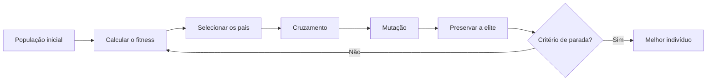

# 06 · Computação Evolucionária
**Profs. Renata da Encarnação Onety e Rubelmar Maia de Azevedo Cruz Neto · 2 aulas · Prioridade: alta (algoritmos genéticos têm vocabulário fixo e são cobrados)**
*Complementa: Pesquisa Operacional (capítulo 26), que usa a mesma modelagem.*

## O fio condutor deste capítulo

Alguns problemas têm tantas combinações possíveis que **testar todas é impossível**. O exemplo clássico é o do caixeiro-viajante: com 20 cidades existem cerca de 6,1 × 10¹⁶ rotas; a 1 milhão de rotas por segundo, levaria perto de 1.900 anos. Em vez de testar tudo, a computação evolucionária faz uma **busca inteligente**: mantém várias soluções ao mesmo tempo, favorece as melhores e sorteia variações, exatamente como a seleção natural. O preço é que **não garante o ótimo**, só uma boa solução ("o bom é inimigo do ótimo").

O capítulo avança assim: primeiro a ideia de otimização e de **heurística/meta-heurística**; depois a **modelagem** de um problema (variáveis, objetivo, restrições); então o **algoritmo genético** em si (vocabulário e ciclo); e por fim aplicações e extensões (multiobjetivo).

## 1. Otimização, heurística e meta-heurística

Todo modelo de ML é, no fundo, um **problema de otimização**: a regressão linear minimiza a soma dos quadrados dos resíduos (SSE); a regressão logística **maximiza a verossimilhança**. Quando o problema é difícil (**não linear**, **multimodal** com muitos máximos e mínimos locais, ou **combinatório**), usam-se métodos aproximados.

| Conceito | Ideia |
|---|---|
| **Heurística** | regra ou intuição para achar uma **boa** solução (ex.: *greedy*, que escolhe o melhor passo local) |
| **Meta-heurística** | combina **intensificação** (refinar o que é bom) e **diversificação** (explorar novas regiões) para **escapar de ótimos locais**; **sem garantia de otimalidade** |

A **computação evolucionária** pertence à inteligência computacional (inspirada na natureza). Seus membros: **algoritmos genéticos** (Holland, anos 60), estratégias evolutivas, programação evolutiva e programação genética.

No **caixeiro-viajante (TSP)** o número de rotas distintas é \(\frac{(n-1)!}{2}\): 3 rotas com 4 cidades, 12 com 5, 181.440 com 10 e 6,1 × 10¹⁶ com 20. Não se conhece algoritmo exato eficiente, o que justifica as meta-heurísticas.

## 2. Modelagem: o passo anterior a qualquer otimização

Modelar é traduzir o problema em três elementos:

| Elemento | Pergunta que responde |
|---|---|
| **Variáveis de decisão** | o que o modelo escolhe? |
| **Função objetivo** | o que **maximizar** (lucro) ou **minimizar** (custo, tempo)? |
| **Restrições** | quais limites definem as soluções viáveis (capacidade, tempo)? |

As restrições podem ser **fortes** (inegociáveis) ou **fracas** (desejáveis; só tratáveis em meta-heurísticas). O primeiro passo prático é **ouvir quem vive o problema**.

> **Exemplo resolvido (mochila).** Escolher itens para **maximizar o valor** carregado, com limite de peso de 5 kg. A variável de cada item é binária (1 = leva, 0 = deixa). A função objetivo soma os valores dos itens levados e a restrição limita a soma dos pesos a 5. O ótimo da aula foi Z = 41.

## 3. O algoritmo genético: o vocabulário

O AG toma emprestado o vocabulário da genética. Aprenda cada termo associado a algo concreto no exemplo da mochila:

| Termo | Significado | Na mochila |
|---|---|---|
| **Gene** | elemento básico do cromossomo | um item |
| **Alelo** | valor que o gene assume | 0 ou 1 |
| **Cromossomo / indivíduo** | uma solução completa | vetor 1 0 1 1 0 |
| **População** | conjunto de indivíduos | 50 vetores |
| **Geração** | um ciclo de evolução | rodada atual |
| **Genótipo** | representação **codificada** | a sequência binária |
| **Fenótipo** | como o genótipo é **interpretado** no problema | valor total da mochila |
| **Fitness (aptidão)** | qualidade, vem da **função objetivo** | valor carregado (penalizado se passar do peso) |

Os operadores que fazem a população evoluir:

| Operador | O que faz | Efeito |
|---|---|---|
| **Seleção** | escolhe os pais: **roleta** (chance proporcional ao fitness) ou **torneio** (sorteia alguns e fica o melhor) | favorece os melhores |
| **Cruzamento (crossover)** | combina genes de dois pais em filhos (1 ou 2 pontos de corte) | **explora** o espaço |
| **Mutação** | altera genes ao acaso | mantém **diversidade**, evita ótimos locais |
| **Elitismo** | preserva os melhores indivíduos sem alteração | não perde o que já é bom |

**Parâmetros típicos:** população de 50 a 200 (regra: ~10 vezes o nº de variáveis); 100 a 1000 gerações; **cruzamento 70–90%**; **mutação 1–5% por gene**. População pequena converge cedo para um **ótimo local**. Escolher os parâmetros é, ele mesmo, um problema de otimização (ajustável por DoE). Restrições violadas são **penalizadas** ou descartadas. **Critérios de parada:** nº máximo de gerações, convergência ou ausência de melhora em N gerações. **Métricas de acompanhamento:** melhor fitness, fitness médio, taxa de convergência e **desvio padrão do fitness** (alto no início, baixo no fim: mede a diversidade).

> **Exemplo resolvido (uma rodada na mochila).** O cromossomo 1 0 1 1 0 significa levar os itens 1, 3 e 4. Seu fitness é a soma dos valores (com penalidade se passar de 5 kg). A seleção por torneio escolhe dois pais; o cruzamento troca a "cauda" entre eles; a mutação inverte um bit com probabilidade pequena; o melhor da geração passa direto para a seguinte (elitismo).

## 4. Aplicações e extensões

| Caso | Como o AG entra |
|---|---|
| **TSP** | cromossomo = ordem das cidades; objetivo = distância total; restrição de visitar cada cidade uma vez |
| **Carteira de investimentos** | maximizar retorno com risco limitado e máximo de 30% por ação |
| **Seleção de variáveis em regressão** | AG no lugar do stepwise (fitness = R² ajustado ou SSE), porque com 20–30 variáveis o stepwise pode não achar o melhor modelo |

No caso **multiobjetivo** (vários objetivos conflitantes), a ponderação \(\sum_i w_i f_i(x)\) transforma tudo em um objetivo único, ou se busca a **fronteira de Pareto**: o conjunto de soluções **não dominadas**, em que nenhuma é melhor em todos os objetivos. Algoritmos: **NSGA-II** (2–3 objetivos), **NSGA-III** (4 ou mais), SPEA2. Outras meta-heurísticas: colônia de formigas, enxame de partículas (PSO), recozimento simulado, busca tabu.

## O que levar daqui

Meta-heurísticas trocam a garantia do ótimo por viabilidade em problemas gigantes. O AG evolui uma população por **seleção, cruzamento, mutação e elitismo**, medindo cada indivíduo por um **fitness**. Mutação traz diversidade; cruzamento explora; elitismo preserva. Genótipo é a codificação; fenótipo, a interpretação. Parâmetros típicos: cruzamento 70–90%, mutação 1–5%.

## Erros que todo mundo comete

| Erro | Correção |
|---|---|
| "O AG garante o ótimo global" | **não**; busca uma boa solução |
| Genótipo = fenótipo | genótipo é a **codificação**; fenótipo, a **interpretação** |
| "Mutação melhora o melhor indivíduo" | serve para **diversidade** e fugir de ótimos locais |
| "Elitismo piora a qualidade" | **preserva** os melhores |
| "Mais população é sempre melhor" | aumenta o custo: é um **trade-off** |
| Heurística = meta-heurística | meta-heurística **combina intensificação e diversificação** |

## Teste-se

1. Qual a diferença entre genótipo e fenótipo?

Ver resposta
Genótipo é a representação codificada (ex.: bits); fenótipo é como ela é interpretada no problema (ex.: valor total da mochila).

2. Para que servem mutação e elitismo?

Ver resposta
A mutação mantém a diversidade e evita ótimos locais; o elitismo preserva os melhores indivíduos entre gerações.

3. Quantas rotas distintas tem o TSP com 5 cidades?

Ver resposta
(5 − 1)!/2 = 24/2 = 12.

4. Por que o AG não garante o ótimo?

Ver resposta
Porque não testa todas as soluções; é estocástico e meta-heurístico, busca uma solução satisfatória.

## Pergunta típica
Heurística × meta-heurística · o que é fitness · papel de cruzamento, mutação e elitismo · genótipo × fenótipo · por que o AG não garante o ótimo · quantas rotas tem o TSP · critérios de parada · roleta × torneio
