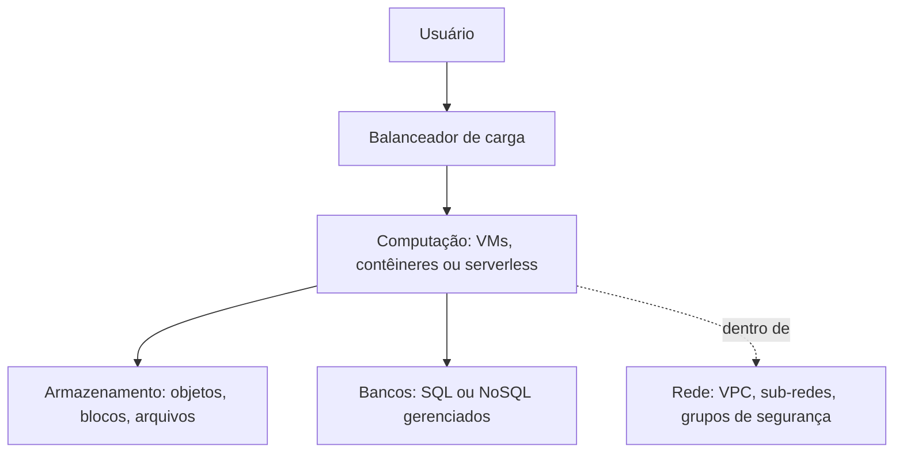

# 07 · Cloud Computing (I e II)
**Prof. Rodrigo Vale · 2 aulas · Prioridade: média — conceitual; você, como dev, já conhece boa parte**

## O fio condutor deste capítulo

Pense na **energia elétrica**: você não constrói uma usina; liga a tomada e paga pelo consumo. **Nuvem** é a mesma ideia para computação: servidores, armazenamento e software entregues pela internet, **pagos sob demanda**. Uma loja que vende dez vezes mais na Black Friday não precisa comprar servidores para o ano inteiro: escala por alguns dias e paga só por isso.

O capítulo parte do *porquê* da nuvem (comparando com o modelo antigo), mostra *o que se pode alugar* (IaaS, PaaS, SaaS e os modelos de implantação), o *que há por dentro* (computação, armazenamento, rede, serverless, bancos), os dois temas de *responsabilidade* (segurança com IAM e custos com FinOps), e termina nos *dados na nuvem* (análise, streaming, Spark, formatos).

## 1. Nuvem × on-premises

| | **On-premises** (antigo) | **Nuvem** |
|---|---|---|
| Custo | **CAPEX**: compra de hardware caro | **OPEX**: paga pelo uso |
| Manutenção | você mantém hardware e espaço físico | o provedor mantém |
| Escala | lenta | **elasticidade** em minutos |
| Responsabilidade | toda sua | **compartilhada** |

A nuvem resolve: custo inicial e ociosidade, dificuldade de escalar em picos, lentidão para provisionar, manutenção de data center, baixa confiabilidade (usa vários data centers) e acesso global. Em troca traz **desvantagens**: dependência da internet, **segurança** (a principal causa de vazamento é **erro de configuração**), **vendor lock-in**, **custos fora de controle** (*cloud sprawl*, custo de saída de dados) e latência. Os três grandes provedores são **AWS** (pioneira e líder), **Azure** (mundo corporativo) e **GCP** (dados e ML).

## 2. O que se aluga: os modelos de serviço (cai sempre)

A pergunta é *o que o provedor gerencia por você?* Quanto mais alto na pirâmide, mais conveniência e menos controle.

| | **IaaS** | **PaaS** | **SaaS** |
|---|---|---|---|
| O que é | máquinas virtuais, redes, armazenamento | plataforma para desenvolver e implantar sem cuidar da infra | **software pronto** |
| **Você gerencia** | SO, aplicações e dados | **aplicações e dados** | **nada** |
| Analogia | alugar o terreno e as ferramentas | casa pré-fabricada | apartamento mobiliado |
| Exemplos | EC2, Azure VMs | App Engine, Elastic Beanstalk | Gmail, Office 365, Salesforce |

Soluções **totalmente gerenciadas** (ex.: Cloud SQL) vão além: o provedor cuida de patches, backup e alta disponibilidade.

Quanto a *onde* roda, há três **modelos de implantação**: **pública** (infra do provedor, compartilhada: menor custo e grande escala), **privada** (uso exclusivo; máximo controle: bancos e governos; na prática, "privada" num provedor público é uma **VPC**) e **híbrida** (on-premises + nuvem pública: dados sensíveis locais e nuvem para picos e recuperação de desastres).

## 3. O que há por dentro

**Computação:** **VMs** são computadores completos virtualizados; **contêineres** são virtualização mais leve, empacotando código e dependências (orquestrados pelo **Kubernetes**). **Armazenamento:** **objetos** (quase infinito, ex. S3), **blocos** (disco rápido de VM) e **arquivos** (compartilhado entre VMs). **Rede:** a **VPC** é uma fatia privada isolada, dividida em **sub-redes** (pública para web, privada para banco) e protegida por **grupos de segurança** (o firewall da VM).

**Serverless (FaaS):** você escreve a função, define um **gatilho** (upload, requisição HTTP, cron) e o provedor aloca recursos. Paga-se apenas pelos **milissegundos** de execução e escala-se automaticamente; em compensação há **cold start** (latência na primeira execução), limites de tempo e memória, depuração difícil e **lock-in**.

**Bancos:** a escolha entre SQL e NoSQL é uma das mais cobradas.

| | **SQL (relacional)** | **NoSQL** |
|---|---|---|
| Esquema | fixo | flexível |
| Garantia | **ACID** (atomicidade, consistência, isolamento, durabilidade) | **BASE** (disponibilidade e **consistência eventual**) |
| Escala | difícil horizontalmente | horizontal |
| Uso típico | transações, ERP | grande escala, velocidade |
| Tipos | MySQL, PostgreSQL, RDS | **documentos** (MongoDB), **chave-valor** (Redis), **colunar** (Cassandra), **grafo** (Neo4j) |

> **Exemplo resolvido.** Um app de ingressos: front em PaaS, banco **SQL** gerenciado (transações precisam de ACID), cache em **Redis** (chave-valor) e geração de PDFs por **serverless** disparado a cada compra.

## 4. Responsabilidades: segurança e custo

### Segurança e IAM

No **modelo de responsabilidade compartilhada**, o provedor cuida da segurança **DA** nuvem (hardware, data centers); você cuida da segurança **NA** nuvem (dados, permissões, rede, senhas). **A configuração errada é sua.** O **IAM** (gestão de identidade e acesso) combina **identidade** (quem), **permissão** (o que pode fazer) e **recurso** (em quê), sob o **princípio do menor privilégio**. Seus pilares são **autenticação** (com **MFA**), **autorização** (políticas e *roles*) e **auditoria** (quem fez o quê, onde e quando). Boas práticas: nunca conceder `*.*`, usar roles e grupos, e **nunca deixar chaves no código**.

### FinOps

**FinOps** é a responsabilidade financeira no modelo variável: **gastar melhor, não apenas menos**. Usa **tags** para alocar custo, alertas de orçamento, **rightsizing**, caça a **recursos zumbis** (discos e IPs soltos) e agendamento (desligar ambientes de teste fora do expediente). O ciclo é contínuo: **Informar → Otimizar → Operar**.

**Multi-cloud** (vários provedores) evita lock-in e usa o melhor de cada um, mas traz custo de saída de dados (*egress*), governança e ferramentas dispersas. **Cloud bursting** usa o data center local e a nuvem para picos.

## 5. Dados na nuvem (Cloud II)

Os quatro tipos de análise formam uma escada de valor:

| Tipo | Pergunta |
|---|---|
| **Descritiva** | o que aconteceu? |
| **Diagnóstica** | por quê? |
| **Preditiva** | o que vai acontecer? |
| **Prescritiva** | o que devemos fazer? |

O ciclo de vida do dado é **Coletar → Processar → Armazenar → Analisar → Ativar → Empoderar**. No transporte entre sistemas, a **fila de mensagens (MQ)** entrega a mensagem a **um** consumidor e a remove; o **streaming** (Kafka) mantém **eventos imutáveis e reproduzíveis** para vários consumidores. O **CDC** (*Change Data Capture*) captura só as mudanças (o método baseado em **log** é o mais usado). **Batch** processa grandes volumes de forma agendada e barata; **tempo real** tem baixa latência e custa mais (ex.: fraude).

No processamento distribuído, o **Hadoop** (HDFS + MapReduce) trabalha em **disco**, enquanto o **Spark** trabalha em **memória**, até cerca de 100 vezes mais rápido. Nos formatos de arquivo, o **Parquet** é colunar (bom para análise) e o **Avro** é por linha (bom para escrita e streaming); o **Iceberg** é um formato de tabela sobre Parquet com **ACID**, evolução de esquema e **time travel** (arquitetura *lakehouse*).

## O que levar daqui

Nuvem troca CAPEX por OPEX e dá elasticidade. IaaS gerencia infra, PaaS entrega plataforma, SaaS entrega software. Segurança é compartilhada (provedor DA nuvem, você NA nuvem), com IAM e menor privilégio. FinOps controla custos. SQL = ACID; NoSQL = BASE. As quatro análises são descritiva, diagnóstica, preditiva e prescritiva; Spark trabalha em memória.

## Erros que todo mundo comete

| Erro | Correção |
|---|---|
| "Nuvem é sempre mais barata" | pode sair mais cara sem FinOps |
| "O provedor cuida de toda a segurança" | cuida **DA** nuvem; você cuida **NA** nuvem |
| "Serverless não tem servidor" | tem; **você não os gerencia** |
| SaaS = PaaS | SaaS é software pronto; PaaS é plataforma para **você** desenvolver |
| "NoSQL é sempre melhor" | troca **consistência** por escala |
| Fila (MQ) = streaming | a fila **remove** a mensagem; o streaming **guarda e reproduz** |

## Teste-se

1. Diferencie IaaS, PaaS e SaaS e dê um exemplo de cada.

Ver resposta
IaaS: infraestrutura (EC2); PaaS: plataforma para desenvolver sem gerir infra (App Engine); SaaS: software pronto (Gmail).

2. O que é cold start?

Ver resposta
Latência extra na primeira execução de uma função serverless, quando o ambiente ainda precisa ser iniciado.

3. Quem responde pela configuração errada de um bucket?

Ver resposta
O cliente (segurança NA nuvem, pelo modelo de responsabilidade compartilhada).

4. Qual a diferença entre ACID e BASE?

Ver resposta
ACID (SQL) garante transações consistentes; BASE (NoSQL) prioriza disponibilidade e velocidade com consistência eventual.

## Pergunta típica
IaaS/PaaS/SaaS (exemplos) · CAPEX × OPEX · responsabilidade compartilhada · menor privilégio e MFA · cold start · SQL × NoSQL (ACID × BASE) · multi-cloud (prós e contras, egress, cloud bursting) · batch × streaming · Hadoop × Spark · Parquet × Avro · 4 tipos de análise
