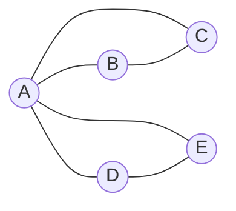

# 08 · Social Network Analysis (SNA)
**Profa. Adriana Silva · 2 aulas · Prioridade: alta (métricas de centralidade e cálculo "na mão" são cobráveis)**

> **Atenção.** SNA **não é** análise de mídias sociais (Instagram, Facebook): é a análise de **relacionamentos entre entidades quaisquer** (ligações telefônicas, e-mails, transações). Também **não é análise de cluster**, embora uma comunidade lembre um cluster.

## O fio condutor deste capítulo

Dois clientes de telefonia têm a mesma idade e o mesmo gasto. Um liga para 50 pessoas; o outro, para 2. Se o primeiro cancelar o plano, tende a arrastar amigos consigo. Uma tabela comum não enxerga isso; **uma rede enxerga**. A ideia da SNA é medir **a importância de cada nó a partir de como ele se conecta aos outros** e usar isso, por exemplo, para reter os clientes que sustentam a rede ("retenha o líder e o grupo fica").

O capítulo vai do mais simples ao mais aplicado: os *conceitos* (nó, aresta, comunidade, papéis), o *processo* de uma análise, as *métricas de centralidade* (a parte cobrada em cálculo), a *detecção de comunidades* e, por fim, as *ferramentas*.

## 1. Conceitos

Um **grafo** é formado por **nós** (indivíduos ou entidades) ligados por **arestas/links** (e-mail, ligação, transação). Uma rede é **direcionada** quando o sentido da relação importa (A liga para B é diferente de B ligar para A) e pode ter **peso** quando a intensidade importa (coluna `weight`). O experimento de Milgram popularizou os **seis graus de separação**: em média, estamos a cerca de seis passos de qualquer pessoa.

Uma **comunidade** é um grupo de nós **mais ligados entre si do que ao resto da rede**. Dentro dela, cada nó cumpre um **papel**:

| Papel | Descrição |
|---|---|
| **Líder** | nó central da comunidade, com conectividade recíproca |
| **Seguidor** | perfil parecido, ligado diretamente ao líder |
| **Marginal** | perfil de seguidor, mas sem proximidade ao líder |
| **Outlier** | poucas ou escassas conexões |
| **Bridge (ponte)** | conecta comunidades diferentes |

**Aplicações em marketing e telecom:** segmentar além de rentabilidade; **reter líderes** (reduz *churn*); fazer **cross-sell e up-sell em líderes** (efeito viral); melhorar a seleção na aquisição; incluir a métrica de rede no **modelo de churn**.

O processo de uma SNA tem cinco passos: (1) obter acesso ao contexto; (2) extrair os dados e definir **links e forças**; (3) montar a base; (4) **detectar comunidades**; (5) **estipular papéis**. **A SNA propriamente dita são os passos 4 e 5**; os três primeiros são contexto e manipulação de dados.

## 2. Métricas de centralidade (muito cobradas)

Cada métrica responde a uma pergunta diferente sobre "importância":

| Métrica | Pergunta | Como calcula e interpreta |
|---|---|---|
| **Degree (grau)** | quantas conexões o nó tem? | nº de links; em redes direcionadas, **out-degree** (saem), **in-degree** (chegam) e degree = in + out |
| **Clustering Coefficient (CC)** | os vizinhos do nó se conhecem entre si? | \(CC = \frac{\text{ligações existentes entre os vizinhos}}{\text{ligações possíveis entre os vizinhos}}\) |
| **Closeness (proximidade)** | quão perto o nó está de todos? | **média dos caminhos mais curtos** até os demais; **menor média = mais central** (difunde informação mais rápido) |
| **Betweenness (intermediação)** | o nó está "no meio do caminho" de outros? | nº de vezes que o nó aparece nos **menores caminhos entre outros pares**; alto = **porteiro/ponte** |

**Como ler o CC.** CC perto de **1**: os vizinhos já se conhecem sem o nó (ele é "dispensável" para a vizinhança). CC perto de **0**: os vizinhos só se ligam **por meio dele**, então ele é muito importante para a sua rede.

> **Exemplo resolvido (CC).** O nó A tem quatro vizinhos (B, C, D e E). Pares possíveis entre eles: \(\frac{4\cdot3}{2} = 6\). Só existem duas ligações entre vizinhos (B–C e D–E).
> \[ CC_A = \frac{2}{6} \approx 0{,}33 \]
> Seus vizinhos pouco se conectam sem A: ele é uma peça importante da vizinhança.

> **Exemplo (in/out).** A liga 5 vezes para B e B liga 1 vez para A: out-degree de A = 5 (ou 1 link com peso 5) e in-degree de A = 1.

**Estatísticas gerais da rede:** a **densidade** é \(\frac{\text{links existentes}}{\text{links possíveis}}\); o **comprimento médio do caminho** é a média dos menores caminhos; a **excentricidade** de um nó é a distância ao nó mais distante; o **raio** é a menor excentricidade e o **diâmetro** a maior.

## 3. Detecção de comunidades

A qualidade de uma divisão em comunidades é medida pela **modularidade (Q)**: a fração dos links **dentro** das comunidades **menos** a fração esperada se os links fossem aleatórios. Algoritmos como o *Louvain* começam com cada nó sozinho e vão fundindo comunidades enquanto a modularidade melhora.

O parâmetro **resolution** controla o tamanho: **valor menor → mais comunidades, menores; valor maior (> 1) → menos comunidades, maiores**. A escolha é feita por tentativa e erro conforme a necessidade do negócio, porque a maior modularidade nem sempre atende. Os tamanhos de comunidade costumam seguir uma **lei de potência** (poucas grandes, muitas pequenas). Em grafos direcionados, o algoritmo **info map** é indicado.

**Ferramentas.** O **Gephi** (software livre) exige, no CSV de links, as colunas **`Source` e `Target`** (e `weight` numérico opcional). Em Python usa-se o **igraph**; a base **Karate Club** (34 nós, 78 ligações) é o exemplo clássico.

## O que levar daqui

SNA mede a importância de nós pelas conexões. Degree conta links; CC mede se os vizinhos se conhecem (baixo = nó importante); closeness mede a distância média aos demais (menor = mais central); betweenness mede a presença nos menores caminhos (ponte). Comunidades são avaliadas por modularidade; resolution maior gera menos comunidades e maiores. A aplicação clássica é reter líderes para reduzir churn.

## Erros que todo mundo comete

| Erro | Correção |
|---|---|
| "SNA é análise de redes sociais" | é análise de **relações entre entidades** |
| "CC alto = nó importante" | CC alto = nó **dispensável** para a vizinhança; **CC baixo** = importante |
| Degree alto = intermediação alta | são métricas diferentes |
| "Closeness alto = muita média de passos" | **menor** média = mais central |
| "Aumentar a resolution gera mais comunidades" | gera **menos e maiores** |
| "Maior modularidade resolve tudo" | o melhor Q nem sempre atende o negócio |

## Teste-se

1. Um nó tem 3 vizinhos e há 1 ligação entre eles. Qual o CC?

Ver resposta
Pares possíveis = 3; existe 1 → CC = 1/3 ≈ 0,33.

2. O que significa betweenness alta?

Ver resposta
O nó aparece em muitos dos menores caminhos entre outros pares: é ponte ou porteiro da informação.

3. O que acontece ao aumentar a resolution?

Ver resposta
Há menos comunidades, e maiores.

4. Por que SNA não é análise de mídia social?

Ver resposta
Porque analisa relacionamentos entre quaisquer entidades (ligações, e-mails, transações), não só redes sociais online.

## Pergunta típica
Calcular o CC de um nó em um grafo pequeno · diferença entre in-degree e out-degree · o que significa closeness ou betweenness alto · o que muda quando a resolution aumenta · por que SNA não é mídia social · qual aplicação de SNA reduz churn · papéis (líder, seguidor, bridge, outlier)
