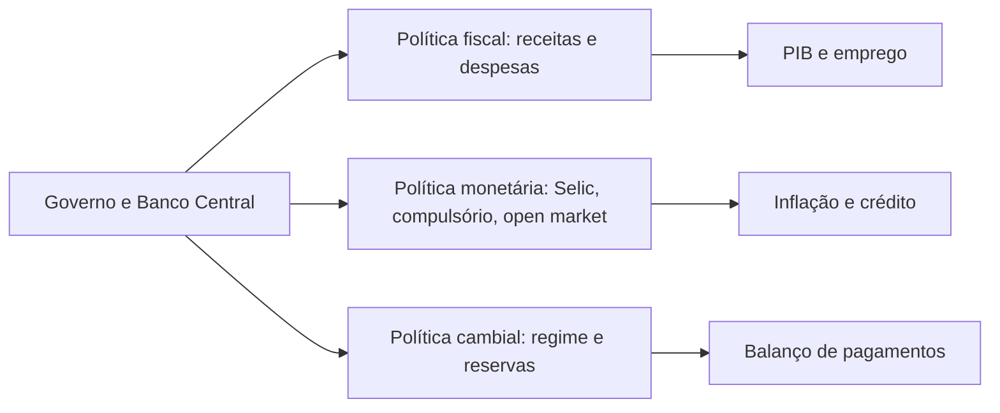

# 09 · Análise da Conjuntura Econômica em Cenários de Tecnologias Disruptivas
**Prof. Dr. Fernando de Souza Coelho (USP) · 2 aulas · Prioridade: média-alta (cálculos simples e conceitos de macroeconomia em múltipla escolha)**

## O fio condutor deste capítulo

Toda decisão de negócio (investir, contratar, precificar) é afetada por **juros, inflação, câmbio e emprego**. A conjuntura econômica é o "painel de instrumentos" que mostra como esses indicadores estão, e a política econômica é o conjunto de alavancas que o governo usa para movê-los. O ponto de partida é entender que tudo envolve **trade-offs**: juros baixos estimulam o crédito, mas pressionam a inflação.

O capítulo percorre o painel na ordem em que ele costuma ser lido: o **PIB** (quanto a economia produz), a **inflação** (quanto os preços sobem), o **mercado de trabalho**, e depois as três políticas que atuam sobre eles: **fiscal**, **monetária** e **cambial** (com o balanço de pagamentos). Termina com o desenho do sistema financeiro.

## 1. Conceitos de base

O **PESTEL** organiza o macroambiente: Político, Econômico, Social, Tecnológico, Ecológico e Legal. A análise pode ser **micro** (agentes e mercados) ou **macro** (agregados e políticas), e **conjuntural** (curto e médio prazo) ou **estrutural** (longo prazo). Os objetivos dos países são três: **crescimento** (PIB), **estabilidade de preços** (inflação) e **emprego**.

## 2. PIB: quanto a economia produz

O **PIB** é o valor monetário dos **bens e serviços finais** produzidos **dentro do território** em um período. É um **fluxo** de renda, e não um estoque de riqueza. Pela ótica do dispêndio:

\[ PIB = C + I + G + (X - M) \]

| Componente | O que é | O que mexe nele |
|---|---|---|
| **C** | consumo das famílias | renda disponível, confiança |
| **I** | investimento | juros e retorno esperado |
| **G** | gastos do governo | política fiscal |
| **X − M** | exportações líquidas | **câmbio** e competitividade |

> **Exemplo resolvido.** Com \(C = 640\), \(I = 170\), \(G = 180\), \(X = 100\) e \(M = 90\): \(PIB = 640 + 170 + 180 + (100 - 90) = 1000\).

O **PIB nominal** usa preços correntes (sem descontar a inflação); o **PIB real** desconta a inflação e mostra o crescimento do volume produzido. O **PIB per capita** é o PIB dividido pela população. E **crescimento não é desenvolvimento**: este é multidimensional (IDH, índice de Gini, sustentabilidade).

## 3. Inflação: quanto os preços sobem

**Inflação** é o aumento do **nível geral de preços**. Há três tipos conforme a causa:

| Tipo | Causa |
|---|---|
| **De demanda** | excesso de consumo e crédito |
| **De custos (oferta)** | choques: clima, câmbio, preços administrados |
| **Inercial** | memória inflacionária, indexação e expectativas (espiral) |

O Brasil saiu da hiperinflação com o **Plano Real (1994)** e consolidou o **tripé macroeconômico** (meta de inflação, superávit primário e câmbio flutuante). Entre os índices, o **IPCA (IBGE)** é o oficial e referência da **meta**; o **IGP-M (FGV)** corrige contratos como aluguel; há também o IPC-FIPE e o ICV-DIEESE. Uma inflação baixa durante uma recessão (como em 2017–2020) pode refletir **baixa demanda agregada**: desemprego alto e famílias comprando menos.

## 4. Mercado de trabalho

A **PIA** é a população com 14 anos ou mais; a **PEA** é formada por ocupados e desocupados; os **inativos** estão fora da PEA. A taxa de desemprego tem denominador próprio:

\[ \text{Taxa de desemprego} = \frac{\text{desocupados}}{PEA} \]

> **Exemplo resolvido.** PEA = 108 milhões e 6 milhões de desocupados → \(6/108 \approx 5{,}6\%\).

O desemprego pode ser **friccional** (rotatividade e assimetria de informação), **estrutural** (automação e IA) ou **conjuntural/cíclico** (crise, sazonalidade). A **NAIRU** é a taxa de desemprego que não acelera a inflação. As fontes são a **PNAD Contínua (IBGE)** e o **CAGED** (emprego formal).

## 5. Política econômica: as três alavancas

O governo exerce três funções: **alocativa** (bens públicos), **distributiva** (renda) e **estabilizadora** (emprego, preços e crescimento).

### Política fiscal

Trata de receitas e despesas. O **resultado primário** exclui os juros; o **nominal** os inclui:

\[ \text{Primário} = \text{receitas} - \text{despesas não financeiras} \qquad \text{Nominal} = \text{Primário} - \text{juros} \]

> **Exemplo resolvido.** Receitas 220; despesas não financeiras 195; juros 45. Primário = 220 − 195 = **+25 (superávit)**. Nominal = 25 − 45 = **−20 (déficit)**.

O sistema tributário brasileiro é **regressivo**: muito imposto indireto (ICMS, IPI, ISS).

### Política monetária

O **Banco Central** executa; o **COPOM** define a **Selic**; a **meta de inflação** é fixada pelo **CMN**. Os instrumentos clássicos:

| Instrumento | O que faz |
|---|---|
| **Selic** | taxa básica de juros |
| **Compulsório** | parcela dos depósitos que os bancos precisam reter |
| **Redesconto** | empréstimo do BC a bancos sem liquidez |
| **Open market** | compra e venda de títulos públicos: **vender retira liquidez; comprar injeta** |

O **Boletim Focus** é a pesquisa semanal de expectativas de mercado.

### Política cambial e balanço de pagamentos

Os regimes cambiais vão do **fixo** à **flutuação suja** (o BC intervém em estresse) e à **flutuante** (o BC não interfere); o Brasil adota o **flutuante**. O **balanço de pagamentos** soma:

\[ \text{Conta corrente} = (X - M) + \text{serviços e rendas} + \text{transferências} \qquad BP = \text{conta corrente} + \text{conta capital e financeira} \]

BP **positivo** aumenta as reservas e tende a apreciar a moeda; **negativo** reduz as reservas e deprecia.

> **Exemplo resolvido.** X = 505, M = 495 → balança comercial = +10. Serviços = −15 → conta corrente = **−5**. Conta capital = +15 → **BP = −5 + 15 = +10** (positivo).

## 6. Sistema Financeiro Nacional

| Camada | Órgãos |
|---|---|
| **Normativos** | CMN, CNSP, CNPC |
| **Supervisores** | BACEN, CVM, SUSEP, PREVIC |
| **Operadores** | bancos, cooperativas, fintechs, bolsas, seguradoras |

## O que levar daqui

PIB = C + I + G + (X − M); o real desconta a inflação. Taxa de desemprego = desocupados ÷ PEA. Primário exclui juros; nominal os inclui. Selic (COPOM) e meta de inflação (CMN); no open market, vender títulos retira liquidez. BP = conta corrente + conta capital e financeira.

## Erros que todo mundo comete

| Erro | Correção |
|---|---|
| Desemprego = desempregados ÷ população | é desocupados ÷ **PEA** |
| Primário inclui juros | **exclui** juros; o nominal inclui |
| PIB nominal = real | o nominal **não** desconta a inflação |
| Vender títulos no open market injeta dinheiro | **retira** liquidez |
| PIB mede riqueza acumulada | mede **fluxo** de produção e renda |
| IPCA e IGP-M servem ao mesmo fim | IPCA = meta; IGP-M = contratos |

## Teste-se

1. Receitas 300, despesas não financeiras 280, juros 35. Qual o primário e o nominal?

Ver resposta
Primário = +20 (superávit); nominal = 20 − 35 = −15 (déficit).

2. O que o Banco Central faz ao vender títulos públicos?

Ver resposta
Retira liquidez da economia (política contracionária).

3. Qual a diferença entre PIB nominal e real?

Ver resposta
Nominal usa preços correntes; real desconta a inflação, mostrando o crescimento do volume produzido.

4. Cite os três tipos de inflação.

Ver resposta
De demanda, de custos/oferta e inercial.

## Pergunta típica
Calcular resultado primário/nominal e saldo do BP · identificar fator que explica queda ou alta do PIB · diferenciar IPCA e IGP-M · tipos de inflação e de desemprego · o que faz o open market · regimes cambiais · funções do governo
