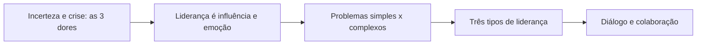

# 11 · Liderança em Data Science
**Profa. Fátima Jinnyat · 1 aula · Prioridade: média (conceitual; costuma aparecer como "qual conceito descreve…")**
*Tema da aula: liderança humanizada diante de incerteza, complexidade e mudança.*

## O fio condutor deste capítulo

Um líder de dados recebe pedidos ambíguos, tecnologia que muda a cada trimestre e equipes ansiosas. Planilhas e processos resolvem problemas **simples**; os **complexos** (cultura, adoção de IA, estratégia) exigem experimentar, ouvir e ajustar. Quem trata um problema complexo como simples **supersimplifica** e falha. A tese do capítulo é: em tempos de incerteza, liderar é **gerenciar o contexto e as pessoas** (emoções, diálogo, colaboração) mais do que controlar tarefas.

O raciocínio se constrói em quatro passos: primeiro, *o que a incerteza faz com as pessoas*; segundo, *por que liderança é influência e emoção*; terceiro, *por que problemas simples e complexos pedem líderes diferentes*; quarto, *como o diálogo e a colaboração substituem o debate e o controle*.

## 1. A incerteza e as três dores

Para Edgar Morin, uma **crise** é o momento em que **as incertezas aumentam**. Seus efeitos nas pessoas se resumem em **três dores**: **desconfiança, desânimo e medo da instabilidade**. O papel do líder é gerenciar o contexto e ajudar a equipe a lidar com elas. Segundo David Rock (NeuroLeadership), a mudança rápida cria **dissonância cognitiva** entre fatos, percepções e emoções, o que gera ansiedade e exaustão.

Há três posturas possíveis diante de uma crise:

| Postura | Comportamento | Resultado |
|---|---|---|
| **Calma exagerada** (*under-reacting*) | minimiza e não muda nada | a crise avança |
| **Pânico** (*over-reacting*) | reage em excesso, foca no negativo | decisões ruins |
| **Adaptação** | aproxima-se das pessoas, **empatiza e nomeia** o que ocorre, **desenha cenários** | resposta construtiva |

## 2. Liderança, influência e emoção

Para Howard Gardner, **líder** é quem, por palavras ou pelo exemplo, **influencia comportamentos, pensamentos e sentimentos** de um número significativo de pessoas. Como "somos máquinas de reagir" (cerca de 99% do pensamento é reativo), as conexões acontecem por meio de **emoções e vínculos**. Por isso a **inteligência emocional** é central:

| Domínio | Competências |
|---|---|
| **Intrapessoal** | autoconsciência, autocontrole, adaptabilidade, otimismo |
| **Interpessoal** | consciência social (empatia) e administração de relacionamentos (influência, desenvolvimento dos outros, conflitos, trabalho em equipe) |

Amy Cuddy mostra que formamos impressões dos outros por duas dimensões: **afetividade** (calor) e **força** (competência), e o cérebro percebe **a afinidade antes da força**. Só força causa temor; só afeto passa a imagem de fraqueza. O alvo é o **equilíbrio**.

## 3. Problemas simples × complexos

Esta é a distinção que organiza o resto do capítulo:

| | **Simples** | **Complexos** |
|---|---|---|
| Natureza | independentes e previsíveis | interdependentes, contexto desconhecido |
| Tratamento | **podem ser resolvidos** | **devem ser gerenciados** |
| Método | há histórico e uma resposta certa | planos raramente funcionam; **experimentação** |
| Quem cuida | pessoas operacionais | **líderes**, com práticas adaptativas |

Daí a ideia da **ambidestria mental**: manter duas ideias opostas na cabeça e ainda funcionar, a "genialidade do **E**" contra a "tirania do **OU**". O excesso de pensamento analítico e linear só refina o *status quo*. Os vícios do líder são **supersimplificar**, buscar previsibilidade e tentar controle total: não existe fórmula universal.

## 4. Os três tipos de liderança (Complexity Leadership, Mariotti)

As organizações têm um lado **administrativo** (formal, convencional, produz **eficiência**) e um lado **adaptativo** (informal e criativo, produz **inovação**). A liderança **integradora** promove a interação entre os dois.

| Tipo | Ideia |
|---|---|
| **Administrativa** | planejar, coordenar, controlar; estrutura e processos |
| **Adaptativa** | emerge de comportamentos coletivos e criativos, da necessidade de ajuste ao ambiente |
| **Capacitadora (*enabling*)** | **metaliderança**: cria as condições para a mudança e facilita conhecimento e criatividade, sem comandar |

A liderança, portanto, é um **fenômeno distribuído**. Para Goffee e Jones, as pessoas querem de um líder **comunidade, autenticidade, significado e entusiasmo**. Na **inteligência de enxame**, as soluções **emergem** das interações e o líder integra e empodera. Em cenários de incerteza, vale ser realista, usar múltiplas abordagens, construir confiança e evitar lógica binária, **consensos rasos** e polarização.

## 5. Diálogo, empatia e colaboração

Segundo David Bohm, o **debate** busca vencer; o **diálogo** é "fluxo de significado", constrói entendimento compartilhado **sem exigir concordância**. Precisamos de mais diálogo e menos debate. A **empatia** é um **comportamento** (o esforço de compreender razões, emoções e intenções do outro) e **não** um sentimento; empatizar não é sentir o mesmo.

| | **Cooperar** | **Colaborar** |
|---|---|---|
| O que é | cumprir a sua parte e permitir que os demais cumpram a deles | entender **todo o processo** e **fazer junto**, para que a sua parte potencialize a dos outros |

Com pouca diversidade, os consensos são fáceis, mas há risco de polarização e de calar os divergentes. **Colaboração com diversidade** gera mais alternativas e maior chance de acerto.

> **Exemplo resolvido.** Um time de dados está dividido sobre adotar um modelo "caixa-preta". No **debate**, cada lado tenta vencer. No **diálogo**, todos expõem suas razões até construir um entendimento comum (talvez: usar o modelo, com monitoramento e explicabilidade). Na **colaboração**, negócio, dados e compliance desenham juntos o processo.

## O que levar daqui

Incerteza gera três dores (desconfiança, desânimo, medo da instabilidade); a postura certa é a adaptação. Liderar é influenciar por meio de emoções e vínculos. Problemas simples se resolvem; os complexos se gerenciam. Existem três tipos de liderança (administrativa, adaptativa, capacitadora). Empatia é comportamento; colaborar vai além de cooperar; diálogo difere de debate.

## Erros que todo mundo comete

| Erro | Correção |
|---|---|
| "Empatia é sentir o que o outro sente" | é **comportamento** de compreender razões e emoções |
| Cooperar = colaborar | cooperar: cumprir a própria parte; colaborar: **fazer junto** |
| "Problemas complexos têm solução definitiva" | são **gerenciados**, não resolvidos |
| Debate = diálogo | o diálogo não exige concordar |
| "Liderança é cargo" | é **influência**, um fenômeno distribuído |
| "Mais diversidade piora o resultado" | reduz consensos fáceis, mas **melhora a qualidade** das decisões |

## Teste-se

1. Diferencie cooperar e colaborar.

Ver resposta
Cooperar é cumprir a sua parte e deixar os demais cumprirem a deles. Colaborar é entender o processo todo e fazer junto, para potencializar o impacto.

2. Quais são as 3 dores da incerteza?

Ver resposta
Desconfiança, desânimo e medo da instabilidade.

3. Empatia é sentimento ou comportamento?

Ver resposta
Comportamento: esforço por compreender razões, emoções e intenções do outro.

4. Quais os três tipos de liderança no modelo de complexidade?

Ver resposta
Administrativa, adaptativa e capacitadora (enabling/metaliderança).

## Pergunta típica
Cooperar × colaborar · debate × diálogo · empatia é comportamento ou sentimento · as 3 dores da incerteza · problema simples × complexo · os 3 tipos de liderança · domínios da inteligência emocional · "tirania do OU"
