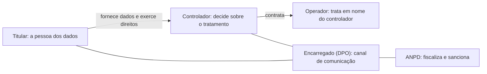

# 12 · Legislação no Ambiente Digital (LGPD)
**Prof. Hélio Ferreira Moraes · 1 aula · Prioridade: alta (questões objetivas diretas; o conteúdo abaixo é cobrado)**

## O fio condutor deste capítulo

Dados pessoais viraram matéria-prima de negócios: marketing, crédito, inteligência artificial. A lei existe para equilibrar o **interesse da empresa em usar dados** com o **direito da pessoa à privacidade**. A regra de bolso da LGPD cabe em quatro perguntas: *coletei só o necessário? Para uma finalidade informada? Tenho uma base legal? Protegi os dados?*

O capítulo caminha do contexto para a prática: primeiro os **marcos legais** que cercam o tema; depois os **conceitos** da LGPD (o que é dado pessoal, quem são os agentes, quais princípios, bases legais, direitos e sanções); em seguida a **segurança da informação**; e por fim a **LGPD na prática** (cadastros, análise de dados e marketing).

> **Destaque.** O direito digital tem como traços a interdisciplinaridade, o dinamismo, o alcance global, a proteção de direitos fundamentais e a flexibilidade normativa (normas "tecnologicamente neutras"). "O direito não é inimigo da tecnologia."

## 1. Marcos legais

| Norma | Ponto-chave |
|---|---|
| **GDPR** (UE, 2018) | regras estritas; **alcance global** (afeta empresas fora da UE que tratam dados de europeus) |
| **CCPA** (Califórnia, 2020) | direito de saber o que é coletado e de pedir exclusão |
| **Marco Civil da Internet** (Lei 12.965/2014) | neutralidade da rede, privacidade, liberdade de expressão; provedor só responde por conteúdo de terceiros após **ordem judicial**; guarda de registros: **conexão 1 ano, acesso a aplicações 6 meses** |
| **Marco Legal das Criptomoedas** (Lei 14.478/2022) | regras para prestadoras de serviços de ativos virtuais |
| **LAI** (Lei 12.527/2011) | transparência na administração pública (tensão com a LGPD: transparência × privacidade) |
| **LGPD** (Lei 13.709/2018) | protege **liberdade, privacidade e livre desenvolvimento da personalidade**; trata dados de **pessoas naturais**, em **qualquer meio** |

## 2. A LGPD por dentro

### O que é dado pessoal

**Dado pessoal** é qualquer informação relacionada a **pessoa natural identificada ou identificável**. O **dado pessoal sensível** merece proteção reforçada, por risco de discriminação: origem racial ou étnica, convicção religiosa, opinião política, filiação sindical, religiosa ou política, **saúde**, vida sexual, **dado genético ou biométrico**. Atenção: **CPF e dados financeiros não são sensíveis** pela lei.

### Quem são os agentes

### Princípios, bases legais e direitos

Os **princípios** incluem finalidade, adequação, **necessidade** (usar o **mínimo**), livre acesso, qualidade, **transparência**, **segurança**, prevenção, não discriminação e **responsabilização**. Todo tratamento precisa de uma **base legal**, **mas nem toda base é consentimento**:

| Base legal | Exemplo |
|---|---|
| Consentimento | newsletter |
| Obrigação legal ou regulatória | guardar nota fiscal |
| **Execução de contrato** | entregar o produto comprado |
| **Legítimo interesse** | prevenção a fraudes do próprio negócio |
| Proteção ao crédito | consulta de score |
| Outras | políticas públicas, estudos por órgão de pesquisa, exercício regular de direitos, proteção da vida, tutela da saúde |

Os **direitos do titular** incluem confirmação do tratamento, **acesso**, correção, anonimização, bloqueio ou eliminação, **portabilidade**, informação sobre compartilhamento, **revogação do consentimento**, oposição e **revisão de decisões automatizadas**. Para transferência internacional há mecanismos como **cláusulas-padrão contratuais** (Resolução ANPD 19).

### Sanções

As **sanções administrativas** vão de advertência a multa simples de **até 2% do faturamento, limitada a R$ 50 milhões por infração**, multa diária, publicização da infração, bloqueio ou eliminação dos dados, suspensão do banco de dados (até 6 meses) ou da atividade de tratamento e proibição de atividades. Há também impacto reputacional.

> **Exemplo resolvido.** Uma loja coleta CPF, endereço e data de nascimento para emitir nota fiscal (**base: obrigação legal**) e, separadamente, pede o e-mail para enviar promoções (**base: consentimento**). Usar o endereço para criar um perfil de crédito sem avisar viola a **finalidade**. Pedir a religião do cliente "por curiosidade" viola a **necessidade** (e é dado sensível).

## 3. Segurança da informação

A **tríade** da segurança é **confidencialidade, integridade e disponibilidade**; um **incidente** é qualquer evento que comprometa uma delas. Entre os ataques estão **phishing** (engano por e-mail ou sites falsos), **malware** (inclui **ransomware**, que sequestra dados e pede resgate), engenharia social, DDoS, força bruta, *man-in-the-middle* (risco em Wi-Fi público), SQL injection e XSS. As **ameaças internas** são frequentes: enviar arquivos ao e-mail pessoal, compartilhar senhas, deixar o computador desbloqueado. **Segurança é responsabilidade de todos.**

## 4. LGPD na prática

No **cadastro**, colete só o necessário; o **lead** também é titular. Na **análise de dados**, conheça a **origem** (evite "comprar base"), use **só para a finalidade informada** e depois **anonimize ou exclua**. No **marketing**, exija consentimento **livre, informado e inequívoco** (*opt-in*, caixa desmarcada), informe cookies e pixels e cuide de preços dinâmicos discriminatórios. **Privacy by Design/Default** significa pensar a privacidade desde o projeto (minimização, anonimização, criptografia, **RIPD**, relatório de impacto). Casos marcantes: **Cambridge Analytica/Facebook** (87 milhões de usuários), **Clearview AI** (imagens faciais sem consentimento) e a atuação da ANPD contra uso de dados para treinar IA e contra a coleta de biometria da íris.

## O que levar daqui

Dado pessoal é o de pessoa natural identificável; sensível é o de raça, religião, política, saúde, vida sexual e genético ou biométrico. O controlador decide; o operador executa; o DPO é o canal; a ANPD fiscaliza. O princípio da necessidade pede o mínimo. Bases legais não se resumem ao consentimento. A multa é de até 2% do faturamento, com teto de R$ 50 milhões por infração.

## Erros que todo mundo comete

| Erro | Correção |
|---|---|
| "Todo tratamento exige consentimento" | **falso**: há outras bases legais |
| "CPF e dado bancário são sensíveis" | **não** são sensíveis pela LGPD |
| "O operador decide como tratar" | quem decide é o **controlador** |
| "Dado público pode ser usado como quiser" | valem finalidade, adequação e necessidade |
| "Anonimizado sempre sai da LGPD" | só se for **irreversível** |
| "A LGPD vale só para dados digitais" | vale em **qualquer meio** |
| "Multa de 2% sem teto" | limitada a **R$ 50 milhões por infração** |

## Teste-se

1. Qual agente trata dados em nome de outro?

Ver resposta
O operador (em nome do controlador).

2. Todo tratamento de dados exige consentimento?

Ver resposta
Falso. Exige uma base legal, e há outras além do consentimento (contrato, obrigação legal, legítimo interesse etc.).

3. O que diz o princípio da necessidade?

Ver resposta
Usar o mínimo de dados necessário para atingir a finalidade.

4. Biometria e CPF são dados sensíveis?

Ver resposta
Biometria sim; CPF não.

5. Qual o limite da multa simples?

Ver resposta
Até 2% do faturamento do último exercício, limitada a R$ 50 milhões por infração.

## Pergunta típica
Qual agente trata dados em nome de outro · quem decide a forma e a duração do tratamento · princípios da LGPD · todo tratamento exige consentimento · quais são dados sensíveis · princípio da necessidade · o que é dado pessoal · sanções e limite da multa · direitos do titular
