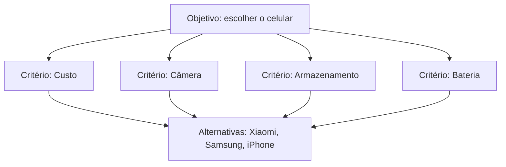

# 13 · Modelagem Matemática e Estruturação de Problemas Complexos (AHP)
**Prof. Dr. Marcos dos Santos (Marinha, IME/ITA/UFF) · 2 aulas · Prioridade: alta (cálculo passo a passo de AHP e AHP-Gaussiano)**

> **Destaque do professor.** *"Na matriz de ponderações, a diagonal principal tem valores sempre: 1"* e *"se estou comparando custo com custo, o grau tem que ser um."*

## O fio condutor deste capítulo

Comprar um celular: o mais barato tem a pior câmera; o melhor tem preço alto. Você pesa critérios de cabeça e, no fim, não sabe justificar a escolha. A **decisão multicritério** organiza esse raciocínio. O **AHP** faz isso de um jeito intuitivo: em vez de ponderar tudo ao mesmo tempo, você **compara critérios dois a dois** ("o custo é moderadamente mais importante que a câmera?") e o método converte esses julgamentos em **pesos** e **notas**, levando a um ranking transparente e justificável.

O capítulo apresenta o problema da decisão multicritério, o AHP clássico (com um exemplo numérico completo, incluindo a checagem de consistência) e o **AHP-Gaussiano**, uma variante que dispensa as comparações par a par ao tirar os pesos dos próprios dados.

## 1. O problema da decisão multicritério

A pesquisa operacional é a abordagem científica para **ajudar quem decide a decidir melhor**. Há decisão sempre que existe um problema com **mais de uma alternativa**, e toda decisão tem ganho e perda. O problema é descrito por uma **matriz de decisão** (alternativas × critérios) acompanhada dos **pesos dos critérios**. Métodos conhecidos: **AHP, ANP, PROMETHEE, ELECTRE, TOPSIS**. Para cada critério é preciso informar se é **de lucro** (quanto maior, melhor) ou **de custo** (quanto menor, melhor).

## 2. AHP (Analytic Hierarchy Process, Saaty, anos 1970)

O AHP é simples e flexível, baseado em matemática e **psicologia (escala psicométrica)**; aceita julgamentos subjetivos e garante **transparência e rastreabilidade**. O primeiro passo é montar a **hierarquia**: objetivo → critérios → alternativas. Os julgamentos usam a **escala de Saaty**:

| Valor | Significado |
|---|---|
| 1 | igual importância |
| 3 | moderadamente mais importante |
| 5 | mais importante |
| 7 | muito mais importante |
| 9 | extremamente mais importante |
| 2, 4, 6, 8 | valores intermediários |
| 1/3, 1/5, 1/7, 1/9 | **recíprocos** (o inverso do julgamento) |

A **matriz de julgamentos** é quadrada; a **diagonal principal vale sempre 1**; vale a **reciprocidade** (se \(a_{ij} = 3\), então \(a_{ji} = 1/3\)); e o número de comparações é \(\frac{n(n-1)}{2}\).

### O passo a passo

1. **Normalizar** a matriz: dividir cada elemento pela **soma da sua coluna**.
2. **Vetor de prioridades (pesos)** = **média de cada linha** da matriz normalizada.
3. **Consistência:** calcular \(\lambda_{max}\) e depois
\[ CI = \frac{\lambda_{max} - n}{n-1} \qquad\qquad CR = \frac{CI}{RI} \]
com o índice aleatório de Saaty \(RI\): 0,58 (n = 3), 0,90 (n = 4), 1,12 (n = 5), 1,24 (n = 6), 1,32 (n = 7). **CR < 10% = consistente.**
4. Julgar as **alternativas em cada critério** (ou normalizar dados quantitativos).
5. **Agregar:** nota global = soma de (peso do critério × prioridade da alternativa).

### Exemplo completo (da aula): comprar um smartphone

**A estrutura do problema.** Objetivo: **comprar um smartphone**. **Critérios:** custo, câmera, armazenamento e bateria. **Alternativas:** Xiaomi, Samsung e iPhone. (Essa árvore hierárquica, com o objetivo no topo, os critérios no meio e as alternativas embaixo, é o que se desenha na metodologia de um TCC.)

**Passo 1: avaliar os critérios par a par.** O decisor responde, com a escala de Saaty (1 a 9), "quanto o critério da linha é mais importante que o da coluna". Na aula: o **custo** é **3** vezes mais importante que a câmera, **5** que o armazenamento e **7** que a bateria; a **câmera** é **3** vezes mais importante que o armazenamento e **7** que a bateria; e o **armazenamento** é **3** vezes mais importante que a bateria. Preenche-se só o triângulo superior; o inferior sai pelos **recíprocos** (1/3, 1/5 etc.) e a diagonal vale 1:

| | Custo | Câmera | Armaz. | Bateria |
|---|---|---|---|---|
| **Custo** | 1 | 3 | 5 | 7 |
| **Câmera** | 1/3 | 1 | 3 | 7 |
| **Armaz.** | 1/5 | 1/3 | 1 | 3 |
| **Bateria** | 1/7 | 1/7 | 1/3 | 1 |
| **Soma da coluna** | 1,676 | 4,476 | 9,333 | 18 |

(O número de comparações é \(n(n-1)/2 = 4\cdot 3/2 = 6\).)

**Passo 2: normalizar** (cada elemento ÷ a soma da sua coluna) **e tirar a média de cada linha**, que é o **peso do critério**:

| | Custo | Câmera | Armaz. | Bateria | **Média da linha (peso)** |
|---|---|---|---|---|---|
| **Custo** | 0,597 | 0,670 | 0,536 | 0,389 | **0,548** |
| **Câmera** | 0,199 | 0,223 | 0,321 | 0,389 | **0,283** |
| **Armaz.** | 0,119 | 0,074 | 0,107 | 0,167 | **0,117** |
| **Bateria** | 0,085 | 0,032 | 0,036 | 0,056 | **0,052** |

Pesos: **custo 54,8%, câmera 28,3%, armazenamento 11,7% e bateria 5,2%** (somam 100%).

**Passo 3: consistência dos julgamentos.** Multiplica-se a matriz original pelo vetor de pesos e divide-se cada resultado pelo peso correspondente: 4,283; 4,172; 4,082; 4,026. A média é \(\lambda_{max} = 4{,}141\). Então \(CI = \frac{4{,}141 - 4}{4 - 1} = 0{,}047\) e \(CR = \frac{CI}{RI} = \frac{0{,}047}{0{,}90} = 0{,}052\) (5,2%), **abaixo de 10%: os julgamentos são consistentes**.

**Passo 4: as alternativas em cada critério (dados quantitativos).** Como os dados são números, não é preciso comparar par a par: **normaliza-se** cada coluna.

| | Custo | Câmera | Armazenamento | Bateria |
|---|---|---|---|---|
| Xiaomi | R$ 1.500 | 12 MP | 64 GB | 24 h |
| Samsung | R$ 1.800 | 12 MP | 128 GB | 18 h |
| iPhone | R$ 5.000 | 20 MP | 128 GB | 10 h |

Câmera, armazenamento e bateria são critérios de **lucro** (quanto maior, melhor): divide-se cada valor pela soma da coluna. O **custo** é de **custo** (quanto menor, melhor): usa-se o **inverso** (1/x) e depois divide-se pela soma. Para o custo: \(1/1500 = 0{,}000667\), \(1/1800 = 0{,}000556\), \(1/5000 = 0{,}000200\), soma = 0,001422, resultando em 0,469; 0,391; 0,141. (Sem inverter, o iPhone, o mais caro, ficaria com a **melhor** nota em custo, um erro.)

| Matriz normalizada | Custo | Câmera | Armazenamento | Bateria |
|---|---|---|---|---|
| Xiaomi | 0,469 | 0,273 | 0,200 | 0,462 |
| Samsung | 0,391 | 0,273 | 0,400 | 0,346 |
| iPhone | 0,141 | 0,455 | 0,400 | 0,192 |

**Passo 5: agregar** (matriz normalizada × vetor de pesos). Para o Xiaomi: \(0{,}469\times 0{,}548 + 0{,}273\times 0{,}283 + 0{,}200\times 0{,}117 + 0{,}462\times 0{,}052 = 0{,}257 + 0{,}077 + 0{,}023 + 0{,}024 = \) **0,381**.

| Alternativa | Preferência global |
|---|---|
| **Xiaomi** | **38,1%** |
| Samsung | 35,6% |
| iPhone | 26,2% |

**A decisão:** o **Xiaomi** é o escolhido (ranking: Xiaomi, Samsung, iPhone). O resultado é **ditado pelos pesos**: como o custo vale 54,8% da decisão, o iPhone (R$ 5.000, o mais caro) fica em último, apesar de ter a melhor câmera. Se o decisor desse mais peso à câmera, o ranking poderia mudar, e é por isso que os julgamentos precisam ser **consistentes** e justificados.

### Dados quantitativos e critérios de custo

Quando os dados são números (preço, GB, horas de bateria), **não é preciso comparar par a par**: **normaliza-se** a coluna dividindo cada valor pela soma. Para um critério de **custo**, usa-se o **inverso (1/x)** antes de normalizar (preços 1500, 1800 e 5000 viram 0,469; 0,391; 0,141). Normalizar torna a matriz **adimensional**, o que permite somar critérios de unidades diferentes.

**Limitações:** funciona bem até cerca de **7 critérios**; o número de comparações cresce rápido; há **desgaste cognitivo** do decisor e **é difícil obter CR < 10%**.

## 3. AHP-Gaussiano (Santos et al., 2020/2021)

Nasceu de um problema real da **Marinha do Brasil** (escolha de um navio). A ideia: os **pesos dos critérios saem dos próprios dados**, pela **dispersão**, **sem comparação par a par**. Isso reduz o esforço cognitivo e a subjetividade e serve para muitas alternativas e critérios.

> **Intuição.** Um critério em que todas as alternativas são parecidas **não ajuda a decidir** (peso baixo). Um critério em que elas **diferem muito** discrimina mais (peso alto).

| Passo | O que se faz |
|---|---|
| 1 | montar a matriz de decisão |
| 2 | normalizar (custo: inverso; lucro: ÷ soma) |
| 3 | calcular a média de cada critério (sempre \(1/n\)) |
| 4 | calcular o **desvio padrão** de cada critério |
| 5 | **fator gaussiano = desvio padrão ÷ média** (o coeficiente de variação) |
| 6 | **normalizar os fatores** (÷ soma): o resultado é o **peso** do critério |
| 7–8 | agregar (peso × valor normalizado) e ranquear |

## O que levar daqui

O AHP converte comparações par a par em pesos, checados por consistência. A matriz tem diagonal 1 e reciprocidade; os pesos são a média das linhas da matriz normalizada; CR < 10% é consistente. Critérios de custo usam o inverso. O AHP-Gaussiano obtém os pesos do coeficiente de variação dos dados, sem comparação par a par.

## Erros que todo mundo comete

| Erro | Correção |
|---|---|
| "A diagonal da matriz pode variar" | é **sempre 1** |
| "Se \(a_{ij} = 3\), então \(a_{ji} = 3\)" | \(a_{ji} = 1/3\) (reciprocidade) |
| "CR alto é aceitável" | o limite é **CR < 10%** |
| "Peso = soma das linhas" | peso = **média das linhas** da matriz normalizada |
| "Critério de custo normaliza direto" | custo usa o **inverso** antes de normalizar |
| "O AHP-Gaussiano pede comparação par a par" | **não**: o peso vem do CV dos dados |

## Teste-se

1. Quantas comparações par a par para 5 critérios?

Ver resposta
5·4/2 = 10.

2. Se \(a_{ij} = 5\), quanto vale \(a_{ji}\)?

Ver resposta
1/5.

3. CI = 0,06 com n = 4 (RI = 0,90). A matriz é consistente?

Ver resposta
CR = 0,06/0,90 ≈ 0,067 (6,7%) < 10%: sim.

4. Como o AHP-Gaussiano obtém os pesos?

Ver resposta
Pelo fator gaussiano (desvio padrão ÷ média) de cada critério, normalizado pela soma, sem comparação par a par.

## Pergunta típica
Calcular o vetor de prioridades (normalizar pela soma da coluna e tirar a média das linhas) · calcular CI/CR com RI dado e decidir se é consistente · aplicar reciprocidade e identificar a diagonal (=1) · critério de custo × lucro · o que muda no AHP-Gaussiano · limitações do AHP
