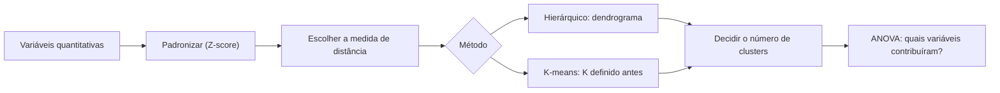

# 14 · Unsupervised ML — Análise de Cluster (Clustering I e II)
**Prof. Wilson Tarantin Jr. · 2 aulas · Prioridade: alta (início do bloco de ML; sempre cobra "qual método e por quê")**
*Livro-base: Fávero & Belfiore (2024), cap. 9. Código: Python (scipy, scikit-learn).*

## O fio condutor deste capítulo

Você tem milhares de clientes e quer descobrir **perfis de comportamento**, mas ninguém lhe deu a "resposta certa". A análise de cluster resolve isso medindo a **distância** entre as observações e juntando as que estão próximas, de modo que cada grupo seja **homogêneo por dentro e diferente dos demais**. Como não há variável a prever, é uma técnica **exploratória e não supervisionada**.

O raciocínio do capítulo tem três decisões em sequência: (1) **como medir a distância** entre duas observações; (2) **como juntar os grupos** (método hierárquico) ou **quantos grupos criar de antemão** (K-means); (3) **quantos grupos manter**, o que se lê no dendrograma ou nos gráficos de cotovelo e silhueta. No fim, o teste F diz quais variáveis realmente separaram os grupos.

## 1. Objetivo e características

O cluster agrupa **observações (linhas)**; para agrupar **variáveis** usa-se a PCA (capítulo 15). Por ser exploratório, **não há variável-alvo, não é preditivo e não permite inferência** para observações de fora da amostra: se entram ou saem observações ou variáveis, **refaz-se o agrupamento**. Aplicações: segmentação de clientes, perfis socioeconômicos de regiões, detecção de fraude (transações atípicas), grupos de pacientes.

**Tratamento inicial.** A análise é **muito sensível à escala**: se as variáveis têm unidades diferentes, **padronize (Z-score)**, senão a de maior escala domina a distância. Também é **sensível a outliers** (um país pode ficar sozinho num cluster). Use só variáveis **quantitativas**; categóricas pedem a análise de correspondência (capítulo 16).

## 2. Método hierárquico aglomerativo

O esquema é simples: começa-se com **n clusters** (cada observação sozinha), une-se os **dois mais próximos**, repete-se **n − 1 vezes** até restar um único cluster. O **dendrograma** mostra a ordem das uniões, e o número de clusters é escolhido **depois**, olhando o gráfico. Duas escolhas definem o resultado.

**Escolha 1: a medida de distância entre observações.**

| Medida | Ideia |
|---|---|
| **Euclidiana** (padrão) | distância em linha reta |
| Euclidiana quadrática | a mesma, ao quadrado |
| **Manhattan** (city block) | soma das diferenças absolutas |
| **Chebychev** | a maior diferença em uma variável |
| Correlação entre linhas | medida de semelhança; vira dissimilaridade com \(1 - r\) |

**Escolha 2: o método de encadeamento** (como medir a distância entre *clusters* já formados):

| Método | Distância entre dois grupos | Quando |
|---|---|---|
| **Single** (vizinho mais próximo) | a **mínima** entre elementos | observações bem distintas |
| **Complete** (vizinho mais distante) | a **máxima** | observações parecidas |
| **Average** (entre grupos) | a **média** de todos os pares | meio-termo |

### Exemplo completo 1 (da aula): 5 candidatos do vestibular

Cinco estudantes, três notas de 0 a 10. Como todas as notas estão **na mesma escala**, o script da aula agrupa os valores **sem padronizar**.

| Estudante | Matemática | Física | Química |
|---|---|---|---|
| Gabriela | 3,7 | 2,7 | 9,1 |
| Luiz Felipe | 7,8 | 8,0 | 1,5 |
| Patrícia | 8,9 | 1,0 | 2,7 |
| Ovídio | 7,0 | 1,0 | 9,0 |
| Leonor | 3,4 | 2,0 | 5,0 |

**Passo 1: a matriz de distâncias euclidianas.** Cada célula é a distância em linha reta entre dois estudantes. Por exemplo, Gabriela × Ovídio:

\[ d = \sqrt{(3{,}7-7{,}0)^2 + (2{,}7-1{,}0)^2 + (9{,}1-9{,}0)^2} = \sqrt{10{,}89 + 2{,}89 + 0{,}01} = \sqrt{13{,}79} = 3{,}71 \]

| | Gabriela | Luiz Felipe | Patrícia | Ovídio | Leonor |
|---|---|---|---|---|---|
| **Gabriela** | 0 | 10,13 | 8,42 | **3,71** | 4,17 |
| **Luiz Felipe** | 10,13 | 0 | 7,19 | 10,29 | 8,22 |
| **Patrícia** | 8,42 | 7,19 | 0 | 6,58 | 6,04 |
| **Ovídio** | 3,71 | 10,29 | 6,58 | 0 | 5,47 |
| **Leonor** | 4,17 | 8,22 | 6,04 | 5,47 | 0 |

**Passo 2: juntar os mais próximos, um par por vez.** O menor valor da matriz é 3,71 (Gabriela e Ovídio), então eles formam o primeiro cluster. Agora é preciso saber a distância entre esse cluster e os demais, e é aí que o **encadeamento** muda o resultado. Para a Leonor, por exemplo: ela está a 4,17 da Gabriela e a 5,47 do Ovídio.

- **Single** usa o **menor**: 4,17.
- **Complete** usa o **maior**: 5,47.
- **Average** usa a **média**: (4,17 + 5,47) ÷ 2 = 4,82.

Repetindo o processo até sobrar um cluster, cada método gera uma sequência de uniões (a distância é a **altura** em que as uniões aparecem no dendrograma):

| Estágio | Single | Complete | Average |
|---|---|---|---|
| 1 | Gabriela + Ovídio (3,71) | Gabriela + Ovídio (3,71) | Gabriela + Ovídio (3,71) |
| 2 | + Leonor (4,17) | + Leonor (5,47) | + Leonor (4,82) |
| 3 | + Patrícia (6,04) | Luiz Felipe + Patrícia (7,19) | + Patrícia (7,02) |
| 4 | + Luiz Felipe (7,19) | tudo junto (10,29) | + Luiz Felipe (8,96) |

Com **n = 5** observações, bastam **n − 1 = 4** uniões. Repare que os três métodos concordam no primeiro estágio e **divergem depois**: no complete, Luiz Felipe e Patrícia formam um par antes de se juntar ao resto; no single e no average, eles entram um de cada vez. Por isso se comparam os dendrogramas.

**Quantos clusters?** Procure **saltos grandes** de distância no dendrograma: um salto grande significa que você está unindo grupos **muito diferentes**, então corte **antes** dele. No single linkage acima há uma região sem uniões entre 4,17 e 6,04; cortar em **4,5** deixa **3 clusters**: {Gabriela, Ovídio, Leonor}, {Patrícia} e {Luiz Felipe}. É esse K = 3 que a aula leva para o K-means.

## 3. Método não hierárquico: K-means

Aqui o **K é definido a priori**. O algoritmo escolhe K centroides iniciais, aloca cada observação ao **centroide mais próximo**, **recalcula** os centroides (médias dos grupos) e repete até **não haver realocações**. O objetivo é minimizar a **WCSS** (*within-cluster sum of squares*), a soma dos quadrados das distâncias de cada observação ao centroide do seu cluster.

### Exemplo completo 1 (continuação): K-means com K = 3 nos mesmos 5 estudantes

O K-means chega aos mesmos três grupos do dendrograma. Os **centroides** são as médias de cada grupo:

| Cluster | Estudantes | Matemática | Física | Química |
|---|---|---|---|---|
| A | Gabriela, Ovídio, Leonor | 4,7 | 1,9 | 7,7 |
| B | Luiz Felipe | 7,8 | 8,0 | 1,5 |
| C | Patrícia | 8,9 | 1,0 | 2,7 |

(Para o cluster A: matemática = (3,7 + 7,0 + 3,4) ÷ 3 = 4,7; física = (2,7 + 1,0 + 2,0) ÷ 3 = 1,9; química = (9,1 + 9,0 + 5,0) ÷ 3 = 7,7.)

**De onde vem a WCSS.** Soma-se, para cada estudante, o quadrado da diferença até o centroide do **seu** cluster, em cada nota. Clusters com um só estudante contribuem com **0** (o estudante é o próprio centroide).

| Estudante | Cálculo | Contribuição |
|---|---|---|
| Gabriela | (3,7−4,7)² + (2,7−1,9)² + (9,1−7,7)² = 1 + 0,64 + 1,96 | 3,60 |
| Ovídio | (7,0−4,7)² + (1,0−1,9)² + (9,0−7,7)² = 5,29 + 0,81 + 1,69 | 7,79 |
| Leonor | (3,4−4,7)² + (2,0−1,9)² + (5,0−7,7)² = 1,69 + 0,01 + 7,29 | 8,99 |
| Luiz Felipe e Patrícia | sozinhos em seus clusters | 0 |
| **WCSS (K = 3)** | | **20,38** |

Repetindo para outros K, a WCSS cai sempre: **K = 1 → 107,94; K = 2 → 46,21; K = 3 → 20,38; K = 4 → 6,90** (e chegaria a 0 com K = 5, um estudante por cluster). Com só 5 observações o cotovelo é meramente ilustrativo; o exemplo seguinte, com 660 clientes, mostra como ele se comporta de verdade.

### Quais variáveis formaram os grupos? ANOVA (teste F)

Depois de formar os clusters, pergunta-se, **variável por variável**: *os grupos realmente se diferenciam nela?* Quem responde é a **ANOVA (teste F)**, que compara dois tipos de variação:

- **entre grupos**: o quanto as **médias dos clusters** se afastam umas das outras;
- **dentro dos grupos**: o quanto as observações **variam dentro de cada cluster**.

\[ F = \frac{\text{variação entre grupos (SQ}_{\text{entre}}/(K-1))}{\text{variação dentro dos grupos (SQ}_{\text{dentro}}/(n-K))} \]

Se as médias dos clusters são bem diferentes e cada cluster é "apertado" por dentro, o F fica **grande**: a variável **separou** os grupos. Se as médias são parecidas, o F fica **perto de 1**. Se **p < α**, a média da variável difere em ao menos um cluster, e ela **contribuiu**.

> **Exemplo completo (os mesmos 5 estudantes, K = 3).** Para a **física**, a média geral é 2,94; as médias dos clusters são 1,9 (A, com 3 estudantes), 8,0 (B) e 1,0 (C).
>
> - **Entre grupos:** 3·(1,9 − 2,94)² + 1·(8,0 − 2,94)² + 1·(1,0 − 2,94)² = 3,24 + 25,60 + 3,76 = **32,61**
> - **Dentro dos grupos:** só o cluster A varia: (2,7−1,9)² + (1,0−1,9)² + (2,0−1,9)² = 0,64 + 0,81 + 0,01 = **1,46**
> - **Graus de liberdade:** K − 1 = **2** (entre) e n − K = 5 − 3 = **2** (dentro)
> - **F = (32,61 ÷ 2) ÷ (1,46 ÷ 2) = 16,31 ÷ 0,73 = 22,34**, com **p ≈ 0,043**.

Fazendo o mesmo para as três notas:

| Variável | SQ entre | SQ dentro | F | p-valor | Conclusão (α = 5%) |
|---|---|---|---|---|---|
| **Física** | 32,61 | 1,46 | **22,34** | **0,043** | contribuiu: **a mais discriminante** |
| Química | 38,35 | 10,94 | 3,51 | 0,222 | não significante |
| Matemática | 16,59 | 7,98 | 2,08 | 0,325 | não significante |

A **física** é a variável mais discriminante (maior F, e significante). Cuidado com a leitura: o F é **sensível ao tamanho da amostra**, e com só 5 estudantes e 2 graus de liberdade no denominador o teste tem pouquíssimo poder; por isso química e matemática não passam, apesar de terem médias bem diferentes entre os grupos.

### Exemplo completo 2 (da aula): 660 clientes de cartão de crédito

Aqui os dados são de verdade e em escala grande. Cada linha é um cliente com **5 variáveis**: limite médio de crédito, nº de cartões, visitas ao banco, visitas online e ligações ao atendimento. **Como o limite está na casa das dezenas de milhares** (média 34.574) e as outras variáveis vão de 0 a 15, é obrigatório **padronizar (Z-score)** antes, senão o limite dominaria todas as distâncias.

**Como escolher o K?**

| Método | Como lê |
|---|---|
| **Cotovelo (Elbow)** | gráfico de WCSS × K; escolhe-se a "dobra" onde a queda deixa de ser grande |
| **Silhueta** | \(s = \frac{b - a}{\max(a, b)}\), com **a** = distância média dentro do próprio cluster e **b** = distância média ao **cluster vizinho mais próximo**; vai de −1 a 1 e **perto de 1 é melhor** |

Rodando o K-means para K de 1 a 10 sobre os dados padronizados:

| K | WCSS | Silhueta média |
|---|---|---|
| 1 | 3.295 | — |
| 2 | 2.038 | 0,418 |
| **3** | **932** | **0,516** |
| 4 | 780 | 0,356 |
| 5 | 703 | 0,272 |
| 6 | 641 | 0,256 |
| 7 | 608 | 0,232 |
| 8 | 573 | 0,221 |
| 9 | 546 | 0,235 |
| 10 | 525 | 0,233 |

> **Como ler o eixo y.** No cotovelo, o eixo y é a **WCSS**. Ela **sempre cai** quando K aumenta (chegaria a 0 com K = nº de clientes), então não se escolhe o K de menor WCSS, e sim a **dobra**. Aqui a queda é enorme de K = 1 para K = 3 (3.295 → 2.038 → 932) e depois **achata** (932 → 780 → 703...). A silhueta confirma: o **pico é em K = 3** (0,516). O valor absoluto da WCSS não é comparável entre conjuntos de dados diferentes (cresce com o nº de observações e com a escala); só serve para comparar K **dentro do mesmo conjunto**.

> **A silhueta, passo a passo (nos 5 estudantes).** Para a Gabriela (cluster A, K = 3): **a** = distância média até os outros do próprio cluster = (3,71 + 4,17) ÷ 2 = **3,94**; **b** = distância média ao cluster vizinho mais próximo = min(10,13 até o Luiz Felipe; 8,42 até a Patrícia) = **8,42**. Então \(s = (8{,}42 - 3{,}94)/8{,}42 \approx \mathbf{0{,}53}\): ela está bem alocada (perto de 1).

**Os 3 clusters finais e seus perfis** (médias na escala original):

| Cluster | Clientes | Limite médio | Cartões | Visitas ao banco | Visitas online | Ligações |
|---|---|---|---|---|---|---|
| 1 | 50 | **141.040** | **8,7** | 0,6 | **10,9** | 1,1 |
| 2 | 224 | 12.174 | 2,4 | 0,9 | 3,6 | **6,9** |
| 3 | 386 | 33.782 | 5,5 | **3,5** | 1,0 | 2,0 |

**Interpretação.** O cluster 1 é o de **alta renda e digital** (limite altíssimo, muitos cartões, quase tudo online). O cluster 2 é de **limite baixo e muito contato por telefone**. O cluster 3 é o **perfil de agência** (limite médio e mais visitas presenciais). A ANOVA confirma que **todas as 5 variáveis** diferenciam os grupos (F de 555 a 1.499, todos com p praticamente zero); a mais discriminante é **visitas online** (F = 1.499).

**Hierárquico × K-means.** O hierárquico é analítico e mostra o passo a passo, mas é difícil com muitas observações; o **K-means é objetivo e escala melhor**. O hierárquico pode sugerir o K inicial.

## 4. Python

`zscore` (padronizar), `scipy.cluster.hierarchy` (`linkage`, `dendrogram`), `AgglomerativeClustering`, `KMeans(n_clusters=k)` (o atributo `.inertia_` é a WCSS), `silhouette_score` e `pingouin` para a ANOVA.

## O que levar daqui

Cluster agrupa linhas, sem Y. Padronize antes. Decida distância (euclidiana) e encadeamento (single, complete, average). No dendrograma, corte antes dos grandes saltos; no K-means, K vem antes e se apoia em cotovelo e silhueta. A ANOVA mostra quais variáveis formaram os grupos.

## Erros que todo mundo comete

| Erro | Correção |
|---|---|
| "Cluster agrupa variáveis" | agrupa **observações**; variáveis → PCA |
| "Cluster é preditivo" | **não**: sem Y e sem inferência fora da amostra |
| "Não precisa padronizar" | **precisa**, se as escalas diferem |
| "Hierárquico exige K no início" | K se escolhe **depois**; é o K-means que exige K **antes** |
| "Silhueta perto de −1 é boa" | **perto de 1** é boa |
| "Single e complete dão o mesmo resultado" | single = mínimo; complete = máximo |

## Teste-se

1. Por que padronizar antes do cluster?

Ver resposta
Porque a distância é sensível à escala: variáveis em unidades maiores dominariam o agrupamento.

2. Quando se define o número de clusters no hierárquico e no K-means?

Ver resposta
No hierárquico, depois, olhando o dendrograma; no K-means, antes (K a priori), apoiado em cotovelo e silhueta.

3. Qual a diferença entre single e complete linkage?

Ver resposta
Single usa a menor distância entre elementos dos dois clusters; complete usa a maior.

4. O que indica uma silhueta próxima de 1?

Ver resposta
Observações bem alocadas: perto do próprio cluster e longe do vizinho.

5. Como saber quais variáveis formaram os clusters?

Ver resposta
Pelo teste F (ANOVA): p < α indica que a média da variável difere entre clusters.

## Pergunta típica
Diferença entre cluster hierárquico e K-means (quando se define K) · por que padronizar · single × complete × average · como escolher o nº de clusters (saltos no dendrograma, cotovelo, silhueta) · o que mede a silhueta · como saber quais variáveis formaram clusters (F/ANOVA) · por que cluster não é preditivo
