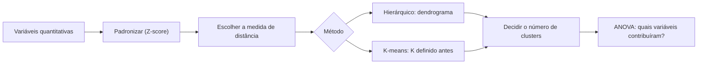

# 14 · Unsupervised ML — Análise de Cluster (Clustering I e II)
**Prof. Wilson Tarantin Jr. · 2 aulas · Prioridade: alta (início do bloco de ML; sempre cobra "qual método e por quê")**
*Livro-base: Fávero & Belfiore (2024), cap. 9. Código: Python (scipy, scikit-learn).*

## O fio condutor deste capítulo

Você tem milhares de clientes e quer descobrir **perfis de comportamento**, mas ninguém lhe deu a "resposta certa". A análise de cluster resolve isso medindo a **distância** entre as observações e juntando as que estão próximas, de modo que cada grupo seja **homogêneo por dentro e diferente dos demais**. Como não há variável a prever, é uma técnica **exploratória e não supervisionada**.

O raciocínio do capítulo tem três decisões em sequência: (1) **como medir a distância** entre duas observações; (2) **como juntar os grupos** (método hierárquico) ou **quantos grupos criar de antemão** (K-means); (3) **quantos grupos manter**, o que se lê no dendrograma ou nos gráficos de cotovelo e silhueta. No fim, o teste F diz quais variáveis realmente separaram os grupos.

## 1. Objetivo e características

O cluster agrupa **observações (linhas)**; para agrupar **variáveis** usa-se a PCA (capítulo 15). Por ser exploratório, **não há variável-alvo, não é preditivo e não permite inferência** para observações de fora da amostra: se entram ou saem observações ou variáveis, **refaz-se o agrupamento**. Aplicações: segmentação de clientes, perfis socioeconômicos de regiões, detecção de fraude (transações atípicas), grupos de pacientes.

**Tratamento inicial.** A análise é **muito sensível à escala**: se as variáveis têm unidades diferentes, **padronize (Z-score)**, senão a de maior escala domina a distância. Também é **sensível a outliers** (um país pode ficar sozinho num cluster). Use só variáveis **quantitativas**; categóricas pedem a análise de correspondência (capítulo 16).

## 2. Método hierárquico aglomerativo

O esquema é simples: começa-se com **n clusters** (cada observação sozinha), une-se os **dois mais próximos**, repete-se **n − 1 vezes** até restar um único cluster. O **dendrograma** mostra a ordem das uniões, e o número de clusters é escolhido **depois**, olhando o gráfico. Duas escolhas definem o resultado.

**Escolha 1: a medida de distância entre observações.**

| Medida | Ideia |
|---|---|
| **Euclidiana** (padrão) | distância em linha reta |
| Euclidiana quadrática | a mesma, ao quadrado |
| **Manhattan** (city block) | soma das diferenças absolutas |
| **Chebychev** | a maior diferença em uma variável |
| Correlação entre linhas | medida de semelhança; vira dissimilaridade com \(1 - r\) |

**Escolha 2: o método de encadeamento** (como medir a distância entre *clusters* já formados):

| Método | Distância entre dois grupos | Quando |
|---|---|---|
| **Single** (vizinho mais próximo) | a **mínima** entre elementos | observações bem distintas |
| **Complete** (vizinho mais distante) | a **máxima** | observações parecidas |
| **Average** (entre grupos) | a **média** de todos os pares | meio-termo |

> **Exemplo resolvido.** Pontos numa reta: A = 1, B = 2, C = 6, D = 8. Estágio 1: une **A e B** (distância 1). Estágio 2: une **C e D** (distância 2). Distância entre {A,B} e {C,D}: **single** = mínima = |B − C| = **4**; **complete** = máxima = |A − D| = **7**; **average** = (5 + 7 + 4 + 6) ÷ 4 = **5,5**. Em dados reais os três métodos podem mudar a ordem das uniões; por isso compare dendrogramas.

**Quantos clusters?** Procure **saltos grandes** de distância no dendrograma: um salto grande significa que você está unindo grupos **muito diferentes**, então corte **antes** dele.

**Quais variáveis formaram os grupos?** Usa-se a **ANOVA (teste F)**: \(F = \frac{\text{variabilidade entre grupos}}{\text{variabilidade dentro dos grupos}}\), com gl = \(K - 1\) e \(n - K\). Se **p < α**, a média da variável difere em ao menos um cluster: ela **contribuiu**. Com n = 30 e K = 3, o F tem gl = 2 e 27.

## 3. Método não hierárquico: K-means

Aqui o **K é definido a priori**. O algoritmo escolhe K centroides iniciais, aloca cada observação ao **centroide mais próximo**, **recalcula** os centroides (médias dos grupos) e repete até **não haver realocações**. O objetivo é minimizar a **WCSS**, a soma dos quadrados das distâncias de cada observação ao centroide do seu cluster.

> **Exemplo resolvido.** Pontos 1, 2, 6 e 8 com K = 2 e centroides iniciais 1 e 8. Alocação: {1, 2} e {6, 8}. Novos centroides: **1,5** e **7**. Ninguém muda de grupo, então convergiu. WCSS = (0,25 + 0,25) + (1 + 1) = **2,5**.

**Como escolher o K?**

| Método | Como lê |
|---|---|
| **Cotovelo (Elbow)** | gráfico de WCSS × K; escolhe-se a "dobra" onde a queda deixa de ser grande |
| **Silhueta** | \(s = \frac{b - a}{\max(a, b)}\), com **a** = distância média dentro do próprio cluster e **b** = distância média ao **cluster vizinho mais próximo**; vai de −1 a 1 e **perto de 1 é melhor** |

> **Exemplo (silhueta).** Se a = 2 e b = 6, então s = (6 − 2) ÷ 6 ≈ **0,67**: a observação está bem alocada.

**Hierárquico × K-means.** O hierárquico é analítico e mostra o passo a passo, mas é difícil com muitas observações; o **K-means é objetivo e escala melhor**. O hierárquico pode sugerir o K inicial.

## 4. Python

`zscore` (padronizar), `scipy.cluster.hierarchy` (`linkage`, `dendrogram`), `AgglomerativeClustering`, `KMeans(n_clusters=k)` (o atributo `.inertia_` é a WCSS), `silhouette_score` e `pingouin` para a ANOVA.

## O que levar daqui

Cluster agrupa linhas, sem Y. Padronize antes. Decida distância (euclidiana) e encadeamento (single, complete, average). No dendrograma, corte antes dos grandes saltos; no K-means, K vem antes e se apoia em cotovelo e silhueta. A ANOVA mostra quais variáveis formaram os grupos.

## Erros que todo mundo comete

| Erro | Correção |
|---|---|
| "Cluster agrupa variáveis" | agrupa **observações**; variáveis → PCA |
| "Cluster é preditivo" | **não**: sem Y e sem inferência fora da amostra |
| "Não precisa padronizar" | **precisa**, se as escalas diferem |
| "Hierárquico exige K no início" | K se escolhe **depois**; é o K-means que exige K **antes** |
| "Silhueta perto de −1 é boa" | **perto de 1** é boa |
| "Single e complete dão o mesmo resultado" | single = mínimo; complete = máximo |

## Teste-se

1. Por que padronizar antes do cluster?

Ver resposta
Porque a distância é sensível à escala: variáveis em unidades maiores dominariam o agrupamento.

2. Quando se define o número de clusters no hierárquico e no K-means?

Ver resposta
No hierárquico, depois, olhando o dendrograma; no K-means, antes (K a priori), apoiado em cotovelo e silhueta.

3. Qual a diferença entre single e complete linkage?

Ver resposta
Single usa a menor distância entre elementos dos dois clusters; complete usa a maior.

4. O que indica uma silhueta próxima de 1?

Ver resposta
Observações bem alocadas: perto do próprio cluster e longe do vizinho.

5. Como saber quais variáveis formaram os clusters?

Ver resposta
Pelo teste F (ANOVA): p < α indica que a média da variável difere entre clusters.

## Pergunta típica
Diferença entre cluster hierárquico e K-means (quando se define K) · por que padronizar · single × complete × average · como escolher o nº de clusters (saltos no dendrograma, cotovelo, silhueta) · o que mede a silhueta · como saber quais variáveis formaram clusters (F/ANOVA) · por que cluster não é preditivo
