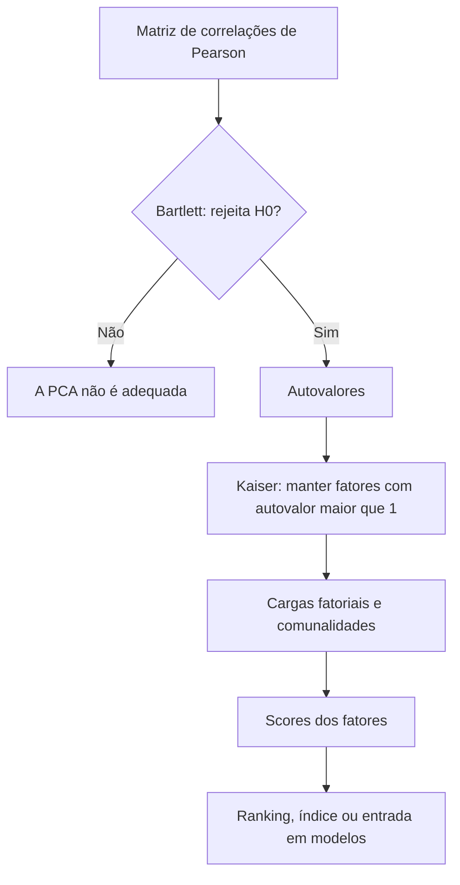

# 15 · Unsupervised ML — Análise Fatorial por Componentes Principais (PCA)
**Prof. Wilson Tarantin Jr. · 2 aulas · Prioridade: alta (conceitos centrais e vocabulário que se repete em outras disciplinas)**

## O fio condutor deste capítulo

Se três variáveis medem quase a mesma coisa (renda, patrimônio, gasto mensal), guardar as três é redundante. A **análise fatorial por componentes principais (PCA)** descobre **eixos novos**, chamados **fatores**, que juntam essa informação repetida: você passa de 10 colunas para 3 fatores que explicam quase tudo. Isso é útil por três motivos: **simplifica** os dados, permite criar **índices e rankings** e fornece variáveis **sem correlação entre si**, o que elimina a **multicolinearidade** nos modelos supervisionados.

A sequência do capítulo reproduz o fluxo da análise: olhar a **matriz de correlações**, verificar se a técnica é **adequada** (Bartlett), extrair os **autovalores**, **decidir quantos fatores manter** (Kaiser), **interpretar** os fatores (cargas e comunalidades) e, por fim, usá-los para construir um **ranking**.

## 1. Objetivo e diferenças

A PCA **agrupa variáveis (colunas)** em fatores; o cluster agrupa **observações (linhas)**. É **não supervisionada**, só para variáveis **métricas**, e baseia-se na **matriz de correlações de Pearson**: por isso **não precisa padronizar** antes (o cluster precisa). Os **fatores são ortogonais** (correlação zero entre si) por construção, e cada um é uma **combinação linear** das variáveis originais. Não há caráter preditivo para observações de fora da amostra.

| Objetivo | O que significa |
|---|---|
| **Redução estrutural** | menos variáveis (5 → 2) |
| **Análise de construtos** | interpretar o que cada fator representa |
| **Rankings e índices** | combinar fatores em uma nota |
| **Fatores ortogonais** | entrada para modelos supervisionados, resolvendo a multicolinearidade |

## 2. Passo a passo

**Passo 1: a matriz de correlações.** Correlações altas (perto de ±1) indicam que poucos fatores bastam; perto de 0, a PCA não ajuda.

**Passo 2: o teste de esfericidade de Bartlett.** A hipótese nula é que a matriz de correlações é a **identidade** (as variáveis não se correlacionam). **Queremos rejeitar H0 (p < 0,05)**, porque só então há correlação a ser resumida.

**Passo 3: os autovalores (λ).** Cada autovalor mede quanto da variância das variáveis originais o fator captura. A soma dos autovalores é igual a K (o nº de variáveis), e a **proporção de variância** de cada fator é \(\lambda / K\). O primeiro fator tem o maior autovalor.

**Passo 4: quantos fatores manter?** O **critério de Kaiser** manda manter os fatores de **autovalor maior que 1**, pois um fator com λ < 1 carrega menos informação do que uma variável original isolada.

> **Exemplo resolvido.** Quatro variáveis; autovalores 2,6; 1,1; 0,2 e 0,1 (soma = 4). Variância de cada fator: 65%; 27,5%; 5%; 2,5%. Kaiser mantém os **dois primeiros** (λ > 1), que acumulam **92,5%** da variância.

**Passo 5: as cargas fatoriais (loadings).** São as **correlações** entre cada variável original e cada fator; servem para **interpretar** o fator (se as variáveis de finanças, custos e marketing têm cargas altas no fator 1, ele é um "fator de gestão"). A **rotação** (ex.: varimax) deixa a interpretação mais limpa sem mudar a variância total acumulada.

**Passo 6: a comunalidade.** É a parte da variância de **cada variável original** retida pelos fatores mantidos.

> **Exemplo resolvido.** Uma variável com carga 0,8 no fator 1 e 0,3 no fator 2 tem comunalidade \(0{,}8^2 + 0{,}3^2 = 0{,}64 + 0{,}09 = 0{,}73\): 73% da sua variância é explicada pelos dois fatores.

**Passo 7: ranking ou índice.** Cada fator é ponderado pelo seu percentual de variância:

\[ R_i = F_{1i}\cdot(\%\text{var}_1) + F_{2i}\cdot(\%\text{var}_2) + \cdots \]

> **Exemplo resolvido.** Observação com \(F_1 = 1{,}2\) e \(F_2 = -0{,}4\): \(R = 1{,}2\cdot 0{,}65 + (-0{,}4)\cdot 0{,}275 = 0{,}78 - 0{,}11 = 0{,}67\). Depois ordena-se todas as observações por R.

Os fatores são calculados a partir das variáveis **padronizadas** (Z) e têm média zero.

## 3. Python

`FactorAnalyzer(n_factors=k, method='principal', rotation=None)`, `calculate_bartlett_sphericity`, `fa.get_eigenvalues()`, `fa.loadings_`, `fa.get_communalities()` e `fa.transform(df)` (scores). Exemplos da aula: desempenho de áreas de uma empresa e um banco de casas (3 fatores retêm 68,5% da variância).

## O que levar daqui

A PCA agrupa variáveis correlacionadas em poucos fatores ortogonais. Bartlett deve rejeitar H0. O autovalor mede a variância capturada; Kaiser mantém λ > 1. Cargas são correlações; comunalidade é a variância de cada variável retida pelos fatores; ranking é a soma ponderada dos fatores. Resolve multicolinearidade em modelos supervisionados.

## Erros que todo mundo comete

| Erro | Correção |
|---|---|
| "PCA agrupa observações" | agrupa **variáveis**; observações → cluster |
| "No Bartlett queremos não rejeitar H0" | queremos **rejeitar** H0 |
| Manter fatores com autovalor < 1 | Kaiser: manter **λ > 1** |
| "Cargas são pesos que multiplicam a variável" | cargas são **correlações** variável–fator |
| "A rotação muda a variância total" | **não** muda a variância acumulada nem as comunalidades |
| "PCA serve para categóricas" | só **métricas**; categóricas → ANACOR/ACM |

## Teste-se

1. Por que a PCA ajuda a resolver multicolinearidade?

Ver resposta
Porque os fatores são ortogonais (correlação zero); usá-los como regressores elimina a correlação entre preditores.

2. Qual a H0 do teste de Bartlett e qual decisão desejamos?

Ver resposta
H0: a matriz de correlações é a identidade. Queremos rejeitá-la (p < 0,05).

3. Autovalores 2,6; 1,1; 0,2; 0,1. Quantos fatores pelo critério de Kaiser?

Ver resposta
Dois (os de autovalor maior que 1).

4. O que é comunalidade?

Ver resposta
A proporção da variância de uma variável original retida pelos fatores mantidos.

## Pergunta típica
O que difere PCA de cluster (variáveis × observações) · quando a análise é adequada (Bartlett: rejeitar H0) · critério de Kaiser (autovalor > 1) · o que é autovalor/% de variância · o que são cargas fatoriais e comunalidades · por que fatores são ortogonais e como isso ajuda em modelos supervisionados · como montar um ranking com soma ponderada · PCA exige variáveis métricas
