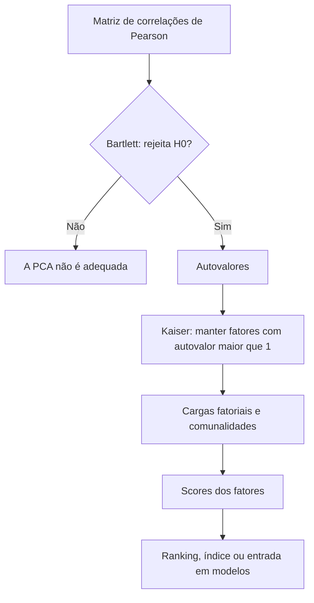

# 15 · Unsupervised ML — Análise Fatorial por Componentes Principais (PCA)
**Prof. Wilson Tarantin Jr. · 2 aulas · Prioridade: alta (conceitos centrais e vocabulário que se repete em outras disciplinas)**

## O fio condutor deste capítulo

Se três variáveis medem quase a mesma coisa (renda, patrimônio, gasto mensal), guardar as três é redundante. A **análise fatorial por componentes principais (PCA)** descobre **eixos novos**, chamados **fatores**, que juntam essa informação repetida: você passa de 10 colunas para 3 fatores que explicam quase tudo. Isso é útil por três motivos: **simplifica** os dados, permite criar **índices e rankings** e fornece variáveis **sem correlação entre si**, o que elimina a **multicolinearidade** nos modelos supervisionados.

A sequência do capítulo reproduz o fluxo da análise: olhar a **matriz de correlações**, verificar se a técnica é **adequada** (Bartlett), extrair os **autovalores**, **decidir quantos fatores manter** (Kaiser), **interpretar** os fatores (cargas e comunalidades) e, por fim, usá-los para construir um **ranking**.



## 1. Objetivo e diferenças

A PCA **agrupa variáveis (colunas)** em fatores; o cluster agrupa **observações (linhas)**. É **não supervisionada**, só para variáveis **métricas**, e baseia-se na **matriz de correlações de Pearson**: por isso **não precisa padronizar** antes (o cluster precisa). Os **fatores são ortogonais** (correlação zero entre si) por construção, e cada um é uma **combinação linear** das variáveis originais. Não há caráter preditivo para observações de fora da amostra.

| Objetivo | O que significa |
|---|---|
| **Redução estrutural** | menos variáveis (5 → 2) |
| **Análise de construtos** | interpretar o que cada fator representa |
| **Rankings e índices** | combinar fatores em uma nota |
| **Fatores ortogonais** | entrada para modelos supervisionados, resolvendo a multicolinearidade |

## 2. Passo a passo

**Passo 1: a matriz de correlações.** Correlações altas (perto de ±1) indicam que poucos fatores bastam; perto de 0, a PCA não ajuda.

**Passo 2: o teste de esfericidade de Bartlett.** A hipótese nula é que a matriz de correlações é a **identidade** (as variáveis não se correlacionam). **Queremos rejeitar H0 (p < 0,05)**, porque só então há correlação a ser resumida.

**Passo 3: os autovalores (λ).** Cada autovalor mede quanto da variância das variáveis originais o fator captura. A soma dos autovalores é igual a K (o nº de variáveis), e a **proporção de variância** de cada fator é \(\lambda / K\). O primeiro fator tem o maior autovalor.

**Passo 4: quantos fatores manter?** O **critério de Kaiser** manda manter os fatores de **autovalor maior que 1**, pois um fator com λ < 1 carrega menos informação do que uma variável original isolada.


> **Exemplo resolvido.** Quatro variáveis; autovalores 2,6; 1,1; 0,2 e 0,1 (soma = 4). Variância de cada fator: 65%; 27,5%; 5%; 2,5%. Kaiser mantém os **dois primeiros** (λ > 1), que acumulam **92,5%** da variância.

**Passo 5: as cargas fatoriais (loadings).** São as **correlações** entre cada variável original e cada fator; servem para **interpretar** o fator (se as variáveis de finanças, custos e marketing têm cargas altas no fator 1, ele é um "fator de gestão"). A **rotação** (ex.: varimax) deixa a interpretação mais limpa sem mudar a variância total acumulada.

**Passo 6: a comunalidade.** É a parte da variância de **cada variável original** retida pelos fatores mantidos.

> **Exemplo resolvido.** Uma variável com carga 0,8 no fator 1 e 0,3 no fator 2 tem comunalidade \(0{,}8^2 + 0{,}3^2 = 0{,}64 + 0{,}09 = 0{,}73\): 73% da sua variância é explicada pelos dois fatores.

**Passo 7: ranking ou índice.** Cada fator é ponderado pelo seu percentual de variância:

\[ R_i = F_{1i}\cdot(\%\text{var}_1) + F_{2i}\cdot(\%\text{var}_2) + \cdots \]

> **Exemplo resolvido.** Observação com \(F_1 = 1{,}2\) e \(F_2 = -0{,}4\): \(R = 1{,}2\cdot 0{,}65 + (-0{,}4)\cdot 0{,}275 = 0{,}78 - 0{,}11 = 0{,}67\). Depois ordena-se todas as observações por R.

Os fatores são calculados a partir das variáveis **padronizadas** (Z) e têm média zero.

## 3. Exemplo completo da aula: indicador socioeconômico dos distritos de São Paulo

Este é o exemplo final da aula (script *Atlas SP*), reproduzido com os dados reais, do começo ao fim. **O objetivo é construir um indicador socioeconômico** a partir de várias características dos 96 distritos da cidade de São Paulo.

**Os dados.** Cada linha é um distrito; as nove colunas são variáveis métricas. O código do IBGE é só um ID e **fica de fora** (não faz sentido numa fatorial).

| Variável | O que mede |
|---|---|
| `renda` | renda média familiar do distrito |
| `quota` | cota residencial, em m² por habitante |
| `escolaridade` | média de anos de estudo da população de 4 anos ou mais |
| `idade` | idade mediana do distrito |
| `mortalidade` | taxa de mortalidade infantil |
| `txcresc` | taxa de crescimento populacional |
| `causasext` | taxa de mortalidade por causas externas (indicador ligado à segurança) |
| `favel` | % da população que vive em favelas |
| `denspop` | densidade populacional (população ÷ área) |

### Passo 1: matriz de correlações


Há dois blocos claros. De um lado, **renda, cota, escolaridade e idade** se correlacionam fortemente entre si (por exemplo, renda × cota = 0,92 e escolaridade × idade = 0,96). Do outro, **mortalidade, crescimento populacional, causas externas e favela** têm correlação **negativa** com esse primeiro bloco (escolaridade × txcresc = −0,69). A densidade populacional quase não se correlaciona com ninguém. Só de olhar, já se espera que **poucos fatores** resumam tudo.

### Passo 2: Bartlett

H0: a matriz de correlações é a identidade. Resultado: **χ² = 748,16** (36 graus de liberdade, \(9\cdot 8/2\)) e **p ≈ 0** (da ordem de 10⁻¹³⁴). Como p < 0,05, **rejeita-se H0**: existe correlação suficiente, e a PCA é adequada.

### Passo 3: autovalores e critério de Kaiser

Rodando primeiro com os 9 fatores possíveis:

| Fator | Autovalor | % da variância | % acumulada |
|---|---|---|---|
| **1** | **4,956** | **55,07%** | 55,07% |
| **2** | **1,164** | **12,94%** | **68,00%** |
| 3 | 0,996 | 11,07% | 79,07% |
| 4 | 0,724 | 8,05% | 87,12% |
| 5 | 0,529 | 5,88% | 93,00% |
| 6 | 0,398 | 4,43% | 97,43% |
| 7 | 0,130 | 1,44% | 98,87% |
| 8 | 0,065 | 0,72% | 99,59% |
| 9 | 0,037 | 0,41% | 100% |

A soma dos autovalores é **9 = K** (nº de variáveis). Como a proporção de cada um é \(\lambda/9\): \(4{,}956/9 = 55{,}07\%\).


Pelo critério de Kaiser (λ > 1), **ficam 2 fatores**, que juntos explicam **68%** da variância. Note que o terceiro autovalor (0,996) fica **por um triz** abaixo de 1: o critério é objetivo, e ele fica de fora.

Em seguida refaz-se a PCA já com `n_factors=2`.

### Passo 4: cargas fatoriais

As **cargas** são as correlações entre cada variável e cada fator:

| Variável | Fator 1 | Fator 2 |
|---|---|---|
| renda | **0,832** | −0,369 |
| quota | **0,901** | −0,226 |
| escolaridade | **0,967** | 0,025 |
| idade | **0,960** | 0,065 |
| mortalidade | −0,656 | 0,177 |
| txcresc | −0,697 | −0,337 |
| causasext | −0,667 | 0,044 |
| favel | −0,457 | −0,443 |
| denspop | 0,166 | **0,793** |


**Interpretação.**

- **Fator 1 = nível socioeconômico.** Cargas **positivas altas** em renda, cota, escolaridade e idade, e **negativas** em mortalidade infantil, crescimento populacional, causas externas e favela. **Quanto maior o Fator 1, melhor a situação do distrito.** É por isso que ele serve de indicador.
- **Fator 2 = adensamento.** Quase só a densidade populacional tem carga alta (0,793); as demais ficam pequenas. Ele captura o que o primeiro fator não explica.

### Passo 5: comunalidades

\(h^2 = \) carga no F1² + carga no F2². Exemplo: **renda** = \(0{,}832^2 + (-0{,}369)^2 = 0{,}692 + 0{,}136 = 0{,}829\).

| Variável | Comunalidade |
|---|---|
| escolaridade | 0,935 |
| idade | 0,926 |
| quota | 0,862 |
| renda | 0,829 |
| denspop | 0,657 |
| txcresc | 0,599 |
| mortalidade | 0,461 |
| causasext | 0,446 |
| favel | 0,405 |

Escolaridade e idade são quase totalmente capturadas pelos dois fatores (93%). **Favela, causas externas e mortalidade** perdem mais (só 40% a 46% retidos): carregam informação que os dois fatores não resumem.

### Passo 6: os fatores de cada distrito e o ranking

Os **scores** (pesos para montar o fator a partir das variáveis padronizadas) geram um valor de Fator 1 e Fator 2 para cada distrito. Os dois fatores têm **média 0, desvio 1 e correlação 0** entre si. Na aula, o professor usa **só o Fator 1** como indicador (um critério diferente da soma ponderada) e ordena os distritos:


| Posição | Distrito | Fator 1 |
|---|---|---|
| 1º (melhor) | Jardim Paulista | 2,467 |
| 2º | Moema | 1,968 |
| 3º | Santo Amaro | 1,898 |
| ... | | |
| último | Marsilac | −2,052 |
| penúltimo | Grajaú | −1,716 |

> **Para comparar com a soma ponderada do passo 7 deste capítulo.** Jardim Paulista tem \(F_1 = 2{,}467\) e \(F_2 = -0{,}493\). Com os pesos 55,07% e 12,94%: \(R = 2{,}467 \cdot 0{,}5507 + (-0{,}493)\cdot 0{,}1294 \approx 1{,}36 - 0{,}06 = 1{,}29\).

Por fim, o Fator 1 foi dividido em **6 faixas** (sextis) e pintado no mapa: o miolo da cidade concentra as faixas mais altas, e as periferias (extremos sul, leste e norte) concentram as mais baixas.


**O que levar deste exemplo:** correlações fortes (e em dois blocos) → Bartlett rejeita H0 → autovalores → Kaiser mantém 2 fatores (68%) → cargas mostram que o F1 é "nível socioeconômico" → ranking e mapa. Todo o fluxo do capítulo, num caso real.

## 4. Python

`FactorAnalyzer(n_factors=k, method='principal', rotation=None)`, `calculate_bartlett_sphericity`, `fa.get_eigenvalues()`, `fa.loadings_`, `fa.get_communalities()` e `fa.transform(df)` (scores). O núcleo do script do exemplo acima:

```python
atlas = pd.read_excel("atlas_ambiental.xlsx")
atlas_pca = atlas.drop(columns=['cód_ibge', 'distritos'])     # só as 9 métricas

corr = atlas_pca.corr()                                        # passo 1
bartlett, p = calculate_bartlett_sphericity(atlas_pca)         # passo 2

fa = FactorAnalyzer(n_factors=9, method='principal', rotation=None).fit(atlas_pca)
autovalores = fa.get_eigenvalues()[0]                          # passo 3

fa = FactorAnalyzer(n_factors=2, method='principal', rotation=None).fit(atlas_pca)
fa.get_factor_variance()       # autovalor, variância e variância acumulada
fa.loadings_                   # passo 4: cargas
fa.get_communalities()         # passo 5
fatores = pd.DataFrame(fa.transform(atlas_pca))                # passo 6: scores
```

A aula tem ainda outros exemplos de aplicação: notas de estudantes em quatro disciplinas, preço de casas e empréstimo bancário (no banco de casas, 3 fatores têm autovalor maior que 1 e retêm cerca de 68% da variância).

## O que levar daqui

A PCA agrupa variáveis correlacionadas em poucos fatores ortogonais. Bartlett deve rejeitar H0. O autovalor mede a variância capturada; Kaiser mantém λ > 1. Cargas são correlações; comunalidade é a variância de cada variável retida pelos fatores; ranking é a soma ponderada dos fatores. Resolve multicolinearidade em modelos supervisionados.

## Erros que todo mundo comete

| Erro | Correção |
|---|---|
| "PCA agrupa observações" | agrupa **variáveis**; observações → cluster |
| "No Bartlett queremos não rejeitar H0" | queremos **rejeitar** H0 |
| Manter fatores com autovalor < 1 | Kaiser: manter **λ > 1** |
| "Cargas são pesos que multiplicam a variável" | cargas são **correlações** variável–fator |
| "A rotação muda a variância total" | **não** muda a variância acumulada nem as comunalidades |
| "PCA serve para categóricas" | só **métricas**; categóricas → ANACOR/ACM |

## Teste-se

1. Por que a PCA ajuda a resolver multicolinearidade?
<details markdown="1"><summary>Ver resposta</summary>Porque os fatores são ortogonais (correlação zero); usá-los como regressores elimina a correlação entre preditores.</details>

2. Qual a H0 do teste de Bartlett e qual decisão desejamos?
<details markdown="1"><summary>Ver resposta</summary>H0: a matriz de correlações é a identidade. Queremos rejeitá-la (p < 0,05).</details>

3. Autovalores 2,6; 1,1; 0,2; 0,1. Quantos fatores pelo critério de Kaiser?
<details markdown="1"><summary>Ver resposta</summary>Dois (os de autovalor maior que 1).</details>

4. O que é comunalidade?
<details markdown="1"><summary>Ver resposta</summary>A proporção da variância de uma variável original retida pelos fatores mantidos.</details>

## Pergunta típica
O que difere PCA de cluster (variáveis × observações) · quando a análise é adequada (Bartlett: rejeitar H0) · critério de Kaiser (autovalor > 1) · o que é autovalor/% de variância · o que são cargas fatoriais e comunalidades · por que fatores são ortogonais e como isso ajuda em modelos supervisionados · como montar um ranking com soma ponderada · PCA exige variáveis métricas
