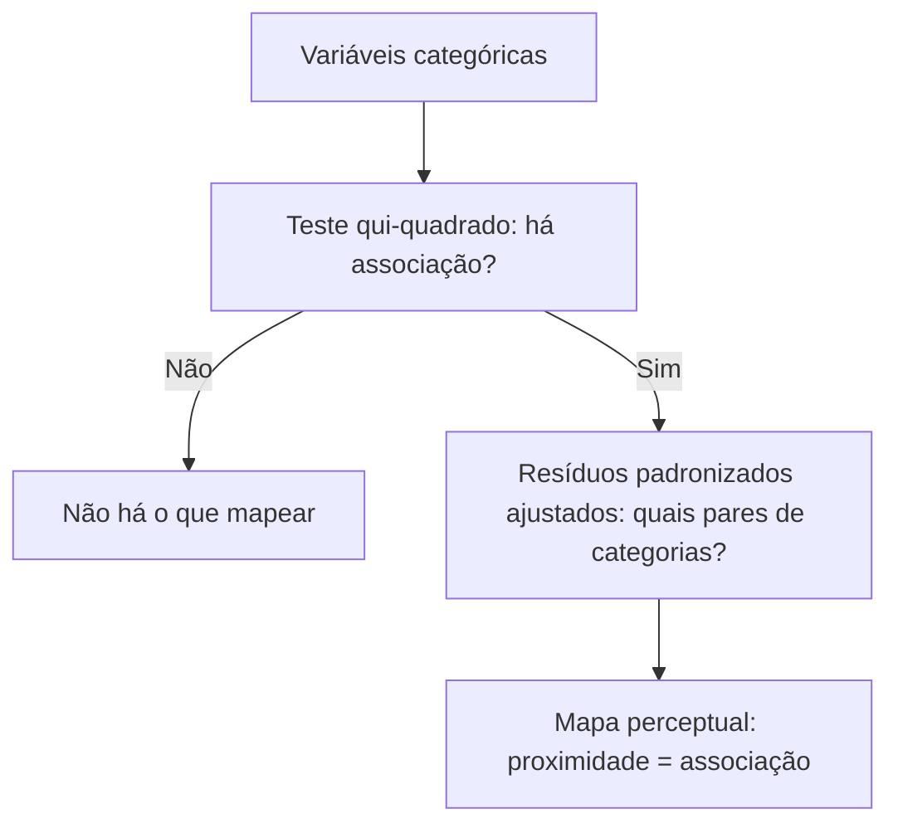

# 16 · Unsupervised ML — Análise de Correspondência (ANACOR e ACM) + Exercícios Aplicados
**Prof. Wilson Tarantin Jr. · 3 aulas · Prioridade: alta (fecha o bloco não supervisionado; "qual técnica para qual tipo de variável" é cobrado sempre)**

## O fio condutor deste capítulo

Cluster e PCA exigem números. Mas muitos dados são **categorias**: escola pública ou privada, perfil do investidor, tipo de aplicação. Não dá para tirar a média de "pública", e codificar categorias como 1, 2, 3 cria uma **ponderação arbitrária**. A **análise de correspondência** resolve isso usando **contagens**: ela primeiro verifica se existe **associação** entre as variáveis (com o qui-quadrado que você já viu) e, havendo, desenha um **mapa** em que **categorias próximas estão associadas**.

O capítulo tem duas versões da técnica: a **ANACOR** (simples), para duas variáveis, e a **ACM** (múltipla), para três ou mais. Ao final, uma visão integrada mostra como escolher entre cluster, PCA e correspondência.

## 1. Objetivo

A técnica serve a **variáveis categóricas** e verifica a **associação entre as variáveis e entre suas categorias**, produzindo o **mapa perceptual**. Uma variável métrica entra se for **categorizada** antes (faixas de idade). É **exploratória** (interdependência), **sem inferência** para fora da amostra; novas observações exigem refazer a análise. A **ANACOR** usa **duas** variáveis; a **ACM (MCA)**, **três ou mais**.

## 2. ANACOR em duas etapas

### Etapa 1: existe associação? (teste qui-quadrado)

Monta-se a **tabela de contingência** (frequências observadas). Para cada célula calcula-se a **esperada**, o que se veria se as variáveis fossem independentes, e compara-se com a observada:

\[ E = \frac{\text{total da linha}\times\text{total da coluna}}{N} \qquad \chi^2 = \sum \frac{(O - E)^2}{E} \qquad gl = (I-1)(J-1) \]

A **H0** é que as variáveis são **independentes** (associação aleatória). **p < α → rejeita H0 → há associação.** O teste é **global**: só se houver associação vale seguir para a etapa 2.

### Etapa 2: quais categorias se associam?

O **resíduo padronizado ajustado**, quando **maior que 1,96** (nível de 5%), indica **associação significativa entre aquelas duas categorias** (um excesso de ocorrências no cruzamento). O **mapa perceptual** é construído a partir dos **autovalores** (inércias principais parciais): o número de dimensões é \(m = \min(I-1, J-1)\); a **inércia total** é a soma dos autovalores, igual a \(\chi^2 / N\); e o **percentual de inércia por dimensão** é \(\lambda / \text{inércia total}\). Quanto maior a inércia, mais forte a associação. As **massas** indicam o peso (representatividade) de cada categoria. **Leitura do mapa: categorias próximas = associadas.**

> **Exemplo resolvido.** Escola (pública/privada) × aprovação (sim/não), N = 200. Observados: pública 30 sim e 70 não; privada 60 sim e 40 não. Totais: linhas 100/100; colunas 90 (sim) e 110 (não).
> **Esperados:** 45; 55; 45; 55. **Resíduos:** −15; +15; +15; −15.
> \(\chi^2 = \frac{225}{45} + \frac{225}{55} + \frac{225}{45} + \frac{225}{55} \approx 5 + 4{,}09 + 5 + 4{,}09 = 18{,}2\), com gl = 1: **rejeita H0, há associação**.
> O resíduo padronizado ajustado da célula (pública, sim) é ≈ −15 ÷ 3,52 ≈ **−4,3**: pública está **menos** associada a "sim" e privada, **mais**.
> Dimensões = mín(1, 1) = **1**; inércia total = 18,2 ÷ 200 ≈ **0,09**.

## 3. ACM (múltipla)

O **primeiro passo** é fazer o χ² **para cada par** de variáveis: **só entram na ACM as variáveis associadas a pelo menos uma outra**. O **input é o banco de dados** (e não uma única tabela de contingência). Há dois caminhos de cálculo:

| Método | Como funciona | Dimensões |
|---|---|---|
| **Matriz binária (indicadora) Z** | 0/1 para presença de cada categoria em cada observação | \(J - Q\) (J = total de categorias; Q = nº de variáveis); inércia total = \((J-Q)/Q\) |
| **Matriz de Burt** \(B = Z'Z\) | cruza todos os pares de variáveis numa única tabela e aplica a ANACOR | as mesmas |

> **Exemplo.** Três variáveis com 3, 2 e 4 categorias → \(J = 9\), \(Q = 3\) → **6 dimensões**; inércia total = \((9 - 3)/3 = 2\).

Em Python usa-se `prince.MCA`; plotam-se as dimensões de autovalor acima da média.

## 4. Visão integrada das técnicas não supervisionadas

| Técnica | Agrupa | Variáveis | Base | Saída |
|---|---|---|---|---|
| **Cluster** | **observações** | métricas | **distâncias** (padronizar) | clusters |
| **PCA** | **variáveis** | métricas | **correlações** | fatores ortogonais, índices |
| **Correspondência** | **categorias** | categóricas | **qui-quadrado** | mapa perceptual |

As técnicas podem ser **combinadas**: cluster → ANACOR; cluster com os fatores da PCA; coordenadas do mapa → cluster ou PCA. Em bancos com variáveis mistas, usa-se **mais de uma técnica**. Cuidados: remover faltantes, **nunca tirar média de categórica**, usar ANOVA para ver quais variáveis formaram os clusters, e lembrar que selecionar fatores sempre **perde informação**.

## O que levar daqui

O χ² decide se há associação (esperada = linha × coluna ÷ N; gl = (I−1)(J−1)). O resíduo ajustado > 1,96 aponta os pares significativos. A ANACOR tem mín(I−1, J−1) dimensões; a ACM, J − Q. Na ACM, filtre variáveis sem associação e use a matriz binária ou a de Burt. Cluster e PCA são para métricas; correspondência, para categóricas.

## Erros que todo mundo comete

| Erro | Correção |
|---|---|
| "ANACOR serve para métricas" | para **categóricas** (métricas só após categorizar) |
| "Associação global = todas as categorias associadas" | o χ² é **global**; o resíduo ajustado mostra **quais pares** |
| "ACM aceita qualquer variável" | só as **associadas** a ao menos uma outra |
| "Dimensões = nº de categorias" | ANACOR: **mín(I−1, J−1)**; ACM: **J − Q** |
| "Categorias distantes no mapa são associadas" | **próximas** = associadas |
| "As técnicas não supervisionadas preveem" | **não** têm caráter preditivo |

## Teste-se

1. Qual a hipótese nula do qui-quadrado de associação?

Ver resposta
As variáveis são independentes (associação aleatória).

2. Quantos graus de liberdade tem uma tabela 4×5?

Ver resposta
(4−1)(5−1) = 12.

3. O que significa um resíduo padronizado ajustado de 2,8?

Ver resposta
Excesso de ocorrências no cruzamento (> 1,96): associação significativa entre aquelas categorias.

4. Por que remover variáveis sem associação na ACM?

Ver resposta
Uma variável que não se associa a nenhuma outra não tem o que mostrar no mapa e só adiciona ruído.

5. Diferença entre ANACOR e ACM?

Ver resposta
ANACOR usa 2 variáveis categóricas; ACM usa 3 ou mais.

## Pergunta típica
Qual técnica usar para cada tipo de variável/objetivo · hipóteses do χ² e gl · significado do resíduo padronizado ajustado > 1,96 · quantas dimensões tem a ANACOR/ACM · o que mede a inércia · diferença ANACOR × ACM · por que remover variável sem associação na ACM · matriz binária × matriz de Burt · por que as técnicas não supervisionadas não preveem
