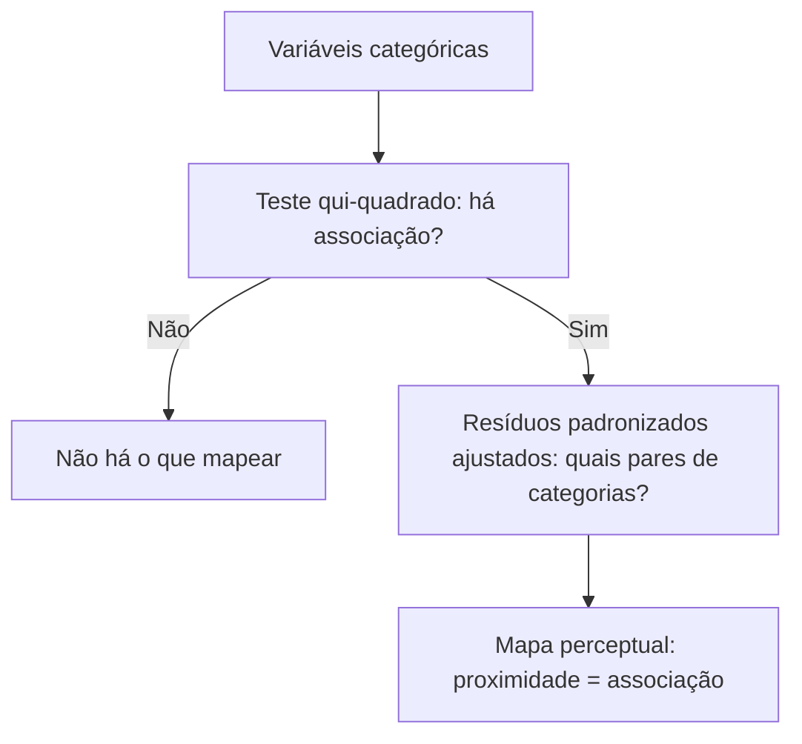

# 16 · Unsupervised ML — Análise de Correspondência (ANACOR e ACM) + Exercícios Aplicados
**Prof. Wilson Tarantin Jr. · 3 aulas · Prioridade: alta (fecha o bloco não supervisionado; "qual técnica para qual tipo de variável" é cobrado sempre)**

## O fio condutor deste capítulo

Cluster e PCA exigem números. Mas muitos dados são **categorias**: escola pública ou privada, perfil do investidor, tipo de aplicação. Não dá para tirar a média de "pública", e codificar categorias como 1, 2, 3 cria uma **ponderação arbitrária**. A **análise de correspondência** resolve isso usando **contagens**: ela primeiro verifica se existe **associação** entre as variáveis (com o qui-quadrado que você já viu) e, havendo, desenha um **mapa** em que **categorias próximas estão associadas**.

O capítulo tem duas versões da técnica: a **ANACOR** (simples), para duas variáveis, e a **ACM** (múltipla), para três ou mais. Ao final, uma visão integrada mostra como escolher entre cluster, PCA e correspondência.

## 1. Objetivo

A técnica serve a **variáveis categóricas** e verifica a **associação entre as variáveis e entre suas categorias**, produzindo o **mapa perceptual**. Uma variável métrica entra se for **categorizada** antes (faixas de idade). É **exploratória** (interdependência), **sem inferência** para fora da amostra; novas observações exigem refazer a análise. A **ANACOR** usa **duas** variáveis; a **ACM (MCA)**, **três ou mais**.

## 2. ANACOR em duas etapas

### Etapa 1: existe associação? (teste qui-quadrado)

Monta-se a **tabela de contingência** (frequências observadas). Para cada célula calcula-se a **esperada**, o que se veria se as variáveis fossem independentes, e compara-se com a observada:

\[ E = \frac{\text{total da linha}\times\text{total da coluna}}{N} \qquad \chi^2 = \sum \frac{(O - E)^2}{E} \qquad gl = (I-1)(J-1) \]

A **H0** é que as variáveis são **independentes** (associação aleatória). **p < α → rejeita H0 → há associação.** O teste é **global**: só se houver associação vale seguir para a etapa 2.

### Etapa 2: quais categorias se associam?

O **resíduo padronizado ajustado**, quando **maior que 1,96** (nível de 5%), indica **associação significativa entre aquelas duas categorias** (um excesso de ocorrências no cruzamento). O **mapa perceptual** é construído a partir dos **autovalores** (inércias principais parciais): o número de dimensões é \(m = \min(I-1, J-1)\); a **inércia total** é a soma dos autovalores, igual a \(\chi^2 / N\); e o **percentual de inércia por dimensão** é \(\lambda / \text{inércia total}\). Quanto maior a inércia, mais forte a associação. As **massas** indicam o peso (representatividade) de cada categoria. **Leitura do mapa: categorias próximas = associadas.**

### Exemplo completo (da aula): perfil de investidor × tipo de aplicação

100 estudantes responderam a duas perguntas: seu **perfil de investidor** (Agressivo, Conservador ou Moderado) e o **tipo de aplicação** que escolheram (Ações, CDB ou Poupança). A pergunta é: *o perfil se associa ao tipo de aplicação? E quais categorias se associam?*

**Passo 1: tabela de contingência (frequências observadas).**

| Perfil \ Aplicação | Ações | CDB | Poupança | Total |
|---|---|---|---|---|
| **Agressivo** | 36 | 20 | 2 | **58** |
| **Conservador** | 5 | 4 | 8 | **17** |
| **Moderado** | 4 | 16 | 5 | **25** |
| **Total** | **45** | **40** | **15** | **100** |

**Passo 2: frequências esperadas** (se perfil e aplicação fossem independentes): \(E = \frac{\text{total da linha}\times\text{total da coluna}}{N}\). Por exemplo, Agressivo × Ações: \(58 \times 45 / 100 = 26{,}10\).

| Perfil \ Aplicação | Ações | CDB | Poupança |
|---|---|---|---|
| Agressivo | 26,10 | 23,20 | 8,70 |
| Conservador | 7,65 | 6,80 | 2,55 |
| Moderado | 11,25 | 10,00 | 3,75 |

Já dá para ver as diferenças: agressivos **observados 36** em ações, contra **26,1 esperados**; conservadores **observados 8** em poupança, contra **2,55 esperados**.

**Passo 3: qui-quadrado.** Cada célula contribui com \((O-E)^2/E\). Para Agressivo × Ações: \((36-26{,}10)^2/26{,}10 = 98{,}01/26{,}10 = 3{,}76\). Somando as 9 células: **χ² = 31,76**, com \(gl = (3-1)(3-1) = 4\) e **p ≈ 0,000002**. Como p < 0,05, **rejeita-se H0 (independência)**: **há associação** entre perfil e aplicação, e vale seguir para a etapa 2.

**De onde vem o p-valor?** O p-valor é a **probabilidade, se H0 fosse verdadeira (variáveis independentes), de obter um χ² tão grande quanto o observado ou maior**. Ele é a **área da cauda direita** da distribuição qui-quadrado com 4 graus de liberdade, à direita de 31,76. Quanto maior o χ² (mais distante o observado do esperado), menor essa área. Como calcular:

- **No Excel:** `=DIST.QUI.QUAD.CD(31,76; 4)` (ou `=1 - DIST.QUI.QUAD(31,76; 4; VERDADEIRO)`) → 0,0000021.
- **No Python:** `from scipy.stats import chi2; chi2.sf(31.76, 4)` → 2,1 × 10⁻⁶ (a função `sf` é a "survival function", 1 − CDF; é a cauda direita).
- **À mão, só para 4 graus de liberdade** (existe fórmula fechada): \(p = e^{-\chi^2/2}\left(1 + \frac{\chi^2}{2}\right) = e^{-15{,}88}\times(1 + 15{,}88) = 1{,}27\times 10^{-7}\times 16{,}88 = 2{,}1\times 10^{-6}\).
- **Pela tabela:** o valor crítico da qui-quadrado com 4 gl a 5% é **9,49**. Como 31,76 está **muito além** de 9,49 (a área à direita de 9,49 já é de apenas 5%), o p-valor é muito menor que 5%. A tabela dá só a faixa; o Excel e o Python dão o número exato.

Ou seja, só haveria 2 chances em um milhão de ver uma discrepância dessas por puro acaso se perfil e aplicação fossem independentes. Por isso se rejeita H0.

**Passo 4: resíduos padronizados ajustados** (a etapa 2). Para Agressivo × Ações:

\[ \text{res.} = \frac{O - E}{\sqrt{E\,(1 - \text{prop. linha})(1 - \text{prop. coluna})}} = \frac{36 - 26{,}10}{\sqrt{26{,}10 \times 0{,}42 \times 0{,}55}} = \frac{9{,}90}{2{,}455} = 4{,}03 \]

| Perfil \ Aplicação | Ações | CDB | Poupança |
|---|---|---|---|
| Agressivo | **4,03** | −1,32 | **−3,80** |
| Conservador | −1,42 | −1,52 | **4,06** |
| Moderado | **−3,37** | **2,83** | 0,81 |

Valores acima de **+1,96** ou abaixo de **−1,96** (em negrito) são significativos. Leitura: **agressivos** se associam a **ações** (e evitam poupança); **conservadores** se associam a **poupança**; **moderados** se associam a **CDB** (e evitam ações). Os demais cruzamentos (por exemplo, Conservador × Ações) **não** são significativos.

**Passo 5: dimensões e inércia.** O nº de dimensões é \(\min(I-1, J-1) = \min(2, 2) = \mathbf{2}\). A **inércia total** é \(\chi^2/N = 31{,}76/100 = \mathbf{0{,}3176}\) (quanto maior, mais forte a associação). Ela se divide entre as dimensões:

| Dimensão | Inércia principal (autovalor) | % da inércia |
|---|---|---|
| 1 | 0,2332 | **73,4%** |
| 2 | 0,0844 | 26,6% |
| **Total** | **0,3176** | 100% |

As **massas** (representatividade de cada categoria) são as proporções marginais: perfis 58% / 17% / 25% e aplicações 45% / 40% / 15%.

**De onde vêm os autovalores (0,2332 e 0,0844)?** Saem de uma matriz construída com a própria tabela, em 4 passos:

1. **Proporções e massas.** Divide-se cada célula por N = 100. As massas são os totais de linha e de coluna em proporção: perfis Agressivo 0,58, Conservador 0,17, Moderado 0,25; aplicações Ações 0,45, CDB 0,40, Poupança 0,15.
2. **A matriz S (resíduos padronizados).** Para cada célula, \(s_{ij} = \dfrac{p_{ij} - r_i\,c_j}{\sqrt{r_i\,c_j}}\), em que \(p_{ij}\) é a proporção observada e \(r_i\,c_j\) é a esperada pela independência. Para Agressivo × Ações: \(p = 0{,}36\), \(r\,c = 0{,}58\times 0{,}45 = 0{,}261\), então \(s = (0{,}36 - 0{,}261)/\sqrt{0{,}261} = 0{,}1938\).

| | Ações | CDB | Poupança |
|---|---|---|---|
| Agressivo | 0,1938 | −0,0664 | −0,2272 |
| Conservador | −0,0958 | −0,1074 | 0,3413 |
| Moderado | −0,2162 | 0,1897 | 0,0645 |

   **Conferência:** a soma dos quadrados das 9 células é **0,3176**, a inércia total (χ² ÷ N).

3. **Os autovalores** são os autovalores da matriz \(S^\top S\) (3×3):

| | | |
|---|---|---|
| 0,0935 | −0,0436 | −0,0907 |
| −0,0436 | 0,0519 | −0,0093 |
| −0,0907 | −0,0093 | 0,1722 |

   Um autovalor é **sempre zero** (a matriz tem posto 2, porque os totais de linha e de coluna já foram "usados"). Os outros dois saem de uma equação do 2º grau: \(\lambda^2 - (\text{soma da diagonal})\,\lambda + (\text{soma dos menores } 2\times 2) = 0\). A soma da diagonal é 0,0935 + 0,0519 + 0,1722 = **0,3176**, e a soma dos três menores 2×2 é 0,00295 + 0,00788 + 0,00885 = **0,01968**:

\[ \lambda^2 - 0{,}3176\,\lambda + 0{,}01968 = 0 \;\Rightarrow\; \lambda = \frac{0{,}3176 \pm \sqrt{0{,}3176^2 - 4(0{,}01968)}}{2} = \frac{0{,}3176 \pm 0{,}1488}{2} \]

   \(\lambda_1 = 0{,}4664/2 = \) **0,2332** e \(\lambda_2 = 0{,}1688/2 = \) **0,0844**.

4. **O percentual de cada dimensão** é o autovalor dividido pela inércia total: \(0{,}2332/0{,}3176 = 73{,}4\%\) e \(0{,}0844/0{,}3176 = 26{,}6\%\).

Em tabelas maiores ninguém faz isso à mão: o software faz a mesma decomposição (SVD). O que vale lembrar: os autovalores **somam a inércia total** (0,3176 = χ² ÷ N), o primeiro é a dimensão que mais explica a associação, e o mapa perceptual usa as duas dimensões com esses autovalores.

**Passo 6: o mapa perceptual.**

Categorias **próximas** estão associadas: **Agressivo** perto de **Ações**, **Conservador** perto de **Poupança** e **Moderado** perto de **CDB**, confirmando o que os resíduos já tinham mostrado. A primeira dimensão (73,4%) separa, basicamente, o lado "arrojado" (Agressivo, Ações) do lado "seguro" (Poupança, Conservador).

## 3. ACM (múltipla)

O **primeiro passo** é fazer o χ² **para cada par** de variáveis: **só entram na ACM as variáveis associadas a pelo menos uma outra**. O **input é o banco de dados** (e não uma única tabela de contingência). Há dois caminhos de cálculo:

| Método | Como funciona | Dimensões |
|---|---|---|
| **Matriz binária (indicadora) Z** | 0/1 para presença de cada categoria em cada observação | \(J - Q\) (J = total de categorias; Q = nº de variáveis); inércia total = \((J-Q)/Q\) |
| **Matriz de Burt** \(B = Z'Z\) | cruza todos os pares de variáveis numa única tabela e aplica a ANACOR | as mesmas |

### Exemplo completo (da aula): perfil × aplicação × estado civil

Os mesmos 100 estudantes ganham uma terceira variável: o **estado civil** (Casado: 43, Solteiro: 57). Agora são **três** variáveis categóricas, então o caso é de ACM.

**Passo 1: qui-quadrado para cada par de variáveis.** Só entram na ACM as variáveis associadas a pelo menos uma outra.

| Par de variáveis | χ² | gl | p-valor | Associação? |
|---|---|---|---|---|
| perfil × aplicação | 31,76 | 4 | 0,000002 | sim |
| perfil × estado civil | 11,44 | 2 | 0,0033 | sim |
| aplicação × estado civil | 17,86 | 2 | 0,00013 | sim |

Todos os pares têm p < 0,05, então **as três variáveis ficam na análise** (nenhuma é excluída).

**Passo 2: quantas dimensões.** O nº de categorias é J = 3 + 3 + 2 = **8** e o nº de variáveis é Q = **3**, então são \(J - Q = 8 - 3 = \mathbf{5}\) dimensões, e a inércia total é \((J-Q)/Q = 5/3 = \mathbf{1{,}667}\).

**Passo 3: inércias principais.**

| Dimensão | Inércia (autovalor) | % da inércia | Acima da média (0,333)? |
|---|---|---|---|
| **1** | **0,602** | 36,1% | sim |
| **2** | **0,436** | 26,2% | sim |
| 3 | 0,276 | 16,6% | não |
| 4 | 0,180 | 10,8% | não |
| 5 | 0,172 | 10,3% | não |
| **Total** | **1,667** | 100% | |

A **média** das inércias é \(1{,}667/5 = 0{,}333\). Mantêm-se as dimensões **acima da média**: duas, que juntas explicam **62,3%** da inércia.

**Passo 4: o mapa.**

Categorias próximas se associam. **Agressivo, Solteiro e Ações** ficam no mesmo lado (à direita); **Conservador e Poupança** formam outro grupo (embaixo, à esquerda); **Moderado e CDB** formam o terceiro (em cima). O estado **Casado** fica do lado dos perfis mais prudentes. (Os valores exatos das coordenadas e da inércia podem variar um pouco conforme a normalização do pacote; aqui foram calculados pela matriz indicadora, que é o método descrito acima.)

Em Python usa-se `prince.MCA`; plotam-se as dimensões de autovalor acima da média.

## 4. Visão integrada das técnicas não supervisionadas

| Técnica | Agrupa | Variáveis | Base | Saída |
|---|---|---|---|---|
| **Cluster** | **observações** | métricas | **distâncias** (padronizar) | clusters |
| **PCA** | **variáveis** | métricas | **correlações** | fatores ortogonais, índices |
| **Correspondência** | **categorias** | categóricas | **qui-quadrado** | mapa perceptual |

As técnicas podem ser **combinadas**: cluster → ANACOR; cluster com os fatores da PCA; coordenadas do mapa → cluster ou PCA. Em bancos com variáveis mistas, usa-se **mais de uma técnica**. Cuidados: remover faltantes, **nunca tirar média de categórica**, usar ANOVA para ver quais variáveis formaram os clusters, e lembrar que selecionar fatores sempre **perde informação**.

## O que levar daqui

O χ² decide se há associação (esperada = linha × coluna ÷ N; gl = (I−1)(J−1)). O resíduo ajustado > 1,96 aponta os pares significativos. A ANACOR tem mín(I−1, J−1) dimensões; a ACM, J − Q. Na ACM, filtre variáveis sem associação e use a matriz binária ou a de Burt. Cluster e PCA são para métricas; correspondência, para categóricas.

## Erros que todo mundo comete

| Erro | Correção |
|---|---|
| "ANACOR serve para métricas" | para **categóricas** (métricas só após categorizar) |
| "Associação global = todas as categorias associadas" | o χ² é **global**; o resíduo ajustado mostra **quais pares** |
| "ACM aceita qualquer variável" | só as **associadas** a ao menos uma outra |
| "Dimensões = nº de categorias" | ANACOR: **mín(I−1, J−1)**; ACM: **J − Q** |
| "Categorias distantes no mapa são associadas" | **próximas** = associadas |
| "As técnicas não supervisionadas preveem" | **não** têm caráter preditivo |

## Teste-se

1. Qual a hipótese nula do qui-quadrado de associação?

Ver resposta
As variáveis são independentes (associação aleatória).

2. Quantos graus de liberdade tem uma tabela 4×5?

Ver resposta
(4−1)(5−1) = 12.

3. O que significa um resíduo padronizado ajustado de 2,8?

Ver resposta
Excesso de ocorrências no cruzamento (> 1,96): associação significativa entre aquelas categorias.

4. Por que remover variáveis sem associação na ACM?

Ver resposta
Uma variável que não se associa a nenhuma outra não tem o que mostrar no mapa e só adiciona ruído.

5. Diferença entre ANACOR e ACM?

Ver resposta
ANACOR usa 2 variáveis categóricas; ACM usa 3 ou mais.

## Pergunta típica
Qual técnica usar para cada tipo de variável/objetivo · hipóteses do χ² e gl · significado do resíduo padronizado ajustado > 1,96 · quantas dimensões tem a ANACOR/ACM · o que mede a inércia · diferença ANACOR × ACM · por que remover variável sem associação na ACM · matriz binária × matriz de Burt · por que as técnicas não supervisionadas não preveem
