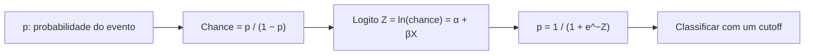

# 18 · Supervised ML — Modelos Logísticos Binários e Multinomiais
**Prof. Dr. Luiz Paulo Fávero · 2 aulas · Prioridade: alta (classificação; "qual modelo", logito, cutoff e ROC)**
*Itens marcados com (†) são padrão da disciplina e complementam o que o professor mostrou nas lousas.*

## O fio condutor deste capítulo

Se Y é "cliente deu calote (1) ou não (0)", uma reta de regressão pode prever −0,3 ou 1,4: probabilidades impossíveis. A saída é modelar não a probabilidade \(p\), mas uma transformação dela, o **logito**, que é linear em X e pode ir de −∞ a +∞; depois uma função em forma de "S" (a **logística**) converte o logito de volta em uma probabilidade entre 0 e 1.

O capítulo vai nesta ordem: primeiro as ferramentas de linguagem (probabilidade, **chance** e logito); depois como o modelo é **estimado** (máxima verossimilhança) e testado; em seguida como **avaliar a eficiência** (cutoff, matriz de confusão, sensibilidade, especificidade e ROC); e por fim a extensão para **mais de duas categorias** (multinomial).

## 1. Quando usar

É a técnica **supervisionada** para **explicar ou predizer a probabilidade de um evento**. Y é **qualitativa**: **binária** (2 categorias) → logística **binária**; **3 ou mais** → **multinomial**. As variáveis X podem ser métricas ou qualitativas (dummies, n − 1). Os objetivos são **atribuir probabilidades** e **classificar** observações. Os erros a evitar são usar OLS quando Y é qualitativa e usar pesos arbitrários em X qualitativas. **Não é preciso** balancear as classes nem separar treino e teste: todos os dados estimam o modelo. Aplicações: atraso, falha de componente, recuperação judicial, **crédito e default**, fidelidade de clientes.

## 2. Probabilidade, chance e logito

A **chance (odds)** compara o evento com o não evento: \(\text{chance} = \frac{p}{1-p}\). Com p = 0,50, a chance é 1; com 0,75, é 3; com 0,25, é 1/3. O **logito** é o logaritmo da chance e é **linear** nas variáveis; isolando \(p\) obtém-se a **função logística**:

\[ Z = \ln\!\left(\frac{p}{1-p}\right) = \alpha + \beta_1 X_1 + \cdots + \beta_k X_k \qquad\Longleftrightarrow\qquad p = \frac{1}{1 + e^{-Z}} \]

(†) **Razão de chances:** \(e^{\beta}\) mostra quanto a **chance** do evento é multiplicada quando X sobe uma unidade. \(\beta > 0\) aumenta a probabilidade; \(\beta < 0\) diminui.

> **Exemplo resolvido.** \(Z = -2 + 0{,}5X\), com \(X = 6\): \(Z = 1\) e \(p = \frac{1}{1 + e^{-1}} = 0{,}73\). Já \(e^{0{,}5} \approx 1{,}65\): cada unidade a mais de X multiplica a chance por 1,65 (aumento de cerca de 65%).

## 3. Estimação: máxima verossimilhança

Y segue uma **Bernoulli**, e a **função objetivo é maximizar o log da verossimilhança (LL)**, em processo **iterativo**. Em Python: `smf.logit('y ~ x1 + x2', data=df).fit()`, com Y numérica 0/1.

| Medida | Para quê |
|---|---|
| **Teste χ² (razão de verossimilhança)** | compara o modelo com o **nulo** (só intercepto); **p < 5% → ao menos um β ≠ 0** (equivale ao F) |
| **Teste z de Wald** | cada parâmetro (equivale ao t) |
| **Pseudo-R² de McFadden** | \(1 - LL/LL_0\); **não** é variância explicada |

> **Exemplo.** LL do modelo = −60; LL do nulo = −100 → McFadden = \(1 - \frac{-60}{-100} = 0{,}40\).

## 4. Eficiência: cutoff, matriz de confusão e ROC

O **cutoff** é a probabilidade a partir da qual se classifica como evento (\(\hat{p} \geq\) cutoff → 1; padrão 0,5). **Baixar o cutoff aumenta a sensibilidade**, ao custo de mais falsos positivos. Os acertos e erros ficam na **matriz de confusão**:

| | Previsto 1 | Previsto 0 |
|---|---|---|
| **Real 1** | VP (verdadeiro positivo) | FN (falso negativo) |
| **Real 0** | FP (falso positivo) | VN (verdadeiro negativo) |

\[ \text{Acurácia} = \frac{VP + VN}{\text{total}} \qquad \text{Sensibilidade} = \frac{VP}{VP + FN} \qquad \text{Especificidade} = \frac{VN}{VN + FP} \]

A **curva ROC** coloca a **sensibilidade** contra **(1 − especificidade)** para **todos os cutoffs**; a **AUC** (área sob a curva) mede o poder de discriminação: **0,5 é aleatório; 1 é perfeito**. Na aula, só com a idade a AUC foi ≈ 70%; com dummies, ≈ 95%.

> **Exemplo resolvido.** 200 casos: VP = 40, FN = 10, FP = 20, VN = 130. Acurácia = 170 ÷ 200 = **85%**; sensibilidade = 40 ÷ 50 = **80%**; especificidade = 130 ÷ 150 ≈ **86,7%**.

## 5. Logística multinomial

Quando Y tem **M categorias**, o modelo usa **M − 1 logitos**, cada um comparando uma categoria à **categoria de referência**. Para três categorias (0 = referência, 1 e 2):

\[ P_0 = \frac{1}{1 + e^{Z_1} + e^{Z_2}} \qquad P_1 = \frac{e^{Z_1}}{1 + e^{Z_1} + e^{Z_2}} \qquad P_2 = \frac{e^{Z_2}}{1 + e^{Z_1} + e^{Z_2}} \]

O denominador é o mesmo e as probabilidades **somam 100%**. A observação é classificada na categoria de **maior probabilidade**; por isso **não há cutoff** no multinomial.

> **Exemplo resolvido.** \(Z_1 = 0{,}5\) e \(Z_2 = -0{,}2\): \(e^{0{,}5} = 1{,}649\), \(e^{-0{,}2} = 0{,}819\), denominador = 3,467. **\(P_0 = 0{,}288\); \(P_1 = 0{,}476\); \(P_2 = 0{,}236\)** (soma = 1). Classificada na categoria 1.

## O que levar daqui

Chance = p/(1−p); logito = ln(chance) = α + βX; p = 1/(1+e⁻ᶻ); e^β é a razão de chances. A estimação é por MLE (maximizar LL), com χ² para o modelo e z para os parâmetros. Sensibilidade = VP/(VP+FN); especificidade = VN/(VN+FP); ROC/AUC. No multinomial há M − 1 logitos e não há cutoff.

## Erros que todo mundo comete

| Erro | Correção |
|---|---|
| "OLS serve para Y binária" | gera probabilidades fora de 0–1; use **logística** |
| "McFadden é variância explicada" | **não**; compara log-likelihoods |
| "β é a variação da probabilidade" | β é a variação do **logito**; **e^β** é razão de chances |
| "O multinomial tem 1 logito" | **M − 1** logitos |
| "O multinomial usa cutoff" | **não**: vai para a categoria de maior probabilidade |
| "Baixar o cutoff aumenta a especificidade" | aumenta a **sensibilidade** |
| "É preciso balancear e separar treino/teste" | **não** nesta disciplina |
| "AUC = 0,5 é bom" | 0,5 é **aleatório** |

## Teste-se

1. Converta p = 0,8 em chance.

Ver resposta
0,8 ÷ 0,2 = 4 (4 para 1).

2. β = 0,7. O que significa e^β ≈ 2,01?

Ver resposta
Cada unidade a mais de X aproximadamente dobra a chance do evento.

3. Quantos logitos tem um Y com 4 categorias?

Ver resposta
3 (M − 1), cada um contra a referência.

4. Por que baixar o cutoff aumenta a sensibilidade?

Ver resposta
Mais observações passam a ser classificadas como evento, capturando mais verdadeiros positivos (ao custo de mais falsos positivos).

## Pergunta típica
Por que logística e não OLS quando Y é qualitativa · logito, chance e probabilidade (converter p ↔ chance) · fórmula p = 1/(1+e⁻ᶻ) · por que MLE e qual a função objetivo · χ² × z de Wald · para que serve o cutoff · sensibilidade × especificidade × ROC/AUC · quantos logitos no multinomial · por que não há cutoff no multinomial · por que não balancear nem separar treino/teste aqui
