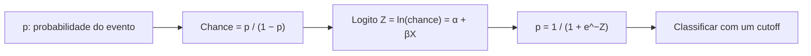

# 18 · Supervised ML — Modelos Logísticos Binários e Multinomiais
**Prof. Dr. Luiz Paulo Fávero · 2 aulas · Prioridade: alta (classificação; "qual modelo", logito, cutoff e ROC)**
*Itens marcados com (†) são padrão da disciplina e complementam o que o professor mostrou nas lousas.*

## O fio condutor deste capítulo

Se Y é "cliente deu calote (1) ou não (0)", uma reta de regressão pode prever −0,3 ou 1,4: probabilidades impossíveis. A saída é modelar não a probabilidade \(p\), mas uma transformação dela, o **logito**, que é linear em X e pode ir de −∞ a +∞; depois uma função em forma de "S" (a **logística**) converte o logito de volta em uma probabilidade entre 0 e 1.

O capítulo vai nesta ordem: primeiro as ferramentas de linguagem (probabilidade, **chance** e logito); depois como o modelo é **estimado** (máxima verossimilhança) e testado; em seguida como **avaliar a eficiência** (cutoff, matriz de confusão, sensibilidade, especificidade e ROC); e por fim a extensão para **mais de duas categorias** (multinomial).

## 1. Quando usar

É a técnica **supervisionada** para **explicar ou predizer a probabilidade de um evento**. Y é **qualitativa**: **binária** (2 categorias) → logística **binária**; **3 ou mais** → **multinomial**. As variáveis X podem ser métricas ou qualitativas (dummies, n − 1). Os objetivos são **atribuir probabilidades** e **classificar** observações. Os erros a evitar são usar OLS quando Y é qualitativa e usar pesos arbitrários em X qualitativas. **Não é preciso** balancear as classes nem separar treino e teste: todos os dados estimam o modelo. Aplicações: atraso, falha de componente, recuperação judicial, **crédito e default**, fidelidade de clientes.

## 2. Probabilidade, chance e logito

A **chance (odds)** compara o evento com o não evento: \(\text{chance} = \frac{p}{1-p}\). Com p = 0,50, a chance é 1; com 0,75, é 3; com 0,25, é 1/3. O **logito** é o logaritmo da chance e é **linear** nas variáveis; isolando \(p\) obtém-se a **função logística**:

\[ Z = \ln\!\left(\frac{p}{1-p}\right) = \alpha + \beta_1 X_1 + \cdots + \beta_k X_k \qquad\Longleftrightarrow\qquad p = \frac{1}{1 + e^{-Z}} \]

(†) **Razão de chances:** \(e^{\beta}\) mostra quanto a **chance** do evento é multiplicada quando X sobe uma unidade. \(\beta > 0\) aumenta a probabilidade; \(\beta < 0\) diminui.

### Exemplo completo (da aula): quem chega atrasado?

Dados de 100 estudantes: a variável dependente **atrasado** (1 = chegou atrasado à aula, 0 = não: 59 atrasados e 41 pontuais) e duas explicativas, a **distância** até a escola (km, média de 14,1) e a **quantidade de semáforos** no caminho (média de 10,2). Por exemplo, a Gabriela percorreu 12,5 km, passou por 7 semáforos e não se atrasou.

**Modelo estimado (máxima verossimilhança):**

| Termo | Coeficiente | Erro-padrão | z | p-valor | e^β (razão de chances) |
|---|---|---|---|---|---|
| Intercepto | −26,1665 | 8,442 | −3,10 | 0,002 | ≈ 0 |
| **dist** | **0,1904** | 0,076 | 2,49 | 0,013 | **1,21** |
| **sem** | **2,3629** | 0,795 | 2,97 | 0,003 | **10,62** |

O logito estimado é \(Z = -26{,}1665 + 0{,}1904\,\text{dist} + 2{,}3629\,\text{sem}\).

**Como ler os coeficientes.** Os betas positivos mostram que **mais distância e mais semáforos aumentam a chance de atraso**. A razão de chances \(e^\beta\) diz quanto a **chance** (odds) é multiplicada: cada **km a mais** multiplica a chance de atraso por **1,21** (+21%), e cada **semáforo a mais** por **10,62** (a chance mais que decuplica).

**Calculando a probabilidade de um estudante.** Um estudante que mora a **20 km** e passa por **10 semáforos**:

\[ Z = -26{,}1665 + 0{,}1904\times 20 + 2{,}3629\times 10 = -26{,}1665 + 3{,}808 + 23{,}629 = 1{,}27 \]

\[ p = \frac{1}{1 + e^{-1{,}27}} = \frac{1}{1 + 0{,}281} = 0{,}78 \]

**78% de probabilidade de chegar atrasado.** Se o mesmo estudante passasse por **5 semáforos**, o logito cairia para \(-10{,}5\) e a probabilidade para **0,003%**: a curva sigmoide é muito inclinada nessa região.

## 3. Estimação: máxima verossimilhança

Y segue uma **Bernoulli**, e a **função objetivo é maximizar o log da verossimilhança (LL)**, em processo **iterativo**. Em Python: `smf.logit('y ~ x1 + x2', data=df).fit()`, com Y numérica 0/1.

| Medida | Para quê |
|---|---|
| **Teste χ² (razão de verossimilhança)** | compara o modelo com o **nulo** (só intercepto); **p < 5% → ao menos um β ≠ 0** (equivale ao F) |
| **Teste z de Wald** | cada parâmetro (equivale ao t) |
| **Pseudo-R² de McFadden** | \(1 - LL/LL_0\); **não** é variância explicada |

> **Exemplo completo (os mesmos 100 estudantes).** O modelo tem log-verossimilhança **LL = −50,466**; o modelo nulo (só intercepto) tem **LL₀ = −67,686**. O **teste de razão de verossimilhança** é \(\chi^2 = -2\,(LL_0 - LL) = -2(-67{,}686 + 50{,}466) = 34{,}44\), com 2 graus de liberdade (as duas explicativas) e **p ≈ 3 × 10⁻⁸**: o modelo como um todo é significante. O **pseudo-R² de McFadden** é \(1 - \frac{-50{,}466}{-67{,}686} = \mathbf{0{,}254}\). Os testes de cada beta são do tipo **z (Wald)**, como na tabela acima.

## 4. Eficiência: cutoff, matriz de confusão e ROC

O **cutoff** é a probabilidade a partir da qual se classifica como evento (\(\hat{p} \geq\) cutoff → 1; padrão 0,5). **Baixar o cutoff aumenta a sensibilidade**, ao custo de mais falsos positivos. Os acertos e erros ficam na **matriz de confusão**:

| | Previsto 1 | Previsto 0 |
|---|---|---|
| **Real 1** | VP (verdadeiro positivo) | FN (falso negativo) |
| **Real 0** | FP (falso positivo) | VN (verdadeiro negativo) |

\[ \text{Acurácia} = \frac{VP + VN}{\text{total}} \qquad \text{Sensibilidade} = \frac{VP}{VP + FN} \qquad \text{Especificidade} = \frac{VN}{VN + FP} \]

A **curva ROC** coloca a **sensibilidade** contra **(1 − especificidade)** para **todos os cutoffs**; a **AUC** (área sob a curva) mede o poder de discriminação: **0,5 é aleatório; 1 é perfeito**. Na aula, só com a idade a AUC foi ≈ 70%; com dummies, ≈ 95%.

> **Exemplo completo (os mesmos 100 estudantes).** Com cada probabilidade estimada, classifica-se como "atrasado" quem tem \(p \geq\) **cutoff**. Três cutoffs (59 atrasados e 41 pontuais de verdade):
>
> | Cutoff | VP | FN | FP | VN | Acurácia | Sensibilidade | Especificidade |
> |---|---|---|---|---|---|---|---|
> | 0,3 | 59 | 0 | 33 | 8 | 67% | **100%** | 19,5% |
> | **0,5** | 46 | 13 | 16 | 25 | **71%** | 78,0% | 61,0% |
> | 0,7 | 29 | 30 | 3 | 38 | 67% | 49,2% | **92,7%** |
>
> Para o cutoff de 0,5: acurácia = \((46 + 25)/100 = 71\%\); sensibilidade = \(46/(46 + 13) = 78{,}0\%\) (dos 59 atrasados, o modelo pegou 46); especificidade = \(25/(25 + 16) = 61{,}0\%\) (dos 41 pontuais, acertou 25).
>
> **O que o cutoff faz.** **Baixar** o cutoff (0,3) faz o modelo "chamar de atrasado" quase todo mundo: sensibilidade sobe a 100%, mas a especificidade cai a 19,5%. **Subir** o cutoff (0,7) faz o oposto. Não existe cutoff "certo": depende do custo de cada erro. A **curva ROC** resume todos os cutoffs de uma vez: a **área sob a curva (AUC) deste modelo é 0,80**.

## 5. Logística multinomial

Quando Y tem **M categorias**, o modelo usa **M − 1 logitos**, cada um comparando uma categoria à **categoria de referência**. Para três categorias (0 = referência, 1 e 2):

\[ P_0 = \frac{1}{1 + e^{Z_1} + e^{Z_2}} \qquad P_1 = \frac{e^{Z_1}}{1 + e^{Z_1} + e^{Z_2}} \qquad P_2 = \frac{e^{Z_2}}{1 + e^{Z_1} + e^{Z_2}} \]

O denominador é o mesmo e as probabilidades **somam 100%**. A observação é classificada na categoria de **maior probabilidade**; por isso **não há cutoff** no multinomial.

### Exemplo completo (da aula): atraso com três categorias

Agora a variável dependente tem **3 categorias**: **não chegou atrasado** (49 estudantes, a **referência**), **chegou atrasado à primeira aula** (16) e **chegou atrasado à segunda aula** (35). Com M = 3 categorias, estimam-se **M − 1 = 2 logitos**, ambos contra a referência:

| | Logito 1: primeira aula vs. referência | Logito 2: segunda aula vs. referência |
|---|---|---|
| Intercepto | −33,1352 | −62,2922 |
| **dist** | **0,5588** (p = 0,022) | **1,0784** (p < 0,001) |
| **sem** | **1,6699** (p = 0,004) | **2,8949** (p < 0,001) |

O modelo geral tem \(\chi^2 = 153{,}0\) (4 graus de liberdade) e pseudo-R² de McFadden de **0,757**.

**Da soma de logitos às probabilidades.** Um estudante que percorre **20 km** e passa por **16 semáforos**:

\[ Z_1 = -33{,}1352 + 0{,}5588\times 20 + 1{,}6699\times 16 = 4{,}76 \qquad Z_2 = -62{,}2922 + 1{,}0784\times 20 + 2{,}8949\times 16 = 5{,}59 \]

A categoria de referência tem \(Z_0 = 0\), logo \(e^{Z_0} = 1\). As três "chances relativas" são \(1\); \(e^{4{,}76} = 116{,}7\); \(e^{5{,}59} = 268{,}5\), e o denominador é \(1 + 116{,}7 + 268{,}5 = 386{,}2\):

| Categoria | Cálculo | Probabilidade |
|---|---|---|
| Não chegou atrasado | 1 / 386,2 | **0,3%** |
| Atrasado na 1ª aula | 116,7 / 386,2 | **30,2%** |
| Atrasado na 2ª aula | 268,5 / 386,2 | **69,5%** |

A soma é 100%. **Não há cutoff na multinomial**: classifica-se o estudante na categoria de **maior probabilidade** (aqui, "atrasado na 2ª aula"). Aplicando esse critério aos 100 estudantes, o modelo **acerta 89** (47 de 49, 12 de 16 e 30 de 35).

## O que levar daqui

Chance = p/(1−p); logito = ln(chance) = α + βX; p = 1/(1+e⁻ᶻ); e^β é a razão de chances. A estimação é por MLE (maximizar LL), com χ² para o modelo e z para os parâmetros. Sensibilidade = VP/(VP+FN); especificidade = VN/(VN+FP); ROC/AUC. No multinomial há M − 1 logitos e não há cutoff.

## Erros que todo mundo comete

| Erro | Correção |
|---|---|
| "OLS serve para Y binária" | gera probabilidades fora de 0–1; use **logística** |
| "McFadden é variância explicada" | **não**; compara log-likelihoods |
| "β é a variação da probabilidade" | β é a variação do **logito**; **e^β** é razão de chances |
| "O multinomial tem 1 logito" | **M − 1** logitos |
| "O multinomial usa cutoff" | **não**: vai para a categoria de maior probabilidade |
| "Baixar o cutoff aumenta a especificidade" | aumenta a **sensibilidade** |
| "É preciso balancear e separar treino/teste" | **não** nesta disciplina |
| "AUC = 0,5 é bom" | 0,5 é **aleatório** |

## Teste-se

1. Converta p = 0,8 em chance.

Ver resposta
0,8 ÷ 0,2 = 4 (4 para 1).

2. β = 0,7. O que significa e^β ≈ 2,01?

Ver resposta
Cada unidade a mais de X aproximadamente dobra a chance do evento.

3. Quantos logitos tem um Y com 4 categorias?

Ver resposta
3 (M − 1), cada um contra a referência.

4. Por que baixar o cutoff aumenta a sensibilidade?

Ver resposta
Mais observações passam a ser classificadas como evento, capturando mais verdadeiros positivos (ao custo de mais falsos positivos).

## Pergunta típica
Por que logística e não OLS quando Y é qualitativa · logito, chance e probabilidade (converter p ↔ chance) · fórmula p = 1/(1+e⁻ᶻ) · por que MLE e qual a função objetivo · χ² × z de Wald · para que serve o cutoff · sensibilidade × especificidade × ROC/AUC · quantos logitos no multinomial · por que não há cutoff no multinomial · por que não balancear nem separar treino/teste aqui
