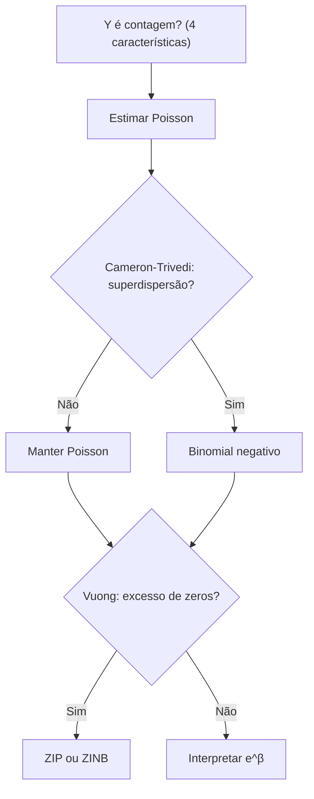

# 19 · Supervised ML — Modelos para Dados de Contagem (Poisson, Binomial Negativo, Inflacionados de Zeros)
**Prof. Dr. Luiz Paulo Fávero · 2 aulas · Prioridade: alta (destaque explícito do professor: "o que caracteriza um dado de contagem?")**

> **Destaque do professor.** *"Se cair uma pergunta na avaliação, só estou dando spoiler: o que caracteriza um dado de contagem? Quatro coisinhas."*

## O fio condutor deste capítulo

Número de idas ao médico por ano, de acidentes por mês, de falhas por lote: **não é contínuo** e **nunca é negativo**, então o OLS falha. A distribuição "natural" das contagens é a **Poisson**, mas ela assume algo restritivo: que **média = variância**. Dados reais costumam ter **caudas longas** (poucos casos com contagens altíssimas) e **muitos zeros**. O capítulo mostra, na ordem, como reconhecer um dado de contagem, o modelo-base (Poisson), como detectar que ele não basta (**superdispersão**), a correção (**binomial negativo**) e a solução para o excesso de zeros (**ZIP e ZINB**).

## 1. As 4 características de um dado de contagem

1. É uma **quantidade** (variável dependente quantitativa);
2. com **valores discretos** (inteiros);
3. **não negativos** (0, 1, 2, …);
4. e precisa ter uma **exposição definida** (tempo, área, região: *"se mudar a exposição, muda a contagem"*).

Exemplos: consultas por ano, IPOs por ano, infrações por mês, falhas de fabricação.

## 2. O modelo Poisson

\[ P(Y = m) = \frac{e^{-\lambda}\,\lambda^m}{m!} \qquad \text{com } E[Y] = Var[Y] = \lambda \;\;(\text{equidispersão}) \]

O \(\lambda\) é a **taxa média** na exposição, e é o **único parâmetro**. O modelo usa ligação logarítmica: \(\ln(\lambda) = \alpha + \beta_1 X_1 + \cdots + \beta_k X_k\), estimado por máxima verossimilhança (`smf.poisson`). (†) \(e^{\beta}\) é a razão entre taxas esperadas por unidade de X.

> **Exemplo resolvido.** \(\lambda = 3\) consultas/ano. \(P(0) = e^{-3} \approx 0{,}050\); \(P(2) = \frac{e^{-3}\cdot 3^2}{2} \approx 0{,}224\) (22,4%). Se a exposição passa de 1 ano para 6 meses, \(\lambda\) cai para cerca de 1,5: por isso a exposição precisa estar definida.

## 3. Superdispersão e o teste de Cameron e Trivedi

A **superdispersão** ocorre quando a **variância é maior que a média** (cauda longa), e a Poisson não captura valores altos. A **subdispersão** é o contrário. O teste de **Cameron e Trivedi (1990)** detecta a superdispersão em quatro passos:

1. estimar o modelo **Poisson**;
2. criar \(Y^* = \frac{(Y - \hat\lambda)^2 - Y}{\hat\lambda}\);
3. rodar uma regressão auxiliar de \(Y^*\) sobre \(\hat\lambda\) **sem intercepto** (é um teste de variância, não preditivo);
4. olhar o **β**: **p < 0,05 → há superdispersão**; se não for significante, vale a Poisson.

## 4. Binomial negativo (Poisson-Gama)

Quando há superdispersão, usa-se o **binomial negativo**, que tem **dois parâmetros** e uma variância **quadrática**:

\[ Var[Y] = \lambda + \varphi\,\lambda^2, \qquad \varphi = \frac{1}{\theta} \]

O \(\varphi\) é o **"alfa"** do statsmodels. **Para decidir:** se o **alfa for significante (p < 0,05)**, há superdispersão e o binomial negativo é melhor; se não for, a saída é idêntica à da Poisson (o binomial negativo nunca é pior). O **teste de razão de verossimilhança (LR)** entre os dois também ajuda, e o modelo prevê melhor valores altos.

> **Exemplo resolvido.** Média = 2 e variância = 10. Na Poisson a variância seria 2. No binomial negativo, \(10 = 2 + \varphi\cdot 2^2\), logo \(\varphi = 2\): o modelo reproduz a cauda longa que a Poisson não captura.

## 5. Excesso de zeros: ZIP e ZINB

Quando o evento é **raro** (ex.: 5.000 residências e só 4 com violência doméstica), há **zeros demais**. A solução combina um **modelo de contagem** com um **modelo binário (logístico)**: o **ZIP** é logit + Poisson e o **ZINB** é logit + binomial negativo (Lambert, 1992). Há **dois tipos de zero**:

| Tipo | Origem | Componente |
|---|---|---|
| **Estrutural** | o evento **nunca** ocorreria | binário (logit) |
| **Amostral** | **poderia** ocorrer, mas não ocorreu no período | de contagem |

\[ P(Y=0) = p_{logit} + (1 - p_{logit})\,P_{contagem}(0) \qquad P(Y=m) = (1 - p_{logit})\,P_{contagem}(m),\; m\geq 1 \]

O **teste de Vuong (1989)** diz se **há inflação de zeros**: se for significante, use o modelo inflacionado.

> **Exemplo resolvido.** \(p_{logit} = 0{,}7\) e \(P_{Poisson}(0) = 0{,}2\) → \(P(Y=0) = 0{,}7 + 0{,}3\times 0{,}2 = 0{,}76\); \(P(Y=1) = 0{,}3\times P_{Poisson}(1)\).

## O que levar daqui

Contagem: quantidade, discreta, não negativa e com exposição. Poisson: média = variância = λ. Binomial negativo: variância = λ + φλ² (alfa = φ). Cameron-Trivedi: β da auxiliar (sem intercepto) significante → superdispersão. ZIP/ZINB: logit + contagem; Vuong detecta zeros em excesso.

## Erros que todo mundo comete

| Erro | Correção |
|---|---|
| "Qualquer Y numérico → OLS" | contagem pede **Poisson/binomial negativo** |
| "Poisson aceita variância maior que a média" | exige **média = variância** |
| "O binomial negativo piora a Poisson sem superdispersão" | com alfa não significante, equivale à Poisson |
| "Zeros em excesso = superdispersão" | são problemas **diferentes**; ZIP/ZINB tratam zeros |
| "O Cameron-Trivedi usa intercepto" | a regressão auxiliar é **sem intercepto** |
| "Zero estrutural = amostral" | estrutural: **nunca** ocorreria; amostral: poderia, mas não ocorreu |
| "O Vuong detecta superdispersão" | detecta **inflação de zeros** |

## Teste-se

1. Quais as 4 características de um dado de contagem?

Ver resposta
Quantidade, valores discretos, não negativos e exposição definida.

2. Média = 4 e variância = 20. Qual o modelo mais adequado?

Ver resposta
Binomial negativo (superdispersão: variância muito maior que a média).

3. O que o teste de Vuong detecta?

Ver resposta
Inflação de zeros (modelo inflacionado × convencional).

4. Diferencie zero estrutural e zero amostral.

Ver resposta
Estrutural: o evento nunca ocorreria (componente logit). Amostral: poderia ocorrer, mas não ocorreu naquele período (componente de contagem).

## Pergunta típica
As 4 características de dado de contagem · equidispersão × superdispersão × subdispersão · o que faz o teste de Cameron e Trivedi (e por que sem intercepto) · quando usar binomial negativo e o que é o alfa · diferença Poisson × binomial negativo · zeros estruturais × amostrais · qual teste detecta inflação de zeros · ZIP × ZINB
