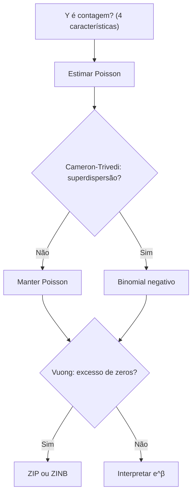

# 19 · Supervised ML — Modelos para Dados de Contagem (Poisson, Binomial Negativo, Inflacionados de Zeros)
**Prof. Dr. Luiz Paulo Fávero · 2 aulas · Prioridade: alta (destaque explícito do professor: "o que caracteriza um dado de contagem?")**

> **Destaque do professor.** *"Se cair uma pergunta na avaliação, só estou dando spoiler: o que caracteriza um dado de contagem? Quatro coisinhas."*

## O fio condutor deste capítulo

Número de idas ao médico por ano, de acidentes por mês, de falhas por lote: **não é contínuo** e **nunca é negativo**, então o OLS falha. A distribuição "natural" das contagens é a **Poisson**, mas ela assume algo restritivo: que **média = variância**. Dados reais costumam ter **caudas longas** (poucos casos com contagens altíssimas) e **muitos zeros**. O capítulo mostra, na ordem, como reconhecer um dado de contagem, o modelo-base (Poisson), como detectar que ele não basta (**superdispersão**), a correção (**binomial negativo**) e a solução para o excesso de zeros (**ZIP e ZINB**).

## 1. As 4 características de um dado de contagem

1. É uma **quantidade** (variável dependente quantitativa);
2. com **valores discretos** (inteiros);
3. **não negativos** (0, 1, 2, …);
4. e precisa ter uma **exposição definida** (tempo, área, região: *"se mudar a exposição, muda a contagem"*).

Exemplos: consultas por ano, IPOs por ano, infrações por mês, falhas de fabricação.

## 2. O modelo Poisson

\[ P(Y = m) = \frac{e^{-\lambda}\,\lambda^m}{m!} \qquad \text{com } E[Y] = Var[Y] = \lambda \;\;(\text{equidispersão}) \]

O \(\lambda\) é a **taxa média** na exposição, e é o **único parâmetro**. O modelo usa ligação logarítmica: \(\ln(\lambda) = \alpha + \beta_1 X_1 + \cdots + \beta_k X_k\), estimado por máxima verossimilhança (`smf.poisson`). (†) \(e^{\beta}\) é a razão entre taxas esperadas por unidade de X.

### Exemplo completo (da aula): multas de estacionamento de diplomatas em Nova York

Dados reais (Fisman e Miguel) de **298 observações** (país × período): a variável dependente **violations** é a **contagem de multas de estacionamento** dos diplomatas de cada país. As explicativas são **staff** (nº de funcionários da missão diplomática, média de 11,8), **post** (se a observação é **depois** de uma mudança na fiscalização: "yes" ou "no") e **corruption** (índice de corrupção do país, padronizado, média 0 e desvio 1).

**Olhando a variável dependente.** Ela é de contagem (0, 1, 2, ... até 167), com **156 zeros (52,3%)**, média **6,50** e variância **331,6**. Repare que a variância é **51 vezes** a média: o Poisson pressupõe média = variância, então já dá para desconfiar de superdispersão.

**Modelo Poisson** (\(\ln\lambda = \alpha + \beta_1\,\text{staff} + \beta_2\,\text{post} + \beta_3\,\text{corruption}\)):

| Termo | Coeficiente | z | p-valor | e^β |
|---|---|---|---|---|
| Intercepto | 2,2127 | 71,1 | < 0,001 | 9,14 |
| staff | 0,0219 | 17,8 | < 0,001 | 1,022 |
| post (yes) | −4,2968 | −21,8 | < 0,001 | **0,0136** |
| corruption | 0,3418 | 12,4 | < 0,001 | 1,407 |

**Como ler.** O \(e^\beta\) é o **fator multiplicativo** da contagem esperada: cada funcionário a mais multiplica as multas por 1,022 (+2,2%); cada desvio-padrão a mais de corrupção multiplica por 1,41 (+41%); e **depois da mudança na fiscalização, as multas caem 98,6%** (fator 0,0136).

**Previsão.** Uma missão com **10 funcionários** e corrupção **0,5**:

\[ \ln\hat\lambda_{antes} = 2{,}2127 + 0{,}0219\times 10 + 0{,}3418\times 0{,}5 = 2{,}60 \;\Rightarrow\; \hat\lambda = e^{2{,}60} = 13{,}5 \text{ multas} \]

\[ \ln\hat\lambda_{depois} = 2{,}60 - 4{,}2968 = -1{,}69 \;\Rightarrow\; \hat\lambda = e^{-1{,}69} = 0{,}18 \text{ multas} \]

## 3. Superdispersão e o teste de Cameron e Trivedi

A **superdispersão** ocorre quando a **variância é maior que a média** (cauda longa), e a Poisson não captura valores altos. A **subdispersão** é o contrário. O teste de **Cameron e Trivedi (1990)** detecta a superdispersão em quatro passos:

1. estimar o modelo **Poisson**;
2. criar \(Y^* = \frac{(Y - \hat\lambda)^2 - Y}{\hat\lambda}\);
3. rodar uma regressão auxiliar de \(Y^*\) sobre \(\hat\lambda\) **sem intercepto** (é um teste de variância, não preditivo);
4. olhar o **β**: **p < 0,05 → há superdispersão**; se não for significante, vale a Poisson.

## 4. Binomial negativo (Poisson-Gama)

Quando há superdispersão, usa-se o **binomial negativo**, que tem **dois parâmetros** e uma variância **quadrática**:

\[ Var[Y] = \lambda + \varphi\,\lambda^2, \qquad \varphi = \frac{1}{\theta} \]

O \(\varphi\) é o **"alfa"** do statsmodels. **Para decidir:** se o **alfa for significante (p < 0,05)**, há superdispersão e o binomial negativo é melhor; se não for, a saída é idêntica à da Poisson (o binomial negativo nunca é pior). O **teste de razão de verossimilhança (LR)** entre os dois também ajuda, e o modelo prevê melhor valores altos.

### Testando a superdispersão e corrigindo com o binomial negativo (mesmos dados)

**Teste de Cameron e Trivedi.** Estima-se uma regressão auxiliar **sem intercepto** que relaciona a variância ao quadrado da média prevista. Se o coeficiente for **estatisticamente significante**, há superdispersão. Resultado: **coeficiente = 2,65, t = 2,75, p = 0,0063 < 0,05**, então **há superdispersão**: o Poisson não é o modelo adequado.

**Modelo binomial negativo** (o mesmo preditor, mas com um parâmetro extra de dispersão \(\varphi\) = alpha):

| Termo | Poisson | Binomial negativo | p-valor (BN) |
|---|---|---|---|
| Intercepto | 2,2127 | 1,9469 | < 0,001 |
| staff | 0,0219 (z = 17,8) | 0,0400 (z = 2,9) | 0,003 |
| post (yes) | −4,2968 | −4,2746 | < 0,001 |
| corruption | 0,3418 (z = 12,4) | 0,4527 (z = 3,4) | 0,001 |
| **alpha (φ)** | (não tem) | **2,096** | < 0,001 |
| Log-verossimilhança | −2.071,8 | **−567,4** | |
| AIC | 4.151,6 | **1.144,8** | |

**O que mudou.** (1) O **alpha = 2,10** é significante: confirma a superdispersão. A variância do modelo é \(\mu + \varphi\mu^2\) (na Poisson seria só \(\mu\)). (2) Os **z despencaram**: o de staff foi de 17,8 para 2,9 e o de corruption de 12,4 para 3,4. Isso mostra que o Poisson **subestimava os erros-padrão** e dava um falso ar de precisão. (3) O ajuste melhorou muito: a LL sobe de −2.071,8 para −567,4. O **teste de razão de verossimilhança** entre os dois modelos tem \(\chi^2 = 2\,(-567{,}4 + 2071{,}8) = 3008{,}8\), com p ≈ 0: o binomial negativo é o modelo preferível. Os coeficientes dão fatores parecidos: depois da fiscalização as multas caem 98,6% e cada desvio-padrão de corrupção multiplica a contagem por 1,57.

## 5. Excesso de zeros: ZIP e ZINB

Quando o evento é **raro** (ex.: 5.000 residências e só 4 com violência doméstica), há **zeros demais**. A solução combina um **modelo de contagem** com um **modelo binário (logístico)**: o **ZIP** é logit + Poisson e o **ZINB** é logit + binomial negativo (Lambert, 1992). Há **dois tipos de zero**:

| Tipo | Origem | Componente |
|---|---|---|
| **Estrutural** | o evento **nunca** ocorreria | binário (logit) |
| **Amostral** | **poderia** ocorrer, mas não ocorreu no período | de contagem |

\[ P(Y=0) = p_{logit} + (1 - p_{logit})\,P_{contagem}(0) \qquad P(Y=m) = (1 - p_{logit})\,P_{contagem}(m),\; m\geq 1 \]

O **teste de Vuong (1989)** diz se **há inflação de zeros**: se for significante, use o modelo inflacionado.

### Excesso de zeros: ZIP e ZINB (mesmos dados)

Mais da metade (**52,3%**) das observações é zero. Dois tipos de zero convivem: os **estruturais** (observações em que o evento **nunca** ocorreria) e os **amostrais** (zeros que poderiam ter ocorrido por acaso numa contagem). Os modelos **inflacionados de zeros** têm duas partes: um **componente logit**, que estima a probabilidade de um zero ser estrutural, e um componente de contagem (Poisson no **ZIP**, binomial negativo no **ZINB**).

No **ZIP** do exemplo, o componente logit usa a **corrupção** como explicativa: **coeficiente = −0,95** (z = −4,9; p < 0,001). O sinal negativo significa que **países mais corruptos têm menor probabilidade de ter um zero estrutural** (ou seja, de ser uma observação em que nenhuma multa ocorreria). Para a corrupção média (0), a probabilidade de zero estrutural é \(1/(1+e^{1{,}61}) = 16{,}6\%\).

**Qual modelo usar?** Compara-se o inflacionado com o convencional pelo **teste de Vuong** (a H0 é que os dois modelos são equivalentes; **z > 1,96 favorece o inflacionado**):

| Comparação | z de Vuong | Decisão | AIC |
|---|---|---|---|
| **ZIP × Poisson** | **2,99** (p ≈ 0,001) | ZIP é melhor | 3.574,6 contra 4.151,6 |
| **ZINB × binomial negativo** | 1,94 (p ≈ 0,05, no limite) | ZINB marginalmente melhor | 1.128,5 contra 1.144,8 |

O ZINB (LL = −557,3) tem o **menor AIC** de todos, e é o melhor modelo da família quando se leva em conta superdispersão **e** excesso de zeros. Como o z do Vuong do ZINB fica no limite de 1,96, a escolha entre ele e o binomial negativo simples é uma **decisão de julgamento**, apoiada no AIC e em saber se a ideia de zeros estruturais faz sentido para o problema.

## O que levar daqui

Contagem: quantidade, discreta, não negativa e com exposição. Poisson: média = variância = λ. Binomial negativo: variância = λ + φλ² (alfa = φ). Cameron-Trivedi: β da auxiliar (sem intercepto) significante → superdispersão. ZIP/ZINB: logit + contagem; Vuong detecta zeros em excesso.

## Erros que todo mundo comete

| Erro | Correção |
|---|---|
| "Qualquer Y numérico → OLS" | contagem pede **Poisson/binomial negativo** |
| "Poisson aceita variância maior que a média" | exige **média = variância** |
| "O binomial negativo piora a Poisson sem superdispersão" | com alfa não significante, equivale à Poisson |
| "Zeros em excesso = superdispersão" | são problemas **diferentes**; ZIP/ZINB tratam zeros |
| "O Cameron-Trivedi usa intercepto" | a regressão auxiliar é **sem intercepto** |
| "Zero estrutural = amostral" | estrutural: **nunca** ocorreria; amostral: poderia, mas não ocorreu |
| "O Vuong detecta superdispersão" | detecta **inflação de zeros** |

## Teste-se

1. Quais as 4 características de um dado de contagem?

Ver resposta
Quantidade, valores discretos, não negativos e exposição definida.

2. Média = 4 e variância = 20. Qual o modelo mais adequado?

Ver resposta
Binomial negativo (superdispersão: variância muito maior que a média).

3. O que o teste de Vuong detecta?

Ver resposta
Inflação de zeros (modelo inflacionado × convencional).

4. Diferencie zero estrutural e zero amostral.

Ver resposta
Estrutural: o evento nunca ocorreria (componente logit). Amostral: poderia ocorrer, mas não ocorreu naquele período (componente de contagem).

## Pergunta típica
As 4 características de dado de contagem · equidispersão × superdispersão × subdispersão · o que faz o teste de Cameron e Trivedi (e por que sem intercepto) · quando usar binomial negativo e o que é o alfa · diferença Poisson × binomial negativo · zeros estruturais × amostrais · qual teste detecta inflação de zeros · ZIP × ZINB
