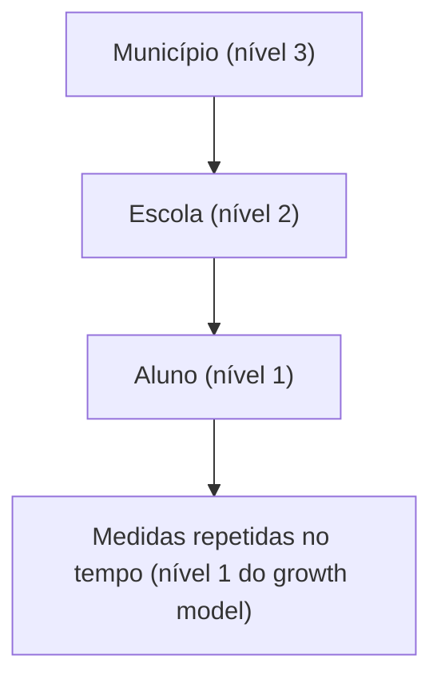

# 20 · Supervised ML — Modelagem Multinível (HLM / GLMM)
**Prof. Dr. Luiz Paulo Fávero · 2 aulas · Prioridade: alta (destaque explícito: "vai cair esse tipo de pergunta": prever valores, ICC, efeito escola × efeito estudante)**

## O fio condutor deste capítulo

Alunos da mesma escola se parecem entre si: compartilham professores, estrutura e vizinhança. Suas notas **não são independentes**. A regressão comum trata todos como um único grupo e ignora isso. O **modelo multinível** reconhece que os dados são **aninhados** (alunos dentro de escolas, empresas dentro de países) e diz: *cada escola tem seu próprio nível médio de desempenho (um intercepto que varia) e, às vezes, sua própria relação entre horas de estudo e nota (uma inclinação que varia)*. Assim, é possível medir **quanto da diferença vem da escola e quanto vem do aluno**.

O capítulo apresenta primeiro a ideia e o vocabulário (e por que OLS e dummies não bastam); depois os componentes (**efeitos fixos e aleatórios**); em seguida as **equações** do modelo de dois níveis, o **ICC** e a **previsão** passo a passo; e termina com o modelo de **três níveis** para medidas repetidas.

## 1. Ideia e vocabulário

Um modelo multinível reconhece **estruturas hierárquicas**: observações (nível 1) dentro de grupos (nível 2), dentro de grupos maiores (nível 3). Seus sinônimos são **HLM** (modelos hierárquicos lineares), modelos mistos, aninhados, de coeficientes aleatórios e **GLMM**; é o modelo supervisionado **mais geral**. Quando não há hierarquia explícita, cria-se um **contexto latente**: faz-se um **cluster** da amostra e usa-se o cluster como nível (a saída do não supervisionado vira entrada do supervisionado).

**Por que não OLS nem OLS com dummies de grupo?** O OLS ignora os efeitos contextuais; as dummies não separam efeitos observáveis dos não observáveis nem modelam a **variância entre contextos**. Existe ainda o **paradoxo de Simpson**: uma tendência presente dentro dos grupos pode **inverter ou desaparecer** quando os grupos são combinados.

## 2. Efeitos fixos e aleatórios

| Componente | O que é | Exemplo |
|---|---|---|
| **Efeitos fixos (γ)** | parâmetros comuns a toda a população | intercepto e inclinação "médios" |
| **\(\nu_{0j}\)** | variação do **intercepto** entre grupos | escolas com médias diferentes |
| **\(\nu_{1j}\)** | variação da **inclinação** entre grupos | o efeito das horas de estudo difere entre escolas |
| **\(\varepsilon_{ij}\)** | erro do nível 1 | variação individual do aluno |

O **primeiro passo** é testar se as **variâncias dos efeitos aleatórios são diferentes de zero**: se forem, o OLS **não é adequado**; se não, o multinível não agrega. Grupos com uma única observação são descartados. Para **comparar modelos** usa-se o **teste de razão de verossimilhança (LR)**, com o log-likelihood, e também o gráfico de valores previstos × reais (quanto mais perto da reta de 45°, melhor).

## 3. As equações do modelo de dois níveis (HLM2)

**Modelo nulo (intercepto aleatório):** nível 1: \(desempenho_{ij} = \beta_{0j} + \varepsilon_{ij}\); nível 2: \(\beta_{0j} = \gamma_{00} + \nu_{0j}\). Juntando:

\[ desempenho_{ij} = \gamma_{00} + \nu_{0j} + \varepsilon_{ij} \]

**Com inclinação aleatória e variável de nível 2** (por exemplo, `texp` = experiência média dos professores da escola):

\[ desempenho_{ij} = \gamma_{00} + \gamma_{10}\,horas_{ij} + \gamma_{01}\,texp_j + \gamma_{11}\,texp_j\,horas_{ij} + \nu_{0j} + \nu_{1j}\,horas_{ij} + \varepsilon_{ij} \]

Note o termo \(\gamma_{11}\,texp\cdot horas\): uma **interação entre níveis**.

### O ICC: efeito escola × efeito estudante

\[ ICC = \frac{\text{variância entre grupos}}{\text{variância entre grupos} + \text{variância do erro}} \]

O ICC é a **fração da variância total atribuível ao contexto** (a escola); o restante é o efeito do indivíduo. Quanto maior o ICC, mais importante o contexto.

> **Exemplo resolvido (ICC).** Variância entre escolas = 20; variância residual = 80. \(ICC = \frac{20}{100} = 0{,}20\): 20% da variação no desempenho é "efeito escola" e **80% é "efeito estudante"**.

> **Exemplo resolvido (previsão).** Dados: \(\gamma_{00} = 50\), \(\gamma_{10} = 2\), \(\gamma_{01} = 1{,}5\), \(\gamma_{11} = 0{,}3\). A escola 1 tem \(\nu_0 = 3\) e \(\nu_1 = 0{,}5\); o aluno estuda **11 horas** e a escola tem **texp = 3,6**.
> **Parte fixa:** \(50 + 2\cdot 11 + 1{,}5\cdot 3{,}6 + 0{,}3\cdot 3{,}6\cdot 11 = 50 + 22 + 5{,}4 + 11{,}88 = 89{,}28\).
> **Parte aleatória da escola 1:** \(3 + 0{,}5\cdot 11 = 8{,}5\).
> **Previsto = 89,28 + 8,5 = 97,78.** (O `fittedvalues` do statsmodels já inclui os efeitos aleatórios.)

## 4. Três níveis e medidas repetidas (growth model)

Quando o mesmo aluno é medido várias vezes, os níveis são: **nível 1 = tempo (medidas repetidas)**, **nível 2 = indivíduo**, **nível 3 = grupo (escola)**. O **modelo de tendência linear** com interceptos e inclinações aleatórios fica:

\[ desempenho = \delta_{000} + \delta_{100}\,m\hat{e}s + \nu_{0jk} + \tau_{00k} + \tau_{10k}\,m\hat{e}s + \varepsilon_{tjk} \]

Variáveis de nível 2 e 3 podem interagir com o tempo.

## 5. Python e aplicações

Em Python usa-se `statsmodels.mixedlm`: `smf.mixedlm('desempenho ~ horas', data, groups=df['escola'], re_formula='~horas')` (para três níveis, `vc_formula`). Variáveis `object` precisam virar dummies ou numéricas. Aplicações: estrutura de capital de empresas por país (Rajan e Zingales), escolas × alunos, crédito e risco. Em geral, "qualquer modelo supervisionado pode ganhar capacidade preditiva ao incorporar contexto".

## O que levar daqui

Multinível lida com dados aninhados separando efeito do indivíduo e do contexto. Efeitos fixos (γ) são comuns; aleatórios (ν, τ) variam por grupo; ε é o erro. O primeiro teste é se as variâncias aleatórias diferem de zero; compara-se modelos por LR. ICC = variância do grupo ÷ (variância do grupo + variância do erro). A previsão soma a parte fixa e os efeitos aleatórios do grupo.

## Erros que todo mundo comete

| Erro | Correção |
|---|---|
| "Dummies de escola equivalem ao multinível" | dummies **não** modelam a variância entre contextos |
| "Efeito fixo = efeito aleatório" | fixo = comum à população; aleatório = **varia entre grupos** |
| "ICC alto = pouco efeito do contexto" | ICC alto = **muito** efeito do contexto |
| "A previsão usa só os γ" | some também \(\nu_{0j}\) e \(\nu_{1j}\cdot x\) do grupo |
| "Multinível exige hierarquia explícita" | pode-se criar **contexto latente** via cluster |
| "\(\nu_{0j}\) é a diferença nas inclinações" | \(\nu_{0j}\) = interceptos; **\(\nu_{1j}\) = inclinações** |

## Teste-se

1. Variância entre grupos = 12 e residual = 28. Qual o ICC?

Ver resposta
12 ÷ (12 + 28) = 0,30 (30% de efeito do contexto).

2. O que \(\nu_{1j}\) representa?

Ver resposta
A variação da inclinação entre grupos (o efeito de X difere entre contextos).

3. Por que não usar OLS com dummies de escola?

Ver resposta
Porque não separam efeitos observáveis dos não observáveis nem capturam a variância entre contextos.

4. Quais são os níveis de um modelo de medidas repetidas de alunos em escolas?

Ver resposta
Tempo (nível 1) → aluno (nível 2) → escola (nível 3).

## Pergunta típica
Definição e sinônimos de modelagem multinível · por que não OLS nem dummies · efeito fixo × aleatório · primeira verificação (variância dos efeitos aleatórios) · como comparar modelos (LR, log-likelihood) · calcular ICC · interpretar ν₀ⱼ e ν₁ⱼ · montar a previsão com a equação final · níveis em medidas repetidas · paradoxo de Simpson · cluster como contexto latente
