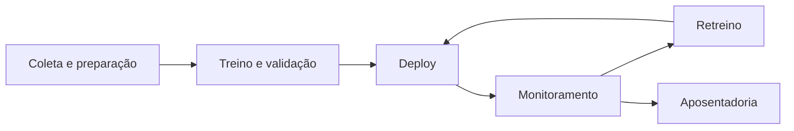

# 21 · Big Data e Deployment de Modelos (MLOps)
**Prof. Helder Prado Santos · 2 aulas · Prioridade: média (você, como dev, já conhece APIs e versionamento; foque nos termos de ML)**

## O fio condutor deste capítulo

Treinar um bom modelo no notebook é só metade do caminho. Em **produção**, os dados mudam (clientes novos, outro comportamento), o modelo envelhece e é preciso **versionar, monitorar e retreinar**. Pense em **MLOps como DevOps para modelos**. Quando o volume de dados cresce além do que cabe em uma máquina, entram as ferramentas de **Big Data**. O capítulo segue essas duas ideias: primeiro o *ciclo de vida do modelo* e o MLOps (com o MLflow como exemplo); depois o *Big Data* (os 5 Vs, Hadoop, Spark) e, por fim, as *arquiteturas* e otimizações que sustentam tudo isso.

## 1. Ciclo de vida do modelo

O modelo passa por seis etapas: (1) coleta e preparação, (2) treinamento e validação, (3) **deploy**, (4) **monitoramento contínuo**, (5) atualização e retreinamento, (6) **aposentadoria** quando fica desatualizado. Os desafios do deploy são o **data drift**, a diferença entre os ambientes de desenvolvimento e produção, o monitoramento pós-deploy e o **versionamento** (um mesmo modelo pode ter dezenas de versões, que devem ser promovidas sem "derrubar e subir" o serviço).

> **Exemplo ilustrativo (cenário criado para esta revisão; não é um caso da aula; data drift).** Um modelo de crédito é treinado com clientes de 2022. Em 2025 a renda média e o perfil mudaram e a taxa de default subiu: a **acurácia medida no treino não se mantém**. O monitoramento detecta a queda e dispara o retreinamento. **Data drift** é exatamente essa mudança na distribuição dos dados (ou de Y) em produção.

## 2. MLOps e MLflow

**MLOps** é DevOps + Machine Learning: automatiza treino, validação, deploy e monitoramento, com **reprodutibilidade e rastreabilidade**. O **MLflow** é o exemplo visto em aula, com **quatro componentes**:

| Componente | Função |
|---|---|
| **Tracking** | registra **experimentos**: parâmetros, métricas e artefatos (`autolog` faz isso sozinho) |
| **Projects** | padroniza o código para reprodutibilidade |
| **Models** | **formato unificado** do modelo, com metadados, dependências e **assinatura (signature)**: o esquema de entrada e saída |
| **Model Registry** | **versões e estágios** (ex.: promover a versão 3 para produção e arquivar a 2) |

O modelo é **servido** por **API REST**, que funciona como uma barreira entre as regras de negócio e o usuário.

### Exemplo completo (da aula): o ciclo MLflow com o modelo tempo × distância

A aula retoma o modelo do capítulo 17 (tempo de viagem × distância, **10 trajetos**) e o leva do notebook até a produção, no Databricks:

**1. Baseline sem MLflow.** Treina-se o **modelo nulo** (`tempo ~ 1`, só o intercepto): ele prevê **a média (30 min)** para qualquer distância; R² = 0, AIC = 83,4 e erro padrão residual de 14,9 min.

**2. Tracking (experimento).** Cria-se um **experimento** e registra-se cada tentativa como um **run**, com **parâmetros** (a fórmula), **métricas** e o **modelo**:

| Run | Fórmula | R² | AIC | Erro padrão residual |
|---|---|---|---|---|
| **Modelo nulo** | `tempo ~ 1` | 0,000 | 83,4 | 14,9 min |
| **Modelo final** | `tempo ~ distancia` | **0,819** | **68,2** | **6,7 min** |

Em vez de procurar a melhor tentativa clicando na tela, o `mlflow.search_runs` busca **por código** o run com a **melhor métrica** (aqui, o modelo final, que tem o maior R² e o menor AIC).

**3. Model Registry (versões e estágios).** O modelo registrado `tempo-distancia` tem **duas versões**: v1 = modelo nulo e v2 = modelo final. Promove-se a **v2 para `staging`** (adaptação/teste): quem carrega `models:/tempo-distancia@staging` recebe o modelo final, **sem mudar o código do consumidor**. Depois de validado, promove-se a v2 para **`production`**, e a v1 sai da fase (ciclo **Staging → Production → Archived**). O uso de **aliases** (`@staging`, `@production`) separa o **código** do **número da versão**.

**4. Previsão e API.** O modelo carregado prevê, para **20 km**, \(5{,}878 + 1{,}4189\times 20 = \) **34,26 minutos**. Em produção, o modelo é **servido por API REST** (`mlflow models serve -m models:/tempo-distancia@production`): o cliente envia um **JSON** com a distância (o *payload*) por **POST** e recebe `{"predictions": [34.26...]}`. Os métodos HTTP: **GET** recupera dados, **POST** envia dados para processamento.

**5. O mesmo caminho para um modelo multinível.** Com a base de **358 estudantes em 10 escolas** (capítulo 20), o **autolog** registra sozinho parâmetros, métricas e artefatos de **5 modelos**: OLS nulo, HLM2 nulo, HLM2 com interceptos aleatórios, com interceptos e inclinações aleatórios e o **modelo final** (`horas + texp + horas:texp`). Em produção, a previsão para o **estudante da escola 1** (11 horas, texp = 3,6) devolve a **parte fixa (21,89)**; os **efeitos aleatórios** da escola 1 (−0,21 e +0,44) são somados à parte, chegando a **26,50**. Um ponto de atenção do deploy: o `predict` do modelo misto retorna **só o componente fixo**.

**6. Observabilidade (MLflow Tracing).** O decorador `@mlflow.trace` envolve as funções do pipeline para **medir o tempo de cada etapa** e achar gargalos, o que é muito usado em pipelines complexos e em IA generativa.

## 3. Big Data

**Big Data** são dados **grandes e complexos demais** para ferramentas tradicionais. Os **5 Vs**:

| V | Significado |
|---|---|
| **Volume** | quantidade |
| **Velocidade** | rapidez com que são gerados e processados |
| **Variedade** | estruturados, semi e não estruturados |
| **Veracidade** | confiabilidade e qualidade |
| **Valor** | insights úteis |

Para processar tanto dado, usa-se um **cluster**: vários computadores em rede, com software **distribuído**.

| | **Hadoop MapReduce** | **Apache Spark** |
|---|---|---|
| Armazenamento | **HDFS** (distribuído) | usa vários (HDFS, nuvem) |
| Processamento | paralelo, **em disco** | **em memória**, bem mais rápido |
| Escala | horizontal (adiciona servidores) | horizontal |

No Spark, uma **DAG** (grafo acíclico dirigido) descreve o plano das operações: *direcionado* (as arestas têm sentido) e *acíclico* (sem ciclos), o que permite otimizar e paralelizar. Os dados vivem em **RDDs**, coleções **distribuídas, resilientes (recuperam por recomputação) e imutáveis**. As **transformações** (`map`, `filter`) são **lazy**: só planejam. As **ações** (`count`, `collect`) é que disparam a execução. Há ainda **DataFrames/Spark SQL** (otimizador **Catalyst**), **MLlib** e **Streaming**.

### Exemplo completo (da aula): 5,6 milhões de voos com Spark

A segunda aula usa a base de **voos nos EUA em 2016**: **5.617.658 linhas** (um voo por linha, com dezenas de colunas) e a tabela `transportadoras` (26 companhias aéreas). Um arquivo desse tamanho (cerca de 700 MB em CSV) já é "grande" para o pandas, e o **Spark** trabalha **distribuído**.

**Exploração.** As colunas são traduzidas para o português e `select` escolhe `DISTANCIA`, `TEMPO_DE_VOO_REAL` e `ATRASO_CHEGADA`: o voo médio tem **850 milhas** e **140 minutos**, e o atraso médio na chegada é de **3,5 minutos** (mínimo de −152, voo adiantado; máximo de 2.142). Há **79.513 voos sem tempo de voo** (cancelados ou desviados), e o código de cancelamento só existe nos **65.861 voos cancelados** (1,17%).

**Estimar o tamanho sem contar tudo.** Para um volume enorme, a aula usa a **extrapolação por amostra**: `df.sample(fraction=0.01)` pega **1%** das linhas, conta e divide por 0,01 para estimar o total (um valor perto dos 5,6 milhões, com uma pequena variação). Barato, e suficiente para dimensionar.

**Preparar e juntar.** `withColumn` cria `ano`, `mes` e `dia` a partir da data; `drop` remove a coluna vazia; um **`join` do tipo `left`** com a tabela de transportadoras troca o código (como `WN`) pelo nome da companhia.

**Agregar: `groupby` → `agg`.** O atraso médio por mês:

| Mês | Atraso médio (min) | % de cancelados |
|---|---|---|
| Jan | 1,5 | **2,62%** |
| Fev | 0,7 | 1,61% |
| Mar | 3,2 | 0,99% |
| Abr | 0,7 | 0,89% |
| Mai | 2,3 | 0,52% |
| Jun | 7,2 | 1,02% |
| **Jul** | **10,4** | 1,85% |
| Ago | 8,0 | 1,38% |
| Set | 0,5 | 0,33% |
| Out | −0,2 | 0,96% |
| Nov | −1,9 | **0,29%** |
| Dez | 8,7 | 1,62% |

Os piores atrasos ficam no **verão (julho) e em dezembro**; a maior taxa de cancelamento, em **janeiro** (inverno). Por **motivo de cancelamento**: **B (clima): 34.465**, **A (transportadora): 20.279**, **C (sistema nacional de transporte aéreo): 11.091** e **D (segurança): 26**: o clima responde por mais da metade. Por **companhia**: as de maior atraso médio foram **Spirit (9,3 min)**, **JetBlue (8,1)** e **Frontier (7,8)**; as de menor, **Alaska (−2,2)**, **Delta (−0,6)** e **Hawaiian (−0,1)**. A Southwest (WN) é a que mais voou (**1,30 milhão de voos**).

**Do Spark para o pandas.** Os resultados agregados são **pequenos**, então se usa `toPandas()` (o DataFrame passa do cluster para a memória do driver) e se faz o gráfico com seaborn: o Spark faz o trabalho pesado, o pandas só desenha.

**Parquet e partições.** Ao salvar em **Parquet** (formato **colunar e comprimido**), usa-se `partitionBy("ano", "mes")`, que cria uma **pasta por ano e por mês**. Depois, ler `ano=2016/mes=12` carrega **só as 460.949 linhas de dezembro** em vez de ler as 5,6 milhões: o Spark **pula as partições que não interessam** (*partition pruning*). Os modos de gravação são `append`, `overwrite`, `ignore` e `error`.

> **Exemplo ilustrativo (avaliação preguiçosa; não é um caso da aula).** `df.filter(preco > 100).select("id")` **não faz nada** ainda; só ao chamar `df.count()` o Spark monta o DAG e executa tudo de uma vez.

Com muito dado, **amostre** para explorar e use ferramenta **distribuída** quando o pandas não cabe em memória.

## 4. Arquiteturas e otimização

A jornada de arquiteturas vai do **Data Warehouse** ao **Data Lake** e ao **Data Lakehouse**. A **arquitetura medalhão** organiza o dado em camadas: **bronze** (bruto), **silver** (limpo) e **gold** (agregado e pronto para consumo). Duas otimizações são centrais: o **Parquet** (formato colunar e compactado, que reduz muito o tamanho e acelera as consultas) e o **particionamento** (por ano ou mês, por exemplo), cuidando para não particionar por uma chave que não combine com as consultas.

## O que levar daqui

O modelo tem ciclo de vida e envelhece (data drift). MLOps automatiza esse ciclo; o MLflow tem Tracking, Projects, Models (com signature) e Registry. Big Data tem 5 Vs. Spark é em memória e Hadoop é em disco; RDD é distribuído, resiliente e imutável; transformação é lazy e ação executa. Medalhão: bronze, silver, gold.

## Erros que todo mundo comete

| Erro | Correção |
|---|---|
| "A acurácia do treino vale para sempre" | o **data drift** a degrada; monitore |
| "MLOps é só deploy" | cobre **todo o ciclo** |
| "Spark e MapReduce processam do mesmo jeito" | Spark: **memória**; MapReduce: **disco** |
| "Transformação executa na hora" | é **lazy**; só a **ação** dispara |
| "RDD é mutável" | é **imutável** |
| "Big Data é só volume" | são **5 Vs** |
| "O Registry guarda experimentos" | experimentos → **Tracking**; versões → **Registry** |

## Teste-se

1. O que é data drift?

Ver resposta
Mudança na distribuição dos dados (ou de Y) em produção que reduz a performance do modelo.

2. Cite os 4 componentes do MLflow.

Ver resposta
Tracking, Projects, Models e Model Registry.

3. Qual a diferença entre transformação e ação no Spark?

Ver resposta
Transformação (map, filter) é lazy e só planeja; ação (count, collect) dispara a execução e retorna valor ao driver.

4. O que são as camadas bronze, silver e gold?

Ver resposta
Bronze: dados brutos; silver: dados limpos; gold: dados agregados e prontos para consumo.

## Pergunta típica
Etapas do ciclo de vida de um modelo · o que é data drift · o que é MLOps · componentes do MLflow · o que é a assinatura de um modelo · Hadoop × Spark (disco × memória) · RDD (resiliente, distribuído, imutável) e DAG · transformação (lazy) × ação · os 5 Vs · arquitetura medalhão · por que Parquet e particionamento
