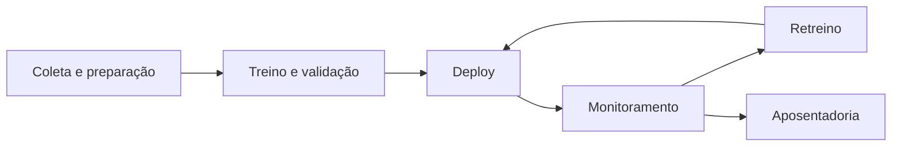

# 21 · Big Data e Deployment de Modelos (MLOps)
**Prof. Helder Prado Santos · 2 aulas · Prioridade: média (você, como dev, já conhece APIs e versionamento; foque nos termos de ML)**

## O fio condutor deste capítulo

Treinar um bom modelo no notebook é só metade do caminho. Em **produção**, os dados mudam (clientes novos, outro comportamento), o modelo envelhece e é preciso **versionar, monitorar e retreinar**. Pense em **MLOps como DevOps para modelos**. Quando o volume de dados cresce além do que cabe em uma máquina, entram as ferramentas de **Big Data**. O capítulo segue essas duas ideias: primeiro o *ciclo de vida do modelo* e o MLOps (com o MLflow como exemplo); depois o *Big Data* (os 5 Vs, Hadoop, Spark) e, por fim, as *arquiteturas* e otimizações que sustentam tudo isso.

## 1. Ciclo de vida do modelo

O modelo passa por seis etapas: (1) coleta e preparação, (2) treinamento e validação, (3) **deploy**, (4) **monitoramento contínuo**, (5) atualização e retreinamento, (6) **aposentadoria** quando fica desatualizado. Os desafios do deploy são o **data drift**, a diferença entre os ambientes de desenvolvimento e produção, o monitoramento pós-deploy e o **versionamento** (um mesmo modelo pode ter dezenas de versões, que devem ser promovidas sem "derrubar e subir" o serviço).

> **Exemplo resolvido (data drift).** Um modelo de crédito é treinado com clientes de 2022. Em 2025 a renda média e o perfil mudaram e a taxa de default subiu: a **acurácia medida no treino não se mantém**. O monitoramento detecta a queda e dispara o retreinamento. **Data drift** é exatamente essa mudança na distribuição dos dados (ou de Y) em produção.

## 2. MLOps e MLflow

**MLOps** é DevOps + Machine Learning: automatiza treino, validação, deploy e monitoramento, com **reprodutibilidade e rastreabilidade**. O **MLflow** é o exemplo visto em aula, com **quatro componentes**:

| Componente | Função |
|---|---|
| **Tracking** | registra **experimentos**: parâmetros, métricas e artefatos (`autolog` faz isso sozinho) |
| **Projects** | padroniza o código para reprodutibilidade |
| **Models** | **formato unificado** do modelo, com metadados, dependências e **assinatura (signature)**: o esquema de entrada e saída |
| **Model Registry** | **versões e estágios** (ex.: promover a versão 3 para produção e arquivar a 2) |

O modelo é **servido** por **API REST**, que funciona como uma barreira entre as regras de negócio e o usuário.

> **Exemplo resolvido (fluxo).** Você treina cinco variações; o **Tracking** registra parâmetros e métricas de cada uma; a melhor vai para o **Registry** como versão 4; é promovida a **Production**; o **Model** é servido como endpoint REST, com a **signature** validando a entrada.

## 3. Big Data

**Big Data** são dados **grandes e complexos demais** para ferramentas tradicionais. Os **5 Vs**:

| V | Significado |
|---|---|
| **Volume** | quantidade |
| **Velocidade** | rapidez com que são gerados e processados |
| **Variedade** | estruturados, semi e não estruturados |
| **Veracidade** | confiabilidade e qualidade |
| **Valor** | insights úteis |

Para processar tanto dado, usa-se um **cluster**: vários computadores em rede, com software **distribuído**.

| | **Hadoop MapReduce** | **Apache Spark** |
|---|---|---|
| Armazenamento | **HDFS** (distribuído) | usa vários (HDFS, nuvem) |
| Processamento | paralelo, **em disco** | **em memória**, bem mais rápido |
| Escala | horizontal (adiciona servidores) | horizontal |

No Spark, uma **DAG** (grafo acíclico dirigido) descreve o plano das operações: *direcionado* (as arestas têm sentido) e *acíclico* (sem ciclos), o que permite otimizar e paralelizar. Os dados vivem em **RDDs**, coleções **distribuídas, resilientes (recuperam por recomputação) e imutáveis**. As **transformações** (`map`, `filter`) são **lazy**: só planejam. As **ações** (`count`, `collect`) é que disparam a execução. Há ainda **DataFrames/Spark SQL** (otimizador **Catalyst**), **MLlib** e **Streaming**.

> **Exemplo resolvido (lazy).** `df.filter(preco > 100).select("id")` **não faz nada** ainda; só ao chamar `df.count()` o Spark monta o DAG e executa tudo de uma vez.

Com muito dado, **amostre** para explorar e use ferramenta **distribuída** quando o pandas não cabe em memória.

## 4. Arquiteturas e otimização

A jornada de arquiteturas vai do **Data Warehouse** ao **Data Lake** e ao **Data Lakehouse**. A **arquitetura medalhão** organiza o dado em camadas: **bronze** (bruto), **silver** (limpo) e **gold** (agregado e pronto para consumo). Duas otimizações são centrais: o **Parquet** (formato colunar e compactado, que reduz muito o tamanho e acelera as consultas) e o **particionamento** (por ano ou mês, por exemplo), cuidando para não particionar por uma chave que não combine com as consultas.

## O que levar daqui

O modelo tem ciclo de vida e envelhece (data drift). MLOps automatiza esse ciclo; o MLflow tem Tracking, Projects, Models (com signature) e Registry. Big Data tem 5 Vs. Spark é em memória e Hadoop é em disco; RDD é distribuído, resiliente e imutável; transformação é lazy e ação executa. Medalhão: bronze, silver, gold.

## Erros que todo mundo comete

| Erro | Correção |
|---|---|
| "A acurácia do treino vale para sempre" | o **data drift** a degrada; monitore |
| "MLOps é só deploy" | cobre **todo o ciclo** |
| "Spark e MapReduce processam do mesmo jeito" | Spark: **memória**; MapReduce: **disco** |
| "Transformação executa na hora" | é **lazy**; só a **ação** dispara |
| "RDD é mutável" | é **imutável** |
| "Big Data é só volume" | são **5 Vs** |
| "O Registry guarda experimentos" | experimentos → **Tracking**; versões → **Registry** |

## Teste-se

1. O que é data drift?

Ver resposta
Mudança na distribuição dos dados (ou de Y) em produção que reduz a performance do modelo.

2. Cite os 4 componentes do MLflow.

Ver resposta
Tracking, Projects, Models e Model Registry.

3. Qual a diferença entre transformação e ação no Spark?

Ver resposta
Transformação (map, filter) é lazy e só planeja; ação (count, collect) dispara a execução e retorna valor ao driver.

4. O que são as camadas bronze, silver e gold?

Ver resposta
Bronze: dados brutos; silver: dados limpos; gold: dados agregados e prontos para consumo.

## Pergunta típica
Etapas do ciclo de vida de um modelo · o que é data drift · o que é MLOps · componentes do MLflow · o que é a assinatura de um modelo · Hadoop × Spark (disco × memória) · RDD (resiliente, distribuído, imutável) e DAG · transformação (lazy) × ação · os 5 Vs · arquitetura medalhão · por que Parquet e particionamento
