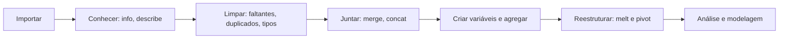
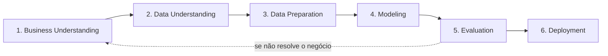

# 23 · Data Wrangling (pandas) — Tratamento e Preparação de Dados
**Prof. Wilson Tarantin Jr. · 4 aulas · Prioridade: média (para você é prática de pandas; fixe os conceitos e o vocabulário)**

## O fio condutor deste capítulo

**Um modelo é tão bom quanto os dados que recebe.** Uma coluna de datas lida como texto, duplicados ou faltantes mal tratados produzem conclusões erradas sem nenhum erro de execução. **Data wrangling** é o trabalho de "arrumar a casa" antes de qualquer gráfico ou modelo: transformar dados brutos em uma estrutura adequada à análise. Costuma ocupar a maior parte do tempo de um projeto.

O capítulo situa o wrangling dentro de um **processo de projeto** (o CRISP-DM), depois detalha as **etapas** (importar, juntar, transformar) e as **operações do pandas** que as realizam, e termina com boas práticas e o vocabulário de versionamento (Git e GitHub).

## 1. O que é data wrangling

É a **preparação, organização e manipulação** da base **antes da análise exploratória, dos gráficos e da modelagem**. Não é uma atividade padronizada: depende do contexto. As etapas comuns são:

| Etapa | O que acontece |
|---|---|
| **Coleta e importação** | CSV, XLSX, Parquet, APIs, bancos via SQL; cuidado com o **encoding** (ex.: `latin1`) |
| **Junção** | combinar fontes; exige uma **variável-chave** com o mesmo nome nas duas tabelas |
| **Transformação** | **limpeza** (faltantes, erros, duplicados), criação e alteração de variáveis, seleção de observações, agregações |

Em um quadro mais amplo, Harvard descreve seis fases: descoberta, estruturação, limpeza, enriquecimento, validação e publicação.

## 2. CRISP-DM: onde o wrangling se encaixa

O **CRISP-DM** (*Cross-Industry Standard Process for Data Mining*) é o ciclo de vida de um projeto de dados, e é **iterativo**: pode-se voltar a etapas anteriores.

O wrangling **começa em Data Understanding** (explorar e avaliar a qualidade) e acontece sobretudo em **Data Preparation**.

## 3. As operações do pandas

| Tarefa | Operação |
|---|---|
| **Ler** | `pd.read_csv`, `pd.read_excel` (parâmetro `encoding`) |
| **Conhecer** | `.info()` (tipos e nulos), `.describe()`, `.head()`, `.unique()`, `.nunique()`, `.value_counts()` |
| **Tipos** | `.astype()`; `category`; `pd.to_datetime` |
| **Selecionar** | `.loc` (rótulos), `.iloc` (posição, **começa em 0**), **`.query('x > 5 and y == "a"')`**, `.isin()`, `.between()` |
| **Limpar** | `.rename()`, `.drop()`, `.drop_duplicates()`, `.dropna()`, `.fillna()` |
| **Criar variáveis** | `.assign()`, **`np.where(cond, a, b)`**, `pd.qcut` (faixas por quantis), `.cumsum()`, `.shift()` |
| **Resumir** | **`.groupby(var).agg(...)`**, `.sort_values()`, `.reset_index()`, `pd.crosstab` (tabela de contingência → qui-quadrado) |
| **Reestruturar** | **`.melt()`** (largo → **longo**), **`.pivot()`** (longo → largo) |
| **Combinar** | `.concat()` e **`.merge(how=…)`** |

### Tipos de merge

| `how` | Mantém |
|---|---|
| **`left`** | todas as linhas da esquerda, mais as correspondentes da direita |
| **`right`** | todas as da direita |
| **`inner`** | só as que aparecem **nas duas** |
| **`outer`** | **todas** (a união) |

> **Exemplo resolvido.** Clientes: {1, 2, 3}; Compras: {2, 3, 4}. `inner` → {2, 3}; `left` (clientes à esquerda) → {1, 2, 3} (o cliente 1 fica com compra = NaN); `right` → {2, 3, 4}; `outer` → {1, 2, 3, 4}.

> **Exemplo (melt).** Uma tabela larga com colunas `ano_2022` e `ano_2023` vira, com `.melt()`, uma tabela com as colunas `ano` e `valor`, uma linha por país e ano (formato longo, útil para gráficos e `groupby`).

## 4. Boas práticas e versionamento

Salve o resultado do `groupby` em **outro objeto**; confira os **tipos** após importar; **não calcule média de variável categórica**; use `.copy()` para trabalhar em cópias; e desconfie de **grupos com poucas observações**, que distorcem médias. Em **Big Data** troca-se a biblioteca (Spark, Dask), mas o ciclo é o mesmo.

**Git × GitHub:** **Git** é o **controle de versão** (histórico e commits); **GitHub** é a **plataforma** onde se hospedam e compartilham repositórios.

## O que levar daqui

Wrangling é preparar dados antes de explorar e modelar. O CRISP-DM tem seis fases e é iterativo. O merge tem `left`, `right`, `inner` e `outer`; `melt` leva o largo ao longo e `pivot` faz o contrário. `groupby/agg` resume; `np.where` e `qcut` criam variáveis. Git é a ferramenta; GitHub, a plataforma.

## Erros que todo mundo comete

| Erro | Correção |
|---|---|
| "`inner` mantém todas as linhas" | só as que existem **nas duas** tabelas |
| "`left` mantém as da direita" | mantém **todas as da esquerda** |
| "`iloc` usa rótulos" | usa **posição** (começa em 0); `loc` usa rótulos |
| "Wide e long são o mesmo" | wide: variáveis em colunas; long: empilhadas |
| "`merge` não precisa de chave" | precisa de **variável-chave** em comum |
| "Wrangling vem depois da modelagem" | vem **antes** (CRISP-DM: preparação) |
| "Git = GitHub" | Git é a **ferramenta**; GitHub é a **plataforma** |

## Teste-se

1. Em que fase do CRISP-DM acontece o grosso do wrangling?

Ver resposta
Data Preparation (começa em Data Understanding).

2. Qual a diferença entre `inner` e `outer` merge?

Ver resposta
Inner mantém só as chaves presentes nas duas tabelas; outer mantém todas as chaves das duas.

3. O que faz `.melt()`?

Ver resposta
Converte o formato largo em longo: variáveis em colunas viram linhas.

4. Por que não calcular média de uma variável categórica?

Ver resposta
Porque os números são rótulos de categoria (ponderação arbitrária); só frequências e moda fazem sentido.

## Pergunta típica
O que é data wrangling e quando ocorre · etapas do CRISP-DM (e onde entra o wrangling) · diferença entre left/right/inner/outer · wide × long (melt e pivot) · para que serve groupby · como o `.query` funciona · como tratar variável categórica no pandas · Git × GitHub
