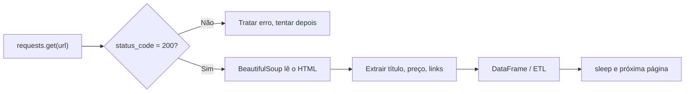

# 24 · Coleta de Dados: Crawlers e Web Scraping
**Prof. Guilherme Lima · 1 aula · Prioridade: média-baixa (você é dev: o técnico é fácil; foque nos aspectos legais e éticos e no vocabulário)**

## O fio condutor deste capítulo

Muita informação útil está em sites, e não em APIs ou bancos. Copiar à mão não escala. **Web scraping** é fazer seu programa **agir como um navegador** para extrair dados de páginas automaticamente. Mas, como seu código é "um visitante", ele pode **sobrecarregar o servidor** ou violar termos de uso e privacidade. Saber **como** fazer e **se pode** fazer é parte do trabalho.

O capítulo vai do *conceito* e das *ferramentas* (requests, BeautifulSoup, Selenium) à *prática robusta* (como não quebrar nem incomodar o servidor) e termina nos *limites legais e éticos*.

## 1. Conceitos e ferramentas

Um **scraper** extrai dados de páginas; um **crawler** **percorre páginas seguindo links**. Ambos entram na etapa de **extração** de um ETL. A comunicação é cliente-servidor: a requisição leva a **URL**, o **método HTTP** (GET, POST…) e os **cabeçalhos (headers)**; a resposta traz o **status code**: **200** (ok), **404** (não encontrado), **403** (proibido) ou **500** (erro do servidor).

As **camadas da web** são o **HTML** (estrutura), o **CSS** (estilo) e o **JavaScript** (interatividade e conteúdo dinâmico). O **DevTools** do navegador mostra o HTML e as requisições. As ferramentas Python têm papéis distintos:

| Ferramenta | Papel |
|---|---|
| **requests** | faz a requisição HTTP |
| **BeautifulSoup** | **lê o HTML** e busca por **tags, classes e IDs** |
| **Selenium** | controla um navegador: páginas **dinâmicas** (JavaScript) e login |

Se o site oferece uma **API JSON**, ela é melhor que raspar HTML.

## 2. Prática e robustez

"A web é um quarto bagunçado": páginas são imprevisíveis. Por isso, use **`try/except`**, **timeout**, confira o **`status_code`/`raise_for_status`**, envie um **User-Agent**, faça **pausas (`time.sleep`)** entre requisições e **respeite o `robots.txt`**. Exemplos de código: `requests.get(url, headers=..., timeout=15)`; `BeautifulSoup(res.text, "lxml")`; `soup.find_all("article", class_="product_pod")`; `.get_text(strip=True)`. Os dados extraídos viram dicionários ou DataFrames e entram no ETL.

> **Exemplo resolvido (fluxo).** (1) `requests.get` na página de produtos; (2) confere `status_code == 200`; (3) `BeautifulSoup` encontra cada `article.product_pod`; (4) extrai título e preço; (5) guarda em um DataFrame; (6) `sleep(1)` e repete na próxima página.

## 3. Aspectos legais e éticos

Ignorar o **robots.txt** e os **termos de serviço** pode causar bloqueio e ações judiciais. A **LGPD** não menciona "scraping", mas o **art. 7º, §3º** diz que dados pessoais de **acesso público** devem ser tratados considerando **finalidade, boa-fé e interesse público**: dado público **não** é livre para qualquer uso. A aula propõe três critérios para avaliar se uma coleta é aceitável:

| Critério | Pergunta |
|---|---|
| **Consentimento** | os termos de serviço permitem? os titulares concordam? |
| **Problemas físicos** | minha coleta sobrecarrega o servidor e prejudica outros usuários? |
| **Intencionalidade** | qual é a **real intenção** do uso dos dados? |

> **Caso Pete Warden (2010).** Coletou dados públicos de cerca de 200 milhões de perfis do Facebook para uma visualização; os advogados da empresa exigiram que **parasse e apagasse** os dados. Mostra que "público" não significa "livre".

## O que levar daqui

Scraper extrai; crawler percorre links. requests faz a requisição, BeautifulSoup lê o HTML, Selenium cobre páginas dinâmicas. Boas práticas: try/except, timeout, User-Agent, sleep e robots.txt. Os critérios éticos são consentimento, problemas físicos e intencionalidade; a LGPD exige finalidade e boa-fé mesmo para dados públicos.

## Erros que todo mundo comete

| Erro | Correção |
|---|---|
| "Dado público pode ser usado livremente" | valem **finalidade e boa-fé** (LGPD art. 7º §3º) |
| "Scraper = crawler" | crawler **percorre links**; scraper **extrai dados** |
| "requests executa JavaScript" | **não**; use Selenium para páginas dinâmicas |
| "Sem robots.txt, tudo liberado" | ainda valem **termos de serviço** e a lei |
| "Rodar sem pausas é inofensivo" | pode **sobrecarregar** o servidor |
| "BeautifulSoup faz a requisição" | quem faz é o **requests**; o BS só **lê o HTML** |

## Teste-se

1. Qual o papel de requests, BeautifulSoup e Selenium?

Ver resposta
requests faz a requisição HTTP; BeautifulSoup analisa o HTML e busca elementos; Selenium controla um navegador para conteúdo dinâmico (JavaScript) e login.

2. Por que usar `sleep` entre requisições?

Ver resposta
Para não sobrecarregar o servidor (critério de problemas físicos) e reduzir o risco de bloqueio.

3. O que a LGPD diz sobre dados de acesso público?

Ver resposta
Devem ser tratados considerando finalidade, boa-fé e interesse público que justificaram sua disponibilização (art. 7º, §3º).

4. Cite os três critérios de legalidade e ética do scraping.

Ver resposta
Consentimento, problemas físicos e intencionalidade.

## Pergunta típica
O que faz um scraper e a diferença para crawler · papel de requests × BeautifulSoup × Selenium · status codes e headers · por que usar robots.txt, sleep e try/except · o que a LGPD diz sobre dados públicos · os 3 critérios (consentimento, problemas físicos, intencionalidade)
