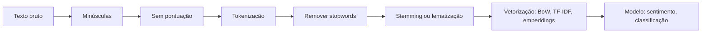

# 25 · Text Mining, Sentiment Analysis e NLP
**Prof. Guilherme Bezerra de Lima · 3 aulas · Prioridade: alta (pipeline de pré-processamento e granularidades são cobrados)**

## O fio condutor deste capítulo

A maior parte dos dados do mundo é **texto**: avaliações, redes sociais, e-mails, contratos. Mas um computador não "lê": ele **conta e transforma em números**. A qualidade do que você extrai depende de **como limpa e representa o texto**, e por isso se diz que "qualidade do dado > qualquer algoritmo de ponta". O capítulo acompanha esse caminho: primeiro as *definições* das quatro áreas vizinhas; depois o *pipeline* de text mining e, em detalhe, o **pré-processamento**; e por fim a **análise de sentimento**, a aplicação mais popular, com suas granularidades, algoritmos e desafios.

## 1. As quatro áreas

| Área | O que é |
|---|---|
| **NLP / PLN** | processa e entende a **linguagem humana** por algoritmos |
| **Text mining** | **extrai padrões e conhecimento** de grandes volumes de texto |
| **Análise de sentimento (AS)** | detecta **emoções e opiniões**, classificando em positivo, negativo ou neutro; computadores não sentem, **identificam padrões** |
| **LLM** | modelo treinado em grandes volumes de texto para **gerar e compreender linguagem** (prevê a próxima palavra) |

Aplicações: sentimento, extração de informação, sumarização, classificação, modelagem de tópicos e detecção de spam e fraude. O **pipeline** geral é: coleta (APIs, web, arquivos) → pré-processamento → modelagem → interpretação → insights, e o pré-processamento **impacta diretamente a acurácia**.

## 2. Pré-processamento, passo a passo

Cada etapa resolve um problema específico. Acompanhe o exemplo "Eu amo DS!":

| Etapa | O que faz | Resultado |
|---|---|---|
| **Minúsculas** | padroniza a caixa | "eu amo ds!" |
| **Remoção de pontuação** (e acentos, se for o caso) | elimina sinais | "eu amo ds" |
| **Tokenização** | divide em unidades (tokens) | ["eu", "amo", "ds"] |
| **Stopwords** | remove palavras muito comuns que **não agregam significado** (a, o, de, que) | "eu estou aprendendo processamento de linguagem" → "aprendendo processamento linguagem" |
| **Stemming** | corta sufixos até o **radical** (rápido, grosseiro; pode não ser palavra real) | aprendendo → "aprend" |
| **Lematização** | leva ao **lema** (forma do dicionário, usa a classe gramatical) | "amasse" → "amar"; "incríveis" → "incrível" |

**Stemming × lematização:** o stemming é mais rápido e grosseiro; a **lematização é mais precisa**. As bibliotecas mais usadas são o **NLTK** e o **spaCy**. Depois dessas etapas vem a **vetorização**, que transforma o texto em números: **Bag of Words (CountVectorizer), TF-IDF ou embeddings** (aprofundados no capítulo 28).

> **Exemplo resolvido.** "Os clientes adoraram o atendimento!" → minúsculas: "os clientes adoraram o atendimento!" → sem pontuação → tokens ["os", "clientes", "adoraram", "o", "atendimento"] → sem stopwords ["clientes", "adoraram", "atendimento"] → **lematização:** ["cliente", "adorar", "atendimento"] (um stemming daria algo como "client", "ador", "atend").

## 3. Análise de sentimento

A AS mede a **polaridade** em uma escala (por exemplo, +2, +1, 0, −1, −2, ou simplesmente positivo, negativo e neutro). Montar uma análise é uma sequência de três decisões: **granularidade → algoritmo → métrica**.

### Granularidade: em que nível classificar?

| Nível | O que classifica | Exemplo |
|---|---|---|
| **Documento** | uma opinião para o texto inteiro | uma avaliação de produto inteira |
| **Frase** | cada sentença (primeiro **subjetiva × objetiva**, depois a polaridade) | cada frase de um comentário |
| **Aspecto (ABSA)** | **um sentimento para cada aspecto** mencionado | "O atendimento foi excelente, **mas** a comida demorou muito" → atendimento (+), tempo da comida (−) |

### Algoritmo: como classificar?

| Abordagem | Como funciona | Limite |
|---|---|---|
| **Léxico** | dicionário de palavras com polaridade (**VADER** em inglês, **LeIA** em português, TextBlob) | gírias e expressões fora do dicionário |
| **ML clássico** | vetorização (CountVectorizer ou TF-IDF) + classificador (**Naive Bayes**, regressão logística); exige **dados rotulados** e divisão treino/teste | depende de bons rótulos |
| **Deep learning / Transformers / LLMs** | modelos pré-treinados (`pipeline("sentiment-analysis")` devolve **rótulo e probabilidade**) | custo e dependência de modelo |

A **métrica** é a validação técnica já conhecida: acurácia, precisão, recall, F1 e matriz de confusão (capítulo 27).

### Desafios

**Sarcasmo, ironia, emojis**, ambiguidade, viés linguístico e erros de ortografia dificultam a tarefa; além disso, o modelo **não vale para sempre**, porque a linguagem muda e é preciso **revalidar**. O futuro é **multimodal** (texto, imagem e áudio).

## O que levar daqui

Text mining transforma texto em números. A ordem do pré-processamento é minúsculas → pontuação → tokenização → stopwords → stemming/lematização → vetorização. A granularidade da AS (documento, frase, aspecto) é escolhida antes do modelo. As abordagens são léxico, ML clássico e deep learning/LLM. Sarcasmo, ironia e ambiguidade continuam difíceis.

## Erros que todo mundo comete

| Erro | Correção |
|---|---|
| "Stemming = lematização" | stemming **corta** sufixos; lematização usa o **dicionário** |
| "Mais dados superam uma limpeza ruim" | o pré-processamento **impacta diretamente** o resultado |
| "Léxico é ML" | léxico = **dicionário**; ML aprende de dados rotulados |
| "ABSA classifica o documento inteiro" | classifica **cada aspecto** |
| "Modelo de sentimento é permanente" | a linguagem muda; é preciso **revalidar** |
| "NLP = LLM" | LLM é um tipo de modelo; NLP é a **área** |

## Teste-se

1. Qual a diferença entre stemming e lematização?

Ver resposta
Stemming corta sufixos até o radical (rápido, pode gerar não-palavra); lematização leva ao lema do dicionário usando a classe gramatical (mais precisa).

2. O que é ABSA?

Ver resposta
Análise de sentimento baseada em aspectos: atribui um sentimento a cada característica mencionada no texto.

3. Cite três abordagens para análise de sentimento.

Ver resposta
Léxico (VADER, LeIA), ML clássico (Naive Bayes com TF-IDF) e deep learning/Transformers/LLMs.

4. Por que o sarcasmo é difícil?

Ver resposta
Porque a polaridade aparente das palavras é oposta à intenção; léxicos e modelos simples não capturam o contexto.

## Pergunta típica
Diferença entre NLP, text mining, AS e LLM · ordem das etapas de pré-processamento · o que é stopword · stemming × lematização (exemplos) · granularidade documento/frase/aspecto e o que é ABSA · abordagens (léxico × ML × deep learning) · por que a qualidade dos dados importa mais que o algoritmo · desafios (sarcasmo, ambiguidade, viés)
