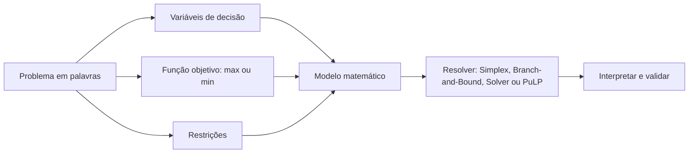

# 26 · Pesquisa Operacional e Modelos de Otimização (I, II, III)
**Prof. Cassiano Augusto Isler · 3 aulas · Prioridade: média-alta (saber MODELAR um enunciado em variáveis, objetivo e restrições é o que se cobra)**

## O fio condutor deste capítulo

Um centro de distribuição precisa decidir quantas caixas de cada tipo enviar, quanto transportar por cada rota, quais terminais ativar. São decisões com muitas combinações e restrições. A **pesquisa operacional (PO)** ensina a **transformar um problema real em um modelo matemático** e a resolvê-lo para obter a melhor decisão. Todo o capítulo gira em torno de um único hábito: *ler o problema em palavras e traduzi-lo em três peças*: **variáveis de decisão, função objetivo e restrições**.

A progressão é esta: primeiro a **modelagem** em si; depois como se **resolve** um modelo pequeno (graficamente e pelo Simplex); em seguida o caso em que as variáveis precisam ser **inteiras** (Branch-and-Bound); e por fim o **modelo misto**, com variáveis contínuas, inteiras e binárias, onde aparecem os padrões mais úteis de modelagem.

## 1. As três peças de todo modelo

| Peça | Pergunta | Exemplo (caixas de livros) |
|---|---|---|
| **Variáveis de decisão** | o que posso escolher? | \(L\) = caixas leves, \(M\) = caixas mistas |
| **Função objetivo** | o que quero maximizar ou minimizar? | maximizar \(Q = 6L + 7M\) (livros entregues) |
| **Restrições** | quais limites existem? (sempre comparam **duas quantidades mensuráveis**) | \(L + M \leq 10\); \(6L + 2M \geq 40\) |

Quando todas as equações são **lineares** (soma de termos "constante × variável", nunca \(x^2\)), tem-se **programação linear (PL)**. Se há variáveis inteiras, é **PLI**; se há inteiras e contínuas juntas, **PLIM (mista)**. O roteiro de modelagem é: entender o problema (conversando com quem o vive) → escrever **em palavras** variáveis, objetivo e restrições → traduzir em equações → resolver → **validar**. **Defina o objetivo antes das restrições**; senão você pode olhar para o ator errado (a livraria, em vez do centro de distribuição).

> **Dica.** **Minimizar \(f\) equivale a maximizar \(-f\).** Uma restrição **flexível** (que pode ser violada a um custo) modela-se com uma variável de folga **penalizada na função objetivo**; uma restrição **absoluta (hard)** nunca pode ser violada.

## 2. Resolvendo um modelo pequeno

Com duas variáveis, o problema se desenha. A **região factível** é o conjunto de pontos que satisfazem **todas** as restrições ao mesmo tempo. A função objetivo vira uma família de **retas paralelas** (todas com o mesmo valor de \(Q\)): desliza-se a reta na direção em que \(Q\) cresce, até o **último ponto de contato** com a região, e esse ponto é um **vértice**.

> **Exemplo resolvido (livros).** Vértices da região: (6,67; 0), (10; 0) e (5; 5). Valores de \(Q = 6L + 7M\): 40, 60 e **65**. O máximo está em **\((L, M) = (5, 5)\) com \(Q = 65\)**.

Em problemas reais há muitas variáveis e não dá para desenhar nem visitar todos os vértices. O **Simplex** caminha de vértice em vértice na direção de maior crescimento da função objetivo e, em cada vértice, testa se algum movimento ainda melhora; quando nenhum melhora, **garante o ótimo**. As ferramentas são o **Solver do Excel** e a biblioteca **PuLP** do Python, com a mesma lógica: *variáveis → objetivo → restrições → resolver*.

## 3. Variáveis inteiras: Branch-and-Bound

Não existe "meia caixa". Quando as variáveis precisam ser inteiras, o Simplex puro pode devolver soluções fracionárias (ex.: \(L = 5{,}7\)). O **Branch-and-Bound** resolve isso em três ideias:

1. **Solução relaxada:** resolve-se primeiro o problema tratando as variáveis como contínuas (isso dá um **limite superior** para o ótimo inteiro).
2. **Ramificação (branching):** se \(L = 5{,}7\), criam-se dois subproblemas, \(L \leq 5\) e \(L \geq 6\), e resolve-se cada um.
3. **Limitação (bounding):** toda solução **inteira** encontrada é **candidata**; ramos que não podem superar a melhor candidata são **podados**.

> **Exemplo resolvido.** No exemplo dos livros a solução relaxada já é (5, 5), **inteira**: não é preciso ramificar. Em outro caso hipotético, o subproblema \(L \leq 5\) dá (5, 5) com \(Q = 65\) e o \(L \geq 6\) dá (6, 4) com \(Q = 64\); a melhor candidata, 65, vence.

Outro exemplo é a **nova ala hospitalar**: variáveis \(q_1, q_2, q_3\) (quartos de 1, 2 e 3 leitos); maximizar a receita \(R = 7500q_1 + 6000q_2 + 4500q_3\) com restrições de **área** (\(10q_1 + 15q_2 + 18q_3 \leq 1200\)), de **capacidade** (\(q_1 + q_2 + q_3 \leq 70\)), de **limite de individuais** (\(q_1 \leq 30\)), de **mínimo de leitos** (\(q_1 + 2q_2 + 3q_3 \geq 120\)) e de **domínio** (inteiros ≥ 0).

## 4. Modelos mistos e os padrões de modelagem

No **PLIM** há variáveis contínuas, inteiras e binárias. O exemplo da aula é um problema de **transporte e transbordo com ativação de terminais**: dois centros (CD1 com 40 t e CD2 com 60 t) abastecem três lojas (30, 35 e 25 t), com a possibilidade de passar por dois terminais de transbordo (T1 e T2), de capacidade 50 t e **custo fixo de ativação de $ 10** cada. Além disso, o trecho CD2 → L2 só pode ser feito em **caminhões de 7 t**. Os padrões para traduzir cada regra são:

| Regra do problema | Como modelar |
|---|---|
| **Oferta** de um centro | soma do que sai ≤ oferta |
| **Demanda** de uma loja | soma do que chega **=** demanda |
| **Conservação de fluxo** no terminal | tudo que **entra** = tudo que **sai** |
| **Decisão sim/não** (ativar um terminal) | variável **binária** \(y\) (0 ou 1) |
| **Custo fixo** | somar \(10\,y\) na função objetivo |
| **Capacidade só se ativado** | \(\text{entrada no terminal} \leq 50\,y\) (com \(y=0\), nada passa; com \(y=1\), até 50 t) |
| **Quantidade em lotes** (caminhões de 7 t) | \(x = 7k\) com \(k\) **inteiro** |

> **Exemplo resolvido (lote).** Se \(x_{CD2,L2} = 7k\), os valores possíveis são 0, 7, 14, 21, 28 e 35. No ótimo da aula, \(k = 3\) e \(x_{CD2,L2} = 21\).

O ótimo do exemplo com terminais custou cerca de **330**, com os dois terminais ativados.

## O que levar daqui

PO transforma problemas em modelos com **variáveis, objetivo e restrições**. PL só tem equações lineares; o Simplex acha o ótimo andando pelos vértices. Para variáveis inteiras usa-se Branch-and-Bound (relaxar, ramificar, limitar, podar). No modelo misto, decisão sim/não vira binária; custo fixo entra multiplicado pela binária; capacidade condicionada vira \(x \leq \text{Cap}\cdot y\); lotes viram \(x = \text{lote}\cdot k\).

## Erros que todo mundo comete

| Erro | Correção |
|---|---|
| "O ótimo está dentro da região" | em PL, está num **vértice** |
| "O Simplex testa todos os vértices" | caminha e para quando nada melhora |
| "Branch-and-Bound sempre ramifica" | se a relaxada já é inteira, **não ramifica** |
| "Variável binária = inteira qualquer" | só pode ser **0 ou 1** |
| Esquecer a conservação de fluxo no terminal | entrada = saída |
| Definir restrições antes do objetivo | defina o **objetivo primeiro** |

## Teste-se

1. Quais os três componentes de um modelo de otimização?

Ver resposta
Variáveis de decisão, função objetivo e restrições.

2. Como modelar "um terminal só pode receber carga se estiver ativado, com capacidade de 50 t"?

Ver resposta
Com uma binária \(y\): entrada no terminal ≤ 50·y.

3. Como representar um trecho que só aceita caminhões de 7 t?

Ver resposta
\(x = 7k\), com \(k\) inteiro não negativo.

4. O que é a solução relaxada no Branch-and-Bound?

Ver resposta
A solução do problema tratando as variáveis inteiras como contínuas; dá um limite superior (em maximização) para o ótimo inteiro.

## Pergunta típica
Os 3 componentes de um modelo de otimização e o que é PL · dado um enunciado, escrever variáveis, função objetivo e restrições (quartos de hospital, caixas de livros, transporte) · o que é região factível e por que o ótimo está em um vértice · Simplex × Branch-and-Bound (branching, bounding, solução relaxada, poda) · quando o modelo é inteiro, binário ou misto · como representar "múltiplo de 7", "terminal só se ativado" e conservação de fluxo · Solver × PuLP
