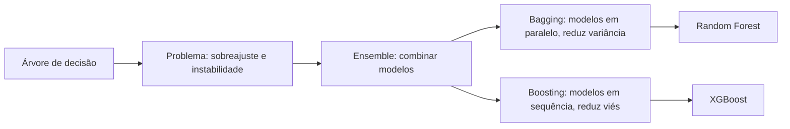

# 27 · Árvores, Redes e Ensemble Models (I, II, III)
**Profa. Valquíria Alencar · 3 aulas · Prioridade: alta (ML supervisionado: conceitos e métricas são cobrados; você já sabe Python, foque nos conceitos)**

## O fio condutor deste capítulo

Imagine decidir, numa sexta à noite, se vai pedir delivery: *tenho comida em casa? estou cansado? há promoção?* Você faz uma **sequência de perguntas de sim ou não** até chegar à decisão. Uma **árvore de decisão** é exatamente isso, aprendida automaticamente a partir de dados. Ela é fácil de explicar, mas tem um defeito sério: **decora os dados** e muda muito com pequenas variações. A solução é **combinar muitas árvores** (os *ensembles*), e é daí que surgem a **Random Forest** e o **XGBoost**.

O capítulo avança em quatro passos: (1) a **árvore** em si; (2) as **métricas** para avaliar um modelo; (3) o **diagnóstico** de viés e variância, que explica *por que* combinar modelos funciona; (4) as técnicas de **ensemble** (voting, bagging, boosting, stacking) e seus dois representantes mais usados.

## 1. A árvore de decisão

É um método **supervisionado não paramétrico**: não impõe uma fórmula; a própria árvore constrói sua estrutura fazendo perguntas "verdadeiro ou falso". Ela tem três tipos de nó:

| Nó | Papel |
|---|---|
| **Raiz** | ponto de partida: o conjunto de dados completo |
| **Internos** | perguntas sobre as características |
| **Folhas** | resultado final |

A mesma árvore serve a dois tipos de problema:

| | **Classificação** | **Regressão** |
|---|---|---|
| Y é... | uma categoria (cancela ou não) | um número (preço, tempo de entrega) |
| A folha devolve | a **classe mais frequente** | a **média** dos valores que caíram nela |
| Melhor divisão | a que **reduz a impureza** dos grupos | a que **reduz o erro** (critério padrão: squared error) |

> **Exemplo resolvido.** Dez clientes: 5 adimplentes e 5 inadimplentes (grupo misturado, difícil decidir). A pergunta "teve atraso anterior?" gera dois grupos: 4 inadimplentes + 1 adimplente (com atraso) e 4 adimplentes + 1 inadimplente (sem atraso). Os grupos ficaram **mais puros**: foi uma boa divisão.

**Vantagens:** exige pouca preparação (em geral **não precisa normalizar**), aceita variáveis numéricas e categóricas e é **"caixa branca"** (cada previsão é explicável por regras). **Desvantagens:** **sobreajuste**, **instabilidade** (pequenas mudanças nos dados geram árvores muito diferentes), sensibilidade a **classes desbalanceadas** e **dificuldade de extrapolar**. Treina-se tipicamente com **80% dos dados** e testa-se nos **20%** restantes; em classificação use **`stratify=y`**. Os **hiperparâmetros** (definidos antes do treino) controlam a árvore: `max_depth`, `min_samples_split`, `min_samples_leaf` e `criterion`. Atenção ao **vazamento de dados** (*data leakage*) e a **não usar IDs** (CPF, RG) como variáveis.

## 2. Como medir um modelo

### Classificação: a matriz de confusão

| | Previsto positivo | Previsto negativo |
|---|---|---|
| **Real positivo** | VP | FN |
| **Real negativo** | FP | VN |

\[ \text{Acurácia} = \frac{VP + VN}{\text{total}} \quad \text{Precisão} = \frac{VP}{VP + FP} \quad \text{Recall} = \frac{VP}{VP + FN} \quad F_1 = \frac{2\cdot\text{Precisão}\cdot\text{Recall}}{\text{Precisão}+\text{Recall}} \]

| Métrica | Pergunta | Importa quando... |
|---|---|---|
| **Acurácia** | quanto acertou no total? | classes equilibradas (enganosa em bases desbalanceadas) |
| **Precisão** | quando diz "positivo", quanto confio? | o **falso alarme** é caro |
| **Recall (sensibilidade)** | quantos positivos reais encontrou? | **perder um positivo** é grave (doença, fraude) |
| **F1** | equilíbrio entre precisão e recall (média **harmônica**) | quer os dois |

A **curva ROC/AUC** mostra a capacidade de distinguir as classes (a diagonal é um classificador aleatório).

### Regressão

| Métrica | Característica |
|---|---|
| **MAE** | erro médio absoluto; mesma unidade; **robusto a outliers** |
| **MSE** | erro quadrático médio; **penaliza erros grandes** |
| **RMSE** | raiz do MSE; mesma unidade |
| **R²** | proporção da variância explicada |

> **Exemplo resolvido.** VP = 40, FN = 10, FP = 20, VN = 130. Precisão = 40/60 ≈ 0,67; recall = 40/50 = 0,80; F1 = 2·0,67·0,80/(0,67+0,80) ≈ **0,73**. Se o dano de perder um doente é grande, priorize o **recall**.

A **validação cruzada K-fold** divide os dados em K partes e usa cada uma como teste uma vez; a média dos resultados é uma avaliação **mais robusta** (não depende da "sorte" de uma divisão).

## 3. Viés, variância e por que combinar modelos

Os erros de um modelo vêm de dois lugares. **Viés alto** é um modelo simples demais (**subajuste**): previsões consistentes, mas "fora do alvo". **Variância alta** é um modelo flexível demais (**sobreajuste**): previsões espalhadas, que acompanham o ruído dos dados de treino. Reduzir um tende a aumentar o outro. Uma árvore profunda tem **baixo viés e alta variância**.

A ideia do **ensemble** é a do **júri**: um único jurado pode errar, mas a decisão coletiva de vários é mais confiável. Modelos diferentes erram em pontos diferentes e, na média ou na votação, os erros individuais tendem a se cancelar.

## 4. As técnicas de ensemble

| Técnica | Como funciona | Efeito |
|---|---|---|
| **Voting / averaging** | modelos diferentes votam: **hard voting** = classe mais votada; **soft voting** = média das **probabilidades**; em regressão, média | simples |
| **Bagging** | modelos do **mesmo tipo**, **em paralelo**, cada um em uma amostra **bootstrap** (com reposição); agrega por voto ou média | **reduz variância** |
| **Boosting** | modelos **em sequência**; cada um foca nos **erros (resíduos)** do anterior | **reduz viés** |
| **Stacking** | um **meta-modelo** aprende a combinar as previsões dos modelos-base (usa previsões *out-of-fold* para evitar vazamento) | combina modelos diferentes |

No **bootstrap**, cada amostra tem o tamanho dos dados originais, mas sorteada **com reposição**: cerca de **63%** dos registros são únicos e **37% ficam de fora**, as chamadas amostras **OOB (out-of-bag)**, que servem como validação "de graça". No **boosting**, os "freios" são o número de estimadores, o **learning rate** (tamanho do passo) e o **early stopping**.

### Random Forest e XGBoost

A **Random Forest** é bagging **mais aleatoriedade na escolha das variáveis**: cada árvore treina em um bootstrap das **linhas** e, em **cada divisão**, só considera um subconjunto aleatório das **colunas**. Isso **descorrelaciona** as árvores e aumenta a redução de variância. Hiperparâmetros: `n_estimators` (nº de árvores, padrão 100), `max_features`, `max_depth`, `min_samples_split`, `min_samples_leaf` e `bootstrap`.

O **XGBoost** é *gradient boosting* com árvores, acrescido de **regularização L1 (`reg_alpha`) e L2 (`reg_lambda`)**, tratamento nativo de **valores faltantes** e paralelização. A regularização penaliza folhas de peso alto: a **L1** pode zerar contribuições (simplifica) e a **L2** as suaviza. Hiperparâmetros: `n_estimators`, `learning_rate`, `max_depth`, `min_child_weight`, `colsample_bytree`. Usa `DMatrix` para validação cruzada e *early stopping* para parar quando a validação deixa de melhorar.

| | **Decision Tree** | **Random Forest** | **XGBoost** |
|---|---|---|---|
| Tipo | modelo único | ensemble **bagging** (paralelo) | ensemble **boosting** (sequencial) |
| Viés / variância | baixo viés, **alta variância** | **reduz variância** | reduz viés; a regularização controla a variância |
| Interpretabilidade | **alta** | média/baixa | média/baixa |
| Quando usar | baseline, explicabilidade | robustez sem muito ajuste | alta performance (sensível a ajuste) |

A estratégia sugerida é **começar simples**: Decision Tree → Random Forest → XGBoost.

## O que levar daqui

A árvore pergunta sim/não até decidir; folha = classe mais frequente (classificação) ou média (regressão). Avalie com acurácia, precisão, recall, F1 (e MAE, RMSE, R² em regressão) e valide por K-fold. Uma árvore profunda tem alta variância; ensembles combinam modelos: bagging (paralelo, reduz variância; Random Forest), boosting (sequencial, reduz viés; XGBoost), stacking (meta-modelo).

## Erros que todo mundo comete

| Erro | Correção |
|---|---|
| "Árvore profunda = modelo melhor" | tende ao **sobreajuste** |
| "Acurácia basta" | enganosa em bases desbalanceadas; olhe **precisão, recall e F1** |
| "Bagging e boosting são parecidos" | bagging: **paralelo**, reduz variância; boosting: **sequencial**, reduz viés |
| "A Random Forest só sorteia as linhas" | sorteia também as **colunas em cada split** |
| "O XGBoost não aceita faltantes" | **trata** valores faltantes nativamente |
| "Aumentar o learning rate sempre ajuda" | alto demais **oscila**; baixo demais é lento |

## Teste-se

1. Para que serve o OOB no bagging?

Ver resposta
As ~37% de observações que ficam fora de cada bootstrap servem como validação embutida, sem separar dados.

2. Quando priorizar recall em vez de precisão?

Ver resposta
Quando perder um positivo real é grave (doença, fraude) e o falso alarme é aceitável.

3. Qual a diferença entre hard e soft voting?

Ver resposta
Hard voting usa a classe mais votada; soft voting faz a média das probabilidades de cada modelo.

4. O que a regularização L1 faz no XGBoost?

Ver resposta
Penaliza a soma dos valores absolutos dos pesos das folhas, podendo zerar contribuições e simplificar o modelo.

## Pergunta típica
Estrutura da árvore (raiz, nós, folhas) e por que é "caixa branca" · classificação × regressão (classe mais frequente × média) · overfitting (sinais, causas, hiperparâmetros que controlam) · definições e fórmulas de acurácia/precisão/recall/F1, e qual priorizar (FN × FP) · MAE × MSE × RMSE × R² · K-fold · viés × variância · bagging × boosting × stacking × voting (hard/soft) · bootstrap e OOB (63%/37%) · "dupla aleatoriedade" do Random Forest · o que o XGBoost acrescenta · learning rate e early stopping
