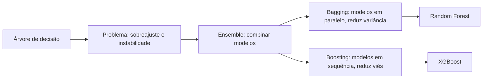

# 27 · Árvores, Redes e Ensemble Models (I, II, III)
**Profa. Valquíria Alencar · 3 aulas · Prioridade: alta (ML supervisionado: conceitos e métricas são cobrados; você já sabe Python, foque nos conceitos)**

## O fio condutor deste capítulo

Imagine decidir, numa sexta à noite, se vai pedir delivery: *tenho comida em casa? estou cansado? há promoção?* Você faz uma **sequência de perguntas de sim ou não** até chegar à decisão. Uma **árvore de decisão** é exatamente isso, aprendida automaticamente a partir de dados. Ela é fácil de explicar, mas tem um defeito sério: **decora os dados** e muda muito com pequenas variações. A solução é **combinar muitas árvores** (os *ensembles*), e é daí que surgem a **Random Forest** e o **XGBoost**.

O capítulo avança em quatro passos: (1) a **árvore** em si; (2) as **métricas** para avaliar um modelo; (3) o **diagnóstico** de viés e variância, que explica *por que* combinar modelos funciona; (4) as técnicas de **ensemble** (voting, bagging, boosting, stacking) e seus dois representantes mais usados.



## 1. A árvore de decisão

É um método **supervisionado não paramétrico**: não impõe uma fórmula; a própria árvore constrói sua estrutura fazendo perguntas "verdadeiro ou falso". Ela tem três tipos de nó:

| Nó | Papel |
|---|---|
| **Raiz** | ponto de partida: o conjunto de dados completo |
| **Internos** | perguntas sobre as características |
| **Folhas** | resultado final |

A mesma árvore serve a dois tipos de problema:

| | **Classificação** | **Regressão** |
|---|---|---|
| Y é... | uma categoria (cancela ou não) | um número (preço, tempo de entrega) |
| A folha devolve | a **classe mais frequente** | a **média** dos valores que caíram nela |
| Melhor divisão | a que **reduz a impureza** dos grupos | a que **reduz o erro** (critério padrão: squared error) |

### Exemplo completo (da aula): árvore para prever doença cardíaca

A aula usa uma base de **270 pacientes** (150 sem doença cardíaca, "Absence", e 120 com doença, "Presence"), com variáveis como idade, sexo, tipo de dor no peito, pressão, colesterol, frequência cardíaca máxima, depressão do segmento ST, nº de vasos coloridos na fluoroscopia e resultado do exame de tálio. As variáveis categóricas (tipo de dor e tálio) são transformadas em dummies, e os dados se dividem em **80% treino (216 pacientes)** e **20% teste (54)**, mantendo a proporção das classes (`stratify`).

**O critério de divisão (Gini).** A impureza Gini de um nó é \(1 - \sum p_i^2\). O nó raiz tem **120 sem doença e 96 com doença**:

\[ G_{raiz} = 1 - \left(\frac{120}{216}\right)^2 - \left(\frac{96}{216}\right)^2 = 1 - 0{,}309 - 0{,}198 = 0{,}494 \]

(o máximo para duas classes é 0,5: grupo completamente misturado). A árvore testa cada variável e escolhe a pergunta que **mais reduz a impureza**. A melhor pergunta é **"o paciente tem dor no peito tipo 4?"** (assintomática):

| Grupo | Sem doença | Com doença | Total | Gini |
|---|---|---|---|---|
| **Não** (tipo ≠ 4) | 94 | 26 | 120 | \(1 - 0{,}783^2 - 0{,}217^2 = \) **0,339** |
| **Sim** (tipo 4) | 26 | 70 | 96 | \(1 - 0{,}271^2 - 0{,}729^2 = \) **0,395** |

A impureza **após** a divisão é a média ponderada: \(\frac{120}{216}(0{,}339) + \frac{96}{216}(0{,}395) = \) **0,364**. O **ganho** é \(0{,}494 - 0{,}364 = \) **0,130**. Os dois grupos ficaram **mais puros** (Gini menor), então foi uma boa divisão, e é isso que a árvore repete, nó após nó, até o critério de parada. (Com o critério **entropia**, a conta é análoga: raiz = 0,991, ganho = 0,198.)

**A árvore completa (sem poda) decora o treino.** Sem limite de profundidade, ela cresce até **profundidade 8 com 33 folhas** e acerta **100% no treino**, mas só **79,6% no teste**: sobreajuste (overfitting). A distância entre os dois números é o sinal.

**A árvore podada (`max_depth=3`).** Fica simples o bastante para ser lida, e **generaliza melhor**: 86,1% no treino e **83,3% no teste**. A árvore completa em texto:

```
dor_tipo_4 <= 0,5 (NÃO)
|   tálio_3 <= 0,5
|   |   vasos <= 0,5      → Sem doença [16 sem, 6 com]
|   |   vasos >  0,5      → Com doença [2 sem, 11 com]
|   tálio_3 >  0,5
|   |   depressão ST <= 2,3 → Sem doença [74 sem, 6 com]
|   |   depressão ST >  2,3 → Com doença [2 sem, 3 com]
dor_tipo_4 >  0,5 (SIM)
|   vasos <= 0,5
|   |   tálio_3 <= 0,5    → Com doença [6 sem, 15 com]
|   |   tálio_3 >  0,5    → Sem doença [17 sem, 5 com]
|   vasos >  0,5
|   |   sexo <= 0,5       → Com doença [3 sem, 7 com]
|   |   sexo >  0,5       → Com doença [0 sem, 43 com]
```

Leia assim: um paciente **com dor tipo 4 e vasos coloridos > 0 e do sexo masculino** cai na folha com **43 doentes e 0 saudáveis** (a regra mais forte). Já alguém **sem dor tipo 4 e com tálio normal (3) e depressão ST pequena** cai na folha com 74 saudáveis e 6 doentes. Por ser uma árvore (modelo "caixa-branca"), cada previsão tem uma **regra explicável**.

**Escolhendo os hiperparâmetros (GridSearchCV).** A aula testa `max_depth` em {3, 5, 7, 10}, `min_samples_leaf` em {1, 5, 10, 20} e `criterion` em {gini, entropy} com **validação cruzada de 5 partições**. A melhor combinação é **entropy, `max_depth=3` e `min_samples_leaf=10`**, com acurácia média de **82,2%**; a árvore ajustada tem 85,6% no treino e **85,2% no teste** (treino e teste **próximos**: boa generalização). Repare no padrão: **a profundidade menor venceu**.


**Vantagens:** exige pouca preparação (em geral **não precisa normalizar**), aceita variáveis numéricas e categóricas e é **"caixa branca"** (cada previsão é explicável por regras). **Desvantagens:** **sobreajuste**, **instabilidade** (pequenas mudanças nos dados geram árvores muito diferentes), sensibilidade a **classes desbalanceadas** e **dificuldade de extrapolar**. Treina-se tipicamente com **80% dos dados** e testa-se nos **20%** restantes; em classificação use **`stratify=y`**. Os **hiperparâmetros** (definidos antes do treino) controlam a árvore: `max_depth`, `min_samples_split`, `min_samples_leaf` e `criterion`. Atenção ao **vazamento de dados** (*data leakage*) e a **não usar IDs** (CPF, RG) como variáveis.

## 2. Como medir um modelo

### Classificação: a matriz de confusão

| | Previsto positivo | Previsto negativo |
|---|---|---|
| **Real positivo** | VP | FN |
| **Real negativo** | FP | VN |

\[ \text{Acurácia} = \frac{VP + VN}{\text{total}} \quad \text{Precisão} = \frac{VP}{VP + FP} \quad \text{Recall} = \frac{VP}{VP + FN} \quad F_1 = \frac{2\cdot\text{Precisão}\cdot\text{Recall}}{\text{Precisão}+\text{Recall}} \]

| Métrica | Pergunta | Importa quando... |
|---|---|---|
| **Acurácia** | quanto acertou no total? | classes equilibradas (enganosa em bases desbalanceadas) |
| **Precisão** | quando diz "positivo", quanto confio? | o **falso alarme** é caro |
| **Recall (sensibilidade)** | quantos positivos reais encontrou? | **perder um positivo** é grave (doença, fraude) |
| **F1** | equilíbrio entre precisão e recall (média **harmônica**) | quer os dois |

A **curva ROC/AUC** mostra a capacidade de distinguir as classes (a diagonal é um classificador aleatório).

### Regressão

| Métrica | Característica |
|---|---|
| **MAE** | erro médio absoluto; mesma unidade; **robusto a outliers** |
| **MSE** | erro quadrático médio; **penaliza erros grandes** |
| **RMSE** | raiz do MSE; mesma unidade |
| **R²** | proporção da variância explicada |

> **Exemplo completo (a mesma base de doença cardíaca): a matriz de confusão da árvore sem poda no teste (54 pacientes).** Classe positiva = "com doença" (24 pacientes no teste):
>
> | | Previsto: com doença | Previsto: sem doença |
> |---|---|---|
> | **Real: com doença** | VP = 20 | FN = 4 |
> | **Real: sem doença** | FP = 7 | VN = 23 |
>
> **Acurácia** = (20 + 23) ÷ 54 = **79,6%**. **Precisão** (dos que o modelo chamou de doentes, quantos eram) = 20 ÷ (20 + 7) = **0,74**. **Recall** (dos doentes de verdade, quantos ele pegou) = 20 ÷ (20 + 4) = **0,83**. **F1** = 2 · 0,74 · 0,83 ÷ (0,74 + 0,83) = **0,78**. Os 4 falsos negativos são **doentes que o modelo mandou para casa**: em medicina esse é o erro mais caro, então se prioriza o **recall**.


A **validação cruzada K-fold** divide os dados em K partes e usa cada uma como teste uma vez; a média dos resultados é uma avaliação **mais robusta** (não depende da "sorte" de uma divisão).

## 3. Viés, variância e por que combinar modelos

Os erros de um modelo vêm de dois lugares. **Viés alto** é um modelo simples demais (**subajuste**): previsões consistentes, mas "fora do alvo". **Variância alta** é um modelo flexível demais (**sobreajuste**): previsões espalhadas, que acompanham o ruído dos dados de treino. Reduzir um tende a aumentar o outro. Uma árvore profunda tem **baixo viés e alta variância**.


A ideia do **ensemble** é a do **júri**: um único jurado pode errar, mas a decisão coletiva de vários é mais confiável. Modelos diferentes erram em pontos diferentes e, na média ou na votação, os erros individuais tendem a se cancelar.

## 4. As técnicas de ensemble

| Técnica | Como funciona | Efeito |
|---|---|---|
| **Voting / averaging** | modelos diferentes votam: **hard voting** = classe mais votada; **soft voting** = média das **probabilidades**; em regressão, média | simples |
| **Bagging** | modelos do **mesmo tipo**, **em paralelo**, cada um em uma amostra **bootstrap** (com reposição); agrega por voto ou média | **reduz variância** |
| **Boosting** | modelos **em sequência**; cada um foca nos **erros (resíduos)** do anterior | **reduz viés** |
| **Stacking** | um **meta-modelo** aprende a combinar as previsões dos modelos-base (usa previsões *out-of-fold* para evitar vazamento) | combina modelos diferentes |

No **bootstrap**, cada amostra tem o tamanho dos dados originais, mas sorteada **com reposição**: cerca de **63%** dos registros são únicos e **37% ficam de fora**, as chamadas amostras **OOB (out-of-bag)**, que servem como validação "de graça". No **boosting**, os "freios" são o número de estimadores, o **learning rate** (tamanho do passo) e o **early stopping**.

### Random Forest e XGBoost

A **Random Forest** é bagging **mais aleatoriedade na escolha das variáveis**: cada árvore treina em um bootstrap das **linhas** e, em **cada divisão**, só considera um subconjunto aleatório das **colunas**. Isso **descorrelaciona** as árvores e aumenta a redução de variância. Hiperparâmetros: `n_estimators` (nº de árvores, padrão 100), `max_features`, `max_depth`, `min_samples_split`, `min_samples_leaf` e `bootstrap`.

O **XGBoost** é *gradient boosting* com árvores, acrescido de **regularização L1 (`reg_alpha`) e L2 (`reg_lambda`)**, tratamento nativo de **valores faltantes** e paralelização. A regularização penaliza folhas de peso alto: a **L1** pode zerar contribuições (simplifica) e a **L2** as suaviza. Hiperparâmetros: `n_estimators`, `learning_rate`, `max_depth`, `min_child_weight`, `colsample_bytree`. Usa `DMatrix` para validação cruzada e *early stopping* para parar quando a validação deixa de melhorar.

| | **Decision Tree** | **Random Forest** | **XGBoost** |
|---|---|---|---|
| Tipo | modelo único | ensemble **bagging** (paralelo) | ensemble **boosting** (sequencial) |
| Viés / variância | baixo viés, **alta variância** | **reduz variância** | reduz viés; a regularização controla a variância |
| Interpretabilidade | **alta** | média/baixa | média/baixa |
| Quando usar | baseline, explicabilidade | robustez sem muito ajuste | alta performance (sensível a ajuste) |

A estratégia sugerida é **começar simples**: Decision Tree → Random Forest → XGBoost.

### Exemplo completo (da aula): Random Forest para prever clientes inativos

A segunda aula usa **10.127 clientes de um banco**, com 20 variáveis (idade, renda, categoria do cartão, limite, transações...). O alvo é se o cliente ficou **Inativo** (churn): **1.627 inativos (16,1%)** e 8.500 ativos (83,9%), uma base **desbalanceada**. As variáveis categóricas viram colunas 0/1 (one-hot), e os dados se dividem em 80% treino (8.101) e 20% teste (2.026), com `stratify`.

| Modelo | Acurácia no treino | Acurácia no teste | Precisão (Inativo) | Recall (Inativo) | F1 (Inativo) |
|---|---|---|---|---|---|
| **Árvore de decisão** (sem poda) | 100% | 92,9% | 0,785 | 0,766 | 0,776 |
| **Random Forest** (100 árvores) | 100% | **95,7%** | **0,954** | 0,769 | **0,852** |

**Como ler.** Os dois modelos têm 100% no treino (decoram os dados), mas **no teste a floresta é melhor**: a acurácia sobe de 92,9% para 95,7%, e a **precisão para a classe Inativo vai de 0,785 para 0,954** (a floresta quase não erra quando diz que alguém vai sair: só 12 falsos alarmes contra 68 da árvore). Isso ilustra o ganho do ensemble: **várias árvores treinadas em amostras diferentes e com variáveis sorteadas, cujas respostas são combinadas por votação, reduzem a variância** e o sobreajuste.

**Um cuidado com o desbalanceamento.** O **recall** de Inativos ficou **parecido (0,77)** nos dois modelos: a floresta ainda deixa passar **75 dos 325 inativos** do teste. A acurácia de 95,7% **esconde** isso. Como o custo de perder um cliente que vai embora é alto, a aula **otimiza o recall** (com busca de hiperparâmetros e `scoring` por recall).

**Quais variáveis importam** (a importância média na floresta): **Valor_Total_Transacoes (18,4%)**, **Quantidade_Total_Transacoes (14,7%)**, **Variacao_Quantidade_Transacoes_T4_T1 (10,5%)**, **Saldo_Rotativo_Total (10,3%)** e **Taxa_Media_Utilizacao_Credito (7,0%)**. O **comportamento recente de uso** (transacionar menos ao longo do ano) é o melhor sinal de que o cliente vai embora.

## O que levar daqui

A árvore pergunta sim/não até decidir; folha = classe mais frequente (classificação) ou média (regressão). Avalie com acurácia, precisão, recall, F1 (e MAE, RMSE, R² em regressão) e valide por K-fold. Uma árvore profunda tem alta variância; ensembles combinam modelos: bagging (paralelo, reduz variância; Random Forest), boosting (sequencial, reduz viés; XGBoost), stacking (meta-modelo).

## Erros que todo mundo comete

| Erro | Correção |
|---|---|
| "Árvore profunda = modelo melhor" | tende ao **sobreajuste** |
| "Acurácia basta" | enganosa em bases desbalanceadas; olhe **precisão, recall e F1** |
| "Bagging e boosting são parecidos" | bagging: **paralelo**, reduz variância; boosting: **sequencial**, reduz viés |
| "A Random Forest só sorteia as linhas" | sorteia também as **colunas em cada split** |
| "O XGBoost não aceita faltantes" | **trata** valores faltantes nativamente |
| "Aumentar o learning rate sempre ajuda" | alto demais **oscila**; baixo demais é lento |

## Teste-se

1. Para que serve o OOB no bagging?
<details markdown="1"><summary>Ver resposta</summary>As ~37% de observações que ficam fora de cada bootstrap servem como validação embutida, sem separar dados.</details>

2. Quando priorizar recall em vez de precisão?
<details markdown="1"><summary>Ver resposta</summary>Quando perder um positivo real é grave (doença, fraude) e o falso alarme é aceitável.</details>

3. Qual a diferença entre hard e soft voting?
<details markdown="1"><summary>Ver resposta</summary>Hard voting usa a classe mais votada; soft voting faz a média das probabilidades de cada modelo.</details>

4. O que a regularização L1 faz no XGBoost?
<details markdown="1"><summary>Ver resposta</summary>Penaliza a soma dos valores absolutos dos pesos das folhas, podendo zerar contribuições e simplificar o modelo.</details>

## Pergunta típica
Estrutura da árvore (raiz, nós, folhas) e por que é "caixa branca" · classificação × regressão (classe mais frequente × média) · overfitting (sinais, causas, hiperparâmetros que controlam) · definições e fórmulas de acurácia/precisão/recall/F1, e qual priorizar (FN × FP) · MAE × MSE × RMSE × R² · K-fold · viés × variância · bagging × boosting × stacking × voting (hard/soft) · bootstrap e OOB (63%/37%) · "dupla aleatoriedade" do Random Forest · o que o XGBoost acrescenta · learning rate e early stopping
