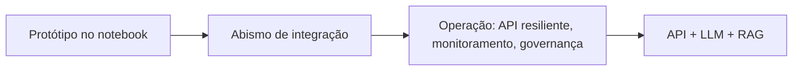
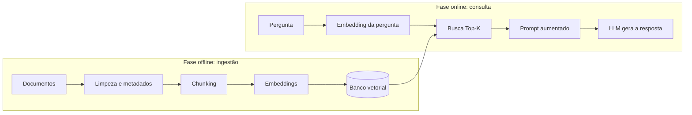

# 29 · Aula Extra: Desenvolvimento de APIs e Integração Prática de LLMs (I–II)
**Prof. Helder Prado Santos · 2 aulas extras · Prioridade: baixa para a avaliação (aula extra; você é dev e já sabe quase tudo de API: leia para o vocabulário de LLM e RAG)**

## O fio condutor deste capítulo

Um modelo de linguagem (LLM) sozinho responde com o que "sabe" de seu treinamento, que está congelado no tempo e **não inclui os documentos da sua empresa**. Para criar um produto útil é preciso resolver três problemas: **expor** o modelo como um serviço que outros sistemas consigam chamar (**API**), **controlá-lo** (custos, formato, segurança) e **dar a ele a memória** dos seus documentos (**RAG**). Os três pilares do capítulo são, portanto, **API (a ponte), LLM (o cérebro) e RAG (a memória)**.

A ordem é: do *protótipo ao produto*; as *APIs* e o que as compõe; os *LLMs sob a ótica da engenharia* (tokens, temperatura, riscos); os *embeddings* e a busca semântica; e, por fim, o **RAG**, que junta tudo.



## 1. Do protótipo ao produto

| Fase | O que acontece |
|---|---|
| **1. Prototipação** | testes em notebooks, validação de prompts, sem preocupação com escala |
| **2. Abismo de integração** | concorrência, padronização de formatos, latência de rede, gestão de dependências |
| **3. Operação** | API resiliente, monitoramento de métricas, auditoria e governança |

Tratar a IA como **serviço** traz vantagens: **atualização independente** (trocar o modelo ou o prompt sem mexer em quem consome), **poliglotismo** (Python para a IA e outras linguagens nos demais sistemas) e **escalabilidade direcionada** (dimensionar só o serviço de inferência).

## 2. APIs

Uma **API** é um **contrato**: define quais dados de entrada exige e qual formato de resposta devolve, escondendo a complexidade interna (a analogia é o garçom: você faz o pedido pelo cardápio e não precisa saber como funciona a cozinha). A arquitetura é **cliente-servidor**: o cliente (navegador, app, dashboard, script) faz uma **requisição (request)** e o servidor (que guarda os recursos, as regras e os modelos) devolve uma **resposta (response)**. O protocolo **HTTP** é **stateless**: cada requisição é isolada e traz tudo de que precisa. Os **endpoints** (rotas) identificam recursos (`/predicao`, `/resumo`).

| Método | Uso |
|---|---|
| **GET** | consulta e leitura (não altera estado) |
| **POST** | envio de dados complexos para inferência ou criação de registros |
| **PUT / PATCH / DELETE** | atualização total, parcial e remoção (REST) |

Uma requisição tem **URL e endpoint**, **headers** (tipo de conteúdo, tokens de segurança), **query parameters** (filtros na URL) e **body/payload** (dados volumosos). A resposta traz um **status code**:

| Família | Significado | Exemplo |
|---|---|---|
| **2xx** | sucesso | 200 OK |
| **4xx** | **erro do cliente** | 400 Bad Request |
| **5xx** | **erro do servidor** | 500 Internal Error |

O formato de troca é o **JSON** (chave-valor, legível por humanos e máquinas, fácil de converter em DataFrames e dicionários). No **FastAPI**, a validação é declarativa com o **Pydantic**:

```python
class RequisicaoAnalise(BaseModel):
    texto: str
    max_tokens: int = 500
    temperatura: float = 0.1
```

O FastAPI é **assíncrono** (`async/await`, evita gargalos em chamadas a LLMs), roda sobre servidores **ASGI** (Uvicorn) e gera **documentação automática** (OpenAPI/Swagger).

## 3. LLMs sob a ótica da engenharia

Um LLM usa a arquitetura **Transformer** (capítulo 28) e funciona como uma **função estocástica**: transforma uma sequência de entrada em uma **distribuição de probabilidade do próximo token**. É uma mudança de paradigma: de regras determinísticas para uma inteligência probabilística. Os provedores se dividem em **proprietários** (Google, OpenAI, Anthropic: conveniência e estado da arte), **open-weight** (Llama, Mistral: **soberania sobre os dados** e personalização) e **aceleração em nuvem** (Groq, Together AI).

| Conceito | O que é |
|---|---|
| **Token** | fragmento de palavra (~4 caracteres em inglês); base de **tarifação** e limites |
| **Janela de contexto** | máximo de tokens (**entrada + saída**) vistos de uma vez |
| **Temperatura baixa (0–0,2)** | **determinismo**; indicada para extração de dados, JSON e RAG |
| **Temperatura alta (0,7–1,0)** | variabilidade e criatividade; brainstorming |
| **Top-P (nucleus sampling)** | restringe a escolha aos tokens mais prováveis |
| **Alucinação** | informação incorreta apresentada de forma plausível |

**Boas práticas de produção:** chaves de API **nunca no código** (use variáveis de ambiente `.env`); **separe os ambientes** (dev, homologação, produção); defina **limites financeiros**; respeite os **rate limits** (**RPM**, requisições por minuto, e **TPM**, tokens por minuto); como a latência é de segundos, use arquiteturas **assíncronas**. As **saídas estruturadas** usam *constrained decoding*, restringindo a geração ao **JSON Schema** para garantir campos e tipos corretos. Para **resiliência**: **exponential backoff**, **timeouts explícitos** e **fallback**.

## 4. Embeddings e busca semântica

Por que um LLM falha com dados privados? Por três razões: o **knowledge cutoff** (o conhecimento é congelado), o **ponto cego corporativo** (nunca viu seus documentos) e o **custo inviável de retreinar**. A saída é transformar texto em **embeddings**: listas de centenas ou milhares de números gerados por um modelo neural, em que **textos de significado parecido ficam próximos**, mesmo com palavras diferentes ("dor de cabeça intensa" ≈ "cefaleia").

| | **Busca léxica** | **Busca semântica (vetorial)** |
|---|---|---|
| Como busca | correspondência exata de caracteres (BM25, SQL `LIKE`) | significado contextual |
| Fraqueza | falha com sinônimos e erros de digitação | exige embeddings e índice vetorial |

A proximidade entre vetores mede-se por **similaridade de cosseno** (o ângulo; a mais usada), **distância euclidiana** ou **produto escalar**. **Bancos vetoriais** (ChromaDB, DuckDB para protótipos; Pinecone, Qdrant, Milvus em nuvem; pgvector no PostgreSQL) respondem rapidamente à pergunta "quais os K vetores mais parecidos?". Como comparar com **todos** os vetores (*k-NN exato*) é inviável em bases grandes, usam-se algoritmos de **busca aproximada (ANN)**, como o índice **HNSW**, que trocam um pouco de precisão por ganhos de até ~100× em velocidade.

## 5. RAG (Retrieval-Augmented Generation)

O RAG é o "**especialista com uma biblioteca**": no momento da pergunta, a LLM recebe os trechos relevantes dos documentos antes de responder. Tem duas etapas: **Retrieval** (buscar os trechos no banco vetorial) e **Generation** (a LLM redige a resposta **ancorada** na fonte).



No **chunking**, pedaços **grandes demais diluem a busca** e **pequenos demais perdem o contexto**; o **overlap** (sobreposição) evita quebrar ideias ao meio, e a divisão **semântica** respeita parágrafos e seções. O **grounding (ancoragem)** instrui a LLM a responder **apenas** com o contexto recuperado e a dizer que não encontrou quando a informação não está lá, o que **reduz alucinações**.

| | **RAG** | **Fine-tuning** |
|---|---|---|
| Ideal para | **conhecimento factual**, dados que mudam, **auditoria da fonte**, menor custo | **estilo e comportamento** (tom de voz, jargões, formatos de saída) |

A API também funciona como **hub de analytics**: pipelines ETL/ELT, dashboards de BI e sistemas corporativos (CRM, ERP, RH) a consomem via HTTP. A arquitetura do laboratório usou **FastAPI** (rotas), **Pydantic** (contrato JSON), **Gemini API** (embeddings e geração) e **ChromaDB** (banco vetorial local).

## O que levar daqui

A IA vira produto quando exposta por uma API com contrato claro (HTTP stateless, JSON, status 2xx/4xx/5xx). Temperatura baixa para extração; chaves em `.env`; respeite rate limits e use backoff. Embeddings habilitam a busca semântica; o RAG combina recuperação e geração com grounding para reduzir alucinações. RAG serve a fatos; fine-tuning serve a estilo.

## Erros que todo mundo comete

| Erro | Correção |
|---|---|
| "HTTP guarda estado entre requisições" | é **stateless** |
| "Erro 4xx é problema do servidor" | **4xx = cliente**; **5xx = servidor** |
| "Fine-tuning é a melhor forma de atualizar fatos" | para fatos use **RAG** |
| "Temperatura alta para extrair dados" | use **baixa** (determinismo) |
| "Busca semântica = busca por palavra-chave" | a semântica busca **significado** |
| "k-NN exato escala bem" | para bases grandes usa-se **ANN** (HNSW) |

## Teste-se

1. O que significa dizer que o HTTP é stateless?
<details markdown="1"><summary>Ver resposta</summary>Cada requisição é isolada e precisa trazer todas as informações para ser processada.</details>

2. Qual temperatura usar para extrair dados em JSON?
<details markdown="1"><summary>Ver resposta</summary>Baixa (0 a 0,2), para ter respostas consistentes e determinísticas.</details>

3. Quais as etapas do RAG?
<details markdown="1"><summary>Ver resposta</summary>Ingestão (limpeza, chunking, embeddings, banco vetorial) e consulta (embedding da pergunta, busca Top-K, prompt aumentado, geração ancorada).</details>

4. Quando usar RAG em vez de fine-tuning?
<details markdown="1"><summary>Ver resposta</summary>Para conhecimento factual e dados que mudam, com necessidade de auditar a fonte e custo menor; fine-tuning serve a estilo e comportamento.</details>

## Pergunta típica
O que é uma API/contrato e o que significa stateless · métodos HTTP e famílias de status (2xx/4xx/5xx) · papel de FastAPI/Pydantic · tokens, janela de contexto, temperatura e Top-P · o que é alucinação e como RAG/grounding reduzem · embedding, busca semântica × léxica, similaridade de cosseno · ANN/HNSW × k-NN exato · etapas do RAG · RAG × fine-tuning · boas práticas (API keys em .env, rate limits RPM/TPM, backoff, structured outputs)
