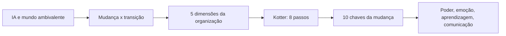

# 30 · Gestão da Mudança na Era Digital
**Profa. Fátima Cador Jinnyat · 1 aula · Prioridade: média (teórica; costuma aparecer como dissertativa ou múltipla escolha de conceitos: memorize os modelos e as listas)**

## O fio condutor deste capítulo

A empresa decide, numa segunda-feira, adotar uma plataforma de inteligência artificial. Em uma semana, a tecnologia está instalada. Mas o cientista de dados que construiu sua identidade profissional em "eu sei analisar dados" está se perguntando: *e agora que a máquina faz parte disso melhor que eu, o que me torna valioso?* O ponto central do capítulo é este descompasso: **a tecnologia muda o trabalho; a transição muda o trabalhador.** Gerir a mudança não é apenas treinar pessoas em uma ferramenta nova; é cuidar da **dimensão humana** (emoções, identidade, poder, cultura).

O percurso é: (1) o *contexto* de uma IA que cresce rápido e de um mundo ambivalente; (2) a diferença entre **mudança** e **transição** (Bridges); (3) as **dimensões** da organização que se alteram; (4) o **método** de Kotter e as **10 chaves**; e (5) o papel de **poder, emoção, aprendizagem e comunicação** na mudança.

## 1. Contexto: IA e um mundo ambivalente

A internet mudou a noção de tempo e espaço, e o crescimento é **exponencial**. Quatro vozes dão leituras diferentes da IA:

| Autor | Visão |
|---|---|
| **Andrew Ng** | a IA tende a **transformar tarefas**, não a eliminar o profissional |
| **Geoffrey Hinton** | preocupação com sistemas difíceis de controlar e com o impacto no trabalho |
| **Fei-Fei Li** | IA **centrada no ser humano** |
| **Sam Altman** | avançar rápido aprendendo no caminho (o paradoxo: aceleração exige cuidado) |

Ortega y Gasset resume: há quem cultue a tecnologia de forma ignorante e quem lute contra ela de forma ignorante. O desafio é **lidar com a ambivalência**, nem otimismo nem medo tecnológico, **humanizando a transformação** sem impedi-la e **preservando a autonomia humana**. Um dado ilustra o descompasso (**McKinsey, 2026**): **88%** das empresas usam IA em ao menos uma área, mas só **37%** relatam impacto real no lucro. A visão tradicional de gestão da mudança não basta; é preciso abrir diálogo sobre **construção de sentido**, **impacto emocional**, **experimentação** e **integração da IA aos processos**.

## 2. Mudança × transição (William Bridges)

> **Memorize.** **Mudança é um evento. Transição é um processo psicológico.**

| **Mudança** | **Transição** |
|---|---|
| acontece **fora** das pessoas | acontece **dentro** das pessoas |
| pode ser planejada | precisa ser vivenciada |
| é visível | muitas vezes invisível |
| envolve estrutura, tecnologia, processos | envolve **identidade e emoções** |
| pode ser rápida | tem **ritmo próprio** |
| é imposta ou decidida | precisa ser assimilada |

Por isso a **adoção não é consequência automática da superioridade técnica**: a pessoa pode reconhecer que a tecnologia é melhor e ainda assim resistir. **"As pessoas não resistem à mudança; resistem à perda que percebem por trás dela."** A transição tem **três fases**:

| Fase | O que acontece |
|---|---|
| **1. Ending** (fim, perda, desapego) | deixar algo para trás: uma rotina, um status, uma crença sobre expertise, uma identidade |
| **2. Neutral Zone** (zona neutra) | o antigo já não funciona e o novo ainda não se consolidou: **incerteza, experimentação, aprendizagem, ambiguidade**; a fase mais desconfortável e potencialmente **a mais criativa** |
| **3. New Beginning** | surge o novo sentido ("é assim que eu trabalho agora") |

**Preparar para a mudança** é ensinar ferramentas, processos e competências; **preparar para a transição** é ajudar a compreender o que se está deixando para trás e que nova identidade profissional emerge. O maior risco da IA talvez não seja substituir pessoas, mas **tornar obsoleta uma identidade profissional** que elas ainda não aprenderam a reconstruir.

## 3. As cinco dimensões da gestão da mudança

| Dimensão | Ideia |
|---|---|
| **Estratégia** | inicia ou provoca a mudança (fusão, nova tecnologia); depende da **capacidade da empresa de mudar** |
| **Estrutura** | papéis, autoridade e segmentação; a IA **redefine funções e elimina tarefas** |
| **Sistemas** | controlam o fluxo de informação e apoiam decisões; o **big data** amplia as variáveis |
| **Cultura** | **valores compartilhados e praticados**; a parte **mais estável e difícil de mudar**; com a IA, migra do **controle para a experimentação** |
| **Estilo de gestão** | os líderes são a **alavanca** da mudança |

As **pessoas** são mais importantes que a estrutura em processos de reestruturação. Em **data science**, a mudança altera pelo menos cinco dimensões: da decisão por **experiência** para **dados + experiência**; do conhecimento **concentrado** para **distribuído**; da **hierarquia** para os **dados** como fonte de autoridade; do trabalho **previsível** para o **criativo**; do especialista "dono do conhecimento" para **especialista + algoritmo**. Fica a pergunta: *quem decide quando o algoritmo discorda do especialista?* **Dados não eliminam o julgamento; mudam o lugar onde ele acontece.**

Ao implantar IA há três desafios: **conhecer a caixa de ferramentas**, **não partir de um recurso em busca de um problema** e aceitar que **a IA resolve problemas de forma diferente**. E há o perigo da **mecanização do pensamento**: "só é relevante o que pode ser medido", seguindo o ciclo *medir → modelar → automatizar*, até tentarmos fazer a realidade caber na métrica. Conta também a ideia de **High Concept** (reconhecer padrões, criar narrativas, combinar ideias) e **High Touch** (empatia, sutilezas da interação), de Daniel Pink; e a de Scott Hartley, de que precisamos de **techies mais "fuzzy"** e de **fuzzies** construindo empresas de tecnologia. Um sistema é **complexo** não pelo número de componentes, mas pelo grau de **interconectividade e interdependência**.

## 4. Os 8 passos de Kotter

| # | Passo | Ideia |
|---|---|---|
| 1 | **Criar senso de urgência** | despertar todos para a oportunidade |
| 2 | **Estabelecer uma equipe-guia** | profissionais de diversos níveis e áreas |
| 3 | **Esclarecer a visão** | onde estamos e onde queremos chegar |
| 4 | **Comunicar para conquistar adesão** | vários canais; atitude coerente |
| 5 | **Dar poder para agir** | *empowerment* |
| 6 | **Criar vitórias de curto prazo** | reconhecer e recompensar; reduz o ceticismo |
| 7 | **Persistir** | cuidar da moral do grupo |
| 8 | **Fazer a mudança perdurar** | fixar o novo padrão e gerar a nova cultura |

## 5. As 10 chaves da mudança (modelo da professora, baseado em Kotter)

| # | Chave | Ideia central |
|---|---|---|
| 1 | **Definição da visão** | dá sentido e justifica a mudança; 5 estágios: formalizar a necessidade → identificar riscos e alternativas → desenvolver visões → escolher → formalizar |
| 2 | **Mobilização** | cria a **ruptura** (situação atual × visão); **lei da inércia**: força maior para iniciar, menor para manter; da estabilidade à instabilidade |
| 3 | **Catalisação** | **agentes catalisadores** superam a inércia (pessoas pouco avessas ao risco) |
| 4 | **Direção** | orientação para "não perder o prumo"; garante que as outras 9 chaves sejam aplicadas |
| 5 | **Realização** | a execução: análise → plano → **testes-piloto** → aplicar → **sistemas que tornem a mudança duradoura** |
| 6 | **Obtenção da participação** | natureza **cooperativa**; equipes multifuncionais; reconhecer contribuições |
| 7 | **Dimensão emocional** | medos e resistências; coaching, mentoria, rodas de conversa; **neuroplasticidade**; **entropia × sinergia** |
| 8 | **Questões de poder** | quem ganha e quem perde; o poder é redistribuído; **resistência inevitável** |
| 9 | **Treinamento e supervisão** | **upskilling/reskilling**; habilidades técnicas e interpessoais |
| 10 | **Comunicação ativa** | vai além de informar: tranquiliza, estimula criatividade, restaura a confiança |

Sobre a **dimensão emocional**: o cérebro resiste à mudança para **economizar energia**, mas tem **neuroplasticidade** (forma novas conexões). Na teoria dos sistemas, a **entropia** é a perda de energia ao longo do tempo e a **sinergia** é o movimento inverso: ações que minimizam essa perda; o líder precisa criar momentos de sinergia quando a equipe entra em entropia. Sobre o **poder**: ele e a mudança estão quase sempre em conflito; os detentores do poder **só questionam o status quo se acreditam que podem se beneficiar ou são forçados**; a liderança deve definir o equilíbrio de poder e **redirecioná-lo**. A pesquisa de Berkeley (Keltner e Obhi) mostra que o poder tende a **inibir a empatia** dos poderosos, e daí os exemplos do bobo da corte e do escravo que lembrava Marco Aurélio de que ele era mortal. Sobre **aprendizagem**, Peter Senge (*A Quinta Disciplina*) lista as cinco disciplinas das organizações que aprendem: **pensamento sistêmico, domínio pessoal, modelos mentais, visão compartilhada e aprendizagem em equipe**; **metanoia** é uma mudança fundamental de mentalidade.

## O que levar daqui

Mudança é evento; transição é processo psicológico em três fases (ending, zona neutra, novo começo). As pessoas resistem à perda, e a IA ameaça identidades. As cinco dimensões são estratégia, estrutura, sistemas, cultura e estilo de gestão. Kotter tem 8 passos; as 10 chaves cobrem visão, mobilização, catalisação, direção, realização, participação, emoção, poder, treinamento e comunicação.

## Erros que todo mundo comete

| Erro | Correção |
|---|---|
| "Mudança e transição são a mesma coisa" | mudança é o **evento externo**; transição é o **processo interno** |
| "Quem é melhor tecnicamente será adotado" | **adoção não decorre** da superioridade técnica |
| "Resistir é ser contra a mudança" | resiste-se à **perda percebida** |
| "Treinar na ferramenta basta" | é preciso preparar também para a **transição** |
| "Cultura muda com um treinamento" | muda no dia a dia e nas **decisões da liderança** |
| "A zona neutra é um fracasso" | é desconfortável, mas **potencialmente a mais criativa** |

## Teste-se

1. Diferencie mudança e transição.

Ver resposta
Mudança é um evento externo, planejável e visível; transição é o processo psicológico interno (identidade, emoções), com ritmo próprio.

2. Quais as três fases da transição de Bridges?

Ver resposta
Ending (fim/perda), zona neutra e novo começo.

3. Cite os 8 passos de Kotter.

Ver resposta
Urgência, equipe-guia, visão, comunicação, empowerment, vitórias de curto prazo, persistir e fazer a mudança perdurar.

4. O que é o paradoxo da McKinsey citado na aula?

Ver resposta
88% das empresas usam IA, mas só 37% relatam impacto real no lucro (EBIT).

## Pergunta típica
Diferença entre mudança e transição (Bridges) e as 3 fases · por que as pessoas "resistem" · preparar para a mudança × para a transição · as 5 dimensões · o paradoxo McKinsey (88% × 37%) · os 8 passos de Kotter · as 10 chaves e o que cada uma pede · papel do poder e da dimensão emocional · entropia × sinergia · como a ciência de dados muda as decisões · high concept × high touch · as 5 disciplinas de Senge
